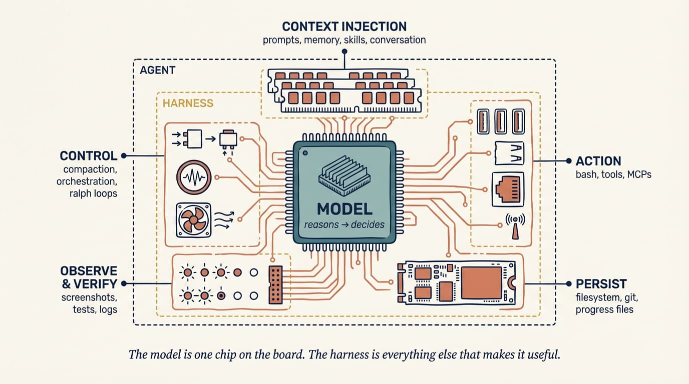
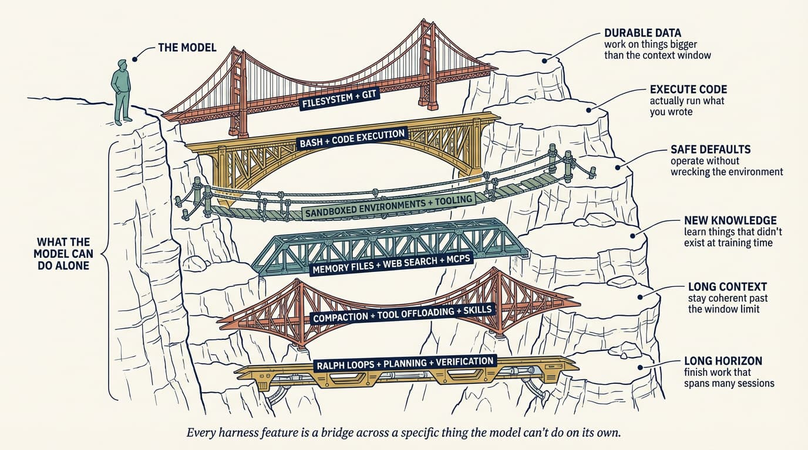
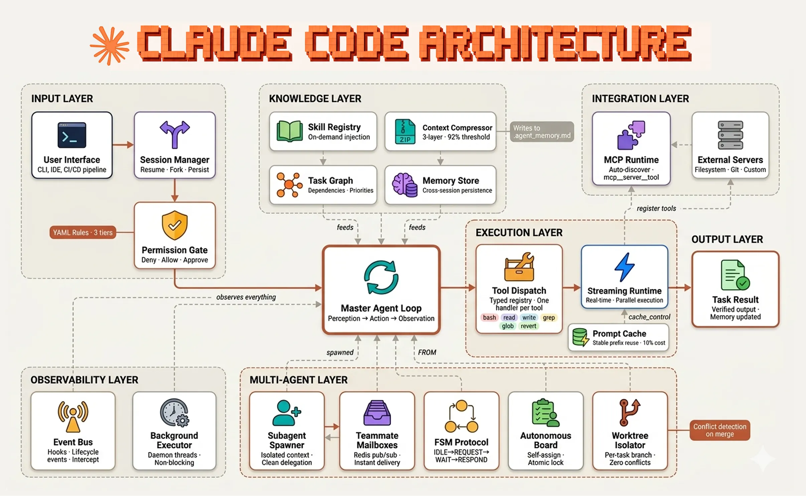
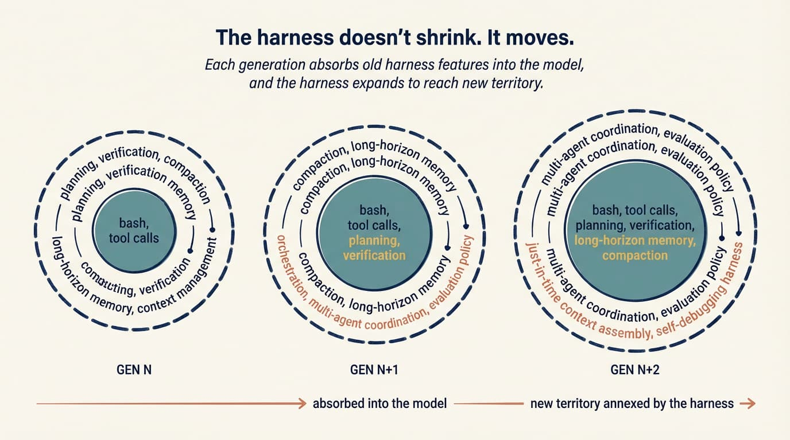

# 智能体 Harness 工程

> 原文：[Agent Harness Engineering](https://addyosmani.com/blog/agent-harness-engineering/)
>
> 发布日期：2026-04-19

---

*一个编码智能体，是模型加上你在它周围搭建的一切。Harness 工程把那层脚手架当作一件真实的产物来对待，并且每当智能体出岔子，它就收紧一次。*

---

大致地说：每当你发现智能体犯了一个错误，你就花时间去工程化一个解决方案，让智能体再也不犯那个错误。

过去两年我们一直在争论模型。哪个最聪明、哪个写的 React 最干净、哪个幻觉更少。这个讨论就其本身而言没问题，但它漏掉了系统的另一半。模型只是运行中的智能体的一个输入。其余的是 *harness*：包裹在模型周围的提示词、工具、上下文策略、钩子、沙箱、子智能体、反馈循环和恢复路径，好让它真的能完成点什么。

**一个还行的模型配上一流的 harness，胜过一个一流的模型配上糟糕的 harness。** 我在自己的工作里反复看到这一点上演。而且有意思的工程越来越多地不在于挑模型，而在于设计它周围的脚手架。

这门手艺现在有名字了。Viv Trivedy 造了 *harness engineering* 这个词，他的[《Anatomy of an Agent Harness》](https://x.com/Vtrivedy10/status/2031408954517971368)是对 harness 究竟是什么、每一块为什么存在最干净的推导。[Dex Horthy](https://x.com/dexhorthy/status/1985699548153467120) 一直在追踪这个模式随着它浮现的样子。[HumanLayer](https://www.humanlayer.dev/blog/skill-issue-harness-engineering-for-coding-agents) 把大多数智能体失效框定为「技能问题」，归根到底是配置而不是模型权重。[Anthropic 的工程团队](https://www.anthropic.com/engineering/harness-design-long-running-apps)发表的，是我认为关于如何为长时间运行的工作设计 harness 最好的公开拆解。而 [Birgitta Böckeler](https://martinfowler.com/articles/exploring-gen-ai/harness-engineering.html) 从使用者一侧给出了一个不错的概览。

本文是我尝试把这些线索拧到一起。

---

## harness 到底是什么？

Viv 的一句话做了大部分工作：

> Agent = Model + Harness。如果你不是模型，你就是 harness。

harness 是除模型本身之外的每一段代码、配置和执行逻辑。一个裸模型不是智能体。一旦 harness 给了它状态、工具执行、反馈循环和可强制执行的约束，它才成为智能体。



具体来说，一个 harness 包括：

- 系统提示词、`CLAUDE.md`、`AGENTS.md`、技能文件，以及子智能体提示词
- 工具、技能、MCP 服务器，以及它们的描述
- 捆绑的基础设施（文件系统、沙箱、浏览器）
- 编排逻辑（子智能体生成、交接、模型路由）
- 用于确定性执行的钩子与中间件（压缩、续跑、lint 检查）
- 可观测性（日志、追踪、成本与延迟计量）

[Simon Willison](https://simonwillison.net/2025/Sep/30/designing-agentic-loops/) 把循环那部分还原到了它的本质：一个智能体是一个*「在循环中运行工具以达成目标」*的系统。功夫在于工具和循环两者的设计。

如果这听起来表面积很大，确实很大。而且它是*你的*表面积，不是模型提供方的。Claude Code、Cursor、Codex、Aider、Cline：这些都是 harness。**底下的模型有时是同一个，但你体验到的行为由 harness 做了什么主导。**

```text
coding agent = AI model(s) + harness
```

这个由 Viv 提出、HumanLayer 附和的等式，才是工作真正所在的地方。关于左边那半边的争论很响。而实际的杠杆大多坐在右边。

---

## 「技能问题」这个重新框定

有一个我常看到工程师掉进去的模式。智能体做了件蠢事，工程师怪模型，然后这份责怪被归档到「等下一个版本」下面。

harness 工程的思维方式拒绝这个默认反应。失效通常是可读的。智能体不知道某条约定，你就把它加到 `AGENTS.md` 里。智能体跑了一条破坏性命令，你就加一个钩子挡住它。智能体在 40 步的任务里迷路了，你就把它拆成规划器和执行器。智能体一直「完成」了却带着坏代码，你就把 typecheck 的背压信号接进循环。

HumanLayer 说：*「这不是模型问题，是配置问题。」* harness 工程就是你认真对待这句话之后发生的事。

在 Viv 的文章和 HumanLayer 的文章里都出现了一个很扎眼的数据点。在 Terminal Bench 2.0 上，跑在 Claude Code 里的 Claude Opus 4.6 得分远低于同一个模型跑在自定义 harness 里。Viv 的团队只改 harness，就把一个编码智能体从 Top 30 挪到了 Top 5。模型在后期训练时会与它训练时使用的 harness 耦合。把它们搬进另一个 harness，配上更适合你代码库的工具、更紧的提示词、更锋利的背压，就能解锁原 harness 白白放在地板上的能力。

这和「等 GPT-6 就好」的叙事正相反。**今天的模型能做什么，与你看到它们在做什么之间的差距，很大程度上是一个 harness 差距。**

---

## 棘轮：每个错误都变成一条规则

harness 工程里最重要的习惯，是把智能体的错误当作永久信号。不是拿来讲笑的一次性故事，不是重试一下就行的「坏运行」。是信号。

如果智能体提了一个把测试注释掉的 PR，而我不小心合并了，那是一个输入。我 `AGENTS.md` 的下一个版本会写「永远不要注释掉测试；要么删掉，要么修好」。我 pre-commit 钩子的下一个版本会在 diff 里 grep `.skip(` 和 `xit(`。我评审者子智能体的下一个版本会把被注释掉的测试标记为阻塞项。

你只在见过真实失败之后才加约束。你只在一个有能力的模型让它们变得多余之后才移除它们。**一个好的 `AGENTS.md` 里的每一行都应该能追溯到某件具体出过错的事。**

这也是为什么 harness 工程是一门手艺而不是一个框架。适合你代码库的 harness 由你的失败史塑形。你下载不到它。

---

## 从行为反推

Viv 的框架在我真正设计 harness 时最有用的一条，是从你想要的行为出发，推导出交付它的那个 harness 部件。他的模式是：*我们想要（或想要修复）的行为 → 帮助模型达成它的 harness 设计。*



这样推导的好处是，每个 harness 组件都有一份具体的工作。**如果你说不出某个组件存在的意义是交付哪个行为，它大概就不该在那儿。**

这一节剩下的部分大致按 Viv 的顺序走一遍各个部件，附上我觉得值得偷的具体模式。

### 文件系统与 Git：持久状态

文件系统是最基础的原语，而且它往往被低估，因为它太无聊。模型只能直接操作装得进上下文的东西。没有文件系统，你就是在往聊天窗口里复制粘贴，那不算工作流。

一旦有了文件系统，智能体就得到一个工作区来读数据、代码和文档；一个地方把中间成果卸载出去而不是一直揣在上下文里；以及一个多个智能体和人类可以通过共享文件协作的表面。在上面加 Git，你就免费得到版本管理，于是智能体能追踪进度、回滚错误、开分支做实验。

其他大多数 harness 原语最终都会指向文件系统去要某样东西。

### Bash 与代码执行：通用工具

今天的主智能体循环是一个 ReAct 循环：模型推理，通过工具调用采取动作，观察结果，然后重复。但一个 harness 只能执行它有逻辑的工具。你可以试着为每一种可能的动作预先造好工具，或者你给智能体 bash，让它在需要时现造工具。

Willison 对此的看法是，智能体本来就擅长 shell 命令；大多数任务都能塌缩成几条精选的 CLI 调用。harness 仍然会提供专注的工具，但 bash 加代码执行已经成为自主解决问题的默认通用策略。这跟教一个人用某一件厨房小工具、与把整间厨房交给他，是两回事。

### 沙箱与默认工具链

bash 只有在安全的地方运行时才有用。在你的笔记本上跑智能体生成的代码是有风险的，而且单个本地环境无法扩展到许多并行的智能体。

沙箱给智能体一个隔离的操作环境。harness 不在本地执行，而是连接到一个沙箱去跑代码、检查文件、安装依赖、验证工作。你可以把命令加进白名单、强制网络隔离、按需起新环境、任务结束时拆掉。

一个好的沙箱自带好的默认配置：预装的语言运行时和包、Git 与测试 CLI、一个用于网页交互的无头浏览器。浏览器、日志、截图和测试运行器，正是让智能体观察自己的工作、闭合自我验证循环的东西。

模型不配置自己的执行环境。决定智能体在哪里跑、有什么可用、如何验证输出，全都是 harness 层面的决定。

### 记忆与搜索：持续学习

除了权重和当前上下文中的内容，模型没有额外知识。在无法修改权重的情况下，增加知识的唯一途径是上下文注入。

文件系统再次成为那个原语。harness 支持 `AGENTS.md` 这样的记忆文件标准，在每次启动时被注入。随着智能体编辑那个文件，harness 重新加载它，一个会话的知识就带进了下一个。这是一种粗糙但有效的持续学习形式。

对于那些训练时还不存在的知识（新的库版本、当前文档、今天的数据），网页搜索和像 Context7 这样的 MCP 工具能跨越那个截止点。这些是该烘焙进 harness、而不是留给用户的实用原语。

### 对抗上下文腐化

上下文腐化指的是这样一个观察：随着上下文窗口被填满，模型在推理和完成任务上会变差。上下文是稀缺的，而 harness 在很大程度上是好的上下文工程的投递机制。

有三种技术反复出现：

**压缩。** 当窗口快满时，总得有个东西让步。让 API 报错对一个生产 harness 来说不是一个选项，所以 harness 智能地摘要并卸载较旧的上下文，好让智能体能继续工作。

**工具调用卸载。** 大的工具输出（比如 2000 行的日志文件）会塞满上下文却不增加多少信号。harness 保留超过阈值的前后若干 token，把完整输出卸载到文件系统，智能体可以在需要时去读。

**带渐进披露的技能。** 在启动时把每个工具和 MCP 都加载进上下文，会在智能体采取第一个动作之前就损毁性能。技能让 harness 只在任务确实需要时才揭示指令和工具。

Anthropic 的 harness 文章为真正长的任务又加了一种技术：完整上下文重置，即 harness 拆掉会话，从一个紧凑的交接文件重建它。他们说得很明确：对长任务而言*仅靠压缩是不够的*；有时你需要带着一份结构化简报重新开始。这更接近人类给新工程师做入职的方式，而不是我们通常想「记忆」的方式。

### 长程执行：Ralph 循环、规划、验证

自主的长程工作是一座圣杯，也是最难做对的事。今天的模型受困于提前停止、复杂问题分解不佳，以及工作跨越多个上下文窗口时不连贯。harness 必须绕着这一切做设计。

我以前在[自我改进的智能体](https://addyosmani.com/blog/self-improving-agents/)和我的[2026 趋势文章](https://beyond.addy.ie/2026-trends/)里写过 Ralph 循环这样的自主编码循环，但在这个框架里值得再说一遍：一个钩子拦截模型的退出尝试，把原始提示词重新注入一个新的上下文窗口，迫使智能体朝着一个完成目标继续。每次迭代都干净开始，但通过文件系统读取上一次的状态。这是把单会话智能体变成多会话智能体的一个简单得令人意外的技巧，也是那种你从「用个更聪明的模型」里永远推导不出来的原语。

**规划**是模型把一个目标分解成一系列步骤，通常落到磁盘上的一个计划文件里。harness 用提示词和关于如何使用计划文件的提醒来支持它。每一步之后，智能体通过自我验证检查自己的工作：钩子跑一套预定义的测试，把失败连同错误文本循环回模型，或者模型按照明确标准审视自己的输出。

**规划器／生成器／评估器的拆分。** Anthropic 的长时运行 harness 工作说得很明确：把生成与评估分离到不同的智能体，胜过自我评估，因为智能体给自己打分时可靠地偏正面。这是散文版的 GAN。相关的模式是**冲刺契约**：生成器与评估者在写代码之前先协商「完成」到底是什么意思。在我自己的工作流里，开始之前把完成条件写下来，比任何我改过的提示词都更多地抓住了范围漂移。

### 钩子：强制执行层

钩子是区分「我告诉智能体做 X」和「系统强制 X」的东西。

一个钩子是在某个特定生命周期点运行的脚本：工具调用之前、文件编辑之后、提交之前、会话开始时。它们适合放在那些智能体永远不该忘、但经常忘的事情上。每次编辑后跑 typecheck、lint 和测试，并把失败暴露出来。拦住破坏性的 bash（`rm -rf`、`git push --force`、`DROP TABLE`）。在开 PR 或推 `main` 之前要求审批。写入时自动格式化，这样智能体不会把 token 浪费在空白字符上。

HumanLayer 强调、我也逐渐认同的原则是：**成功时沉默，失败时啰嗦。** 如果 typecheck 通过，智能体什么也听不到。如果失败，错误文本被注入循环，智能体自我纠正。这让常见情况下的反馈循环几乎免费，而一旦出问题又可以直接行动。

### `AGENTS.md` 与工具选择

仓库根目录下那个扁平 markdown 规则手册，仍然是单点杠杆最高的配置点，因为它每一轮都会落到系统提示词里。约定放这里：包管理器、测试框架、格式化、「永远别碰 `/legacy`」、「永远用我们的 logger」。两条来之不易的教训：

保持简短。HumanLayer 把他们的控制在 60 行以内。每一行都在争夺注意力，规则越多每条规则就越不重要。**是飞行员的检查单，不是风格指南。**

每行都要挣来。规则应当能追溯到一次具体的过往失败或一条硬性的外部约束。如果不能，它们就是噪音。上棘轮，别头脑风暴。

同样的纪律适用于工具。每个工具的名字、描述和 schema 每个请求都会被盖进提示词。十个专注的工具胜过五十个彼此重叠的，因为模型得把这份菜单装在脑子里。HumanLayer 还在这里指出一个真实的安全问题：工具描述会填充提示词，所以你安装的任何 MCP 服务器都是模型会去读的可信文本。一个潦草或恶意的 MCP 可能在你还没打字之前就对智能体做了提示词注入。

### 这在生产里长什么样

我见过的对成熟 harness 最清晰的公开图景，是 Fareed Khan 对 [Claude Code 架构](https://levelup.gitconnected.com/building-claude-code-with-harness-engineering-d2e8c0da85f0)的（估算式）拆解，值得对着那张图坐一会儿。



上一节里几乎每个概念在这张图上都以具名组件的形式出现。上下文注入是知识层。循环状态活在记忆存储和 worktree 隔离器里。破坏性动作钩子坐在权限门后面。子智能体上下文防火墙就是整个多智能体层。工具分发注册表是 MCP 服务器和 bash 共同插入的地方。Khan 的论证和 Viv 的相同，只是通过一个已交付的产品讲出来：**Claude Code 的轨迹至少同样关乎 harness，而不只是底下的模型。**

---

## harness 不会缩小，它们会移动

Anthropic 那篇文章里一个更好的观察是：随着模型变强，有意思的 harness 组合空间不会缩小。它会移动。

天真的故事是更好的模型让 harness 过时。如果模型能规划，就不需要规划器。如果模型在长程上连贯，就不需要上下文重置。而且没错，Opus 4.6 大体上杀死了上下文焦虑这个失效模式（Sonnet 4.5 过去会在接近它自认为的上下文上限时过早收尾），这意味着我六个月前写的一整类缓解焦虑的脚手架现在都是死代码。

但天花板也随着模型移动了。曾经够不着的任务现在进入了射程，而它们有自己的失效模式。焦虑脚手架消失了，取而代之的是你需要一份多日记忆策略，或者一个协调三个专业智能体的 harness，或者给生成式 UI 的设计质量配的评估器。假设变了，编码这些假设的脚手架也随之改变。

Anthropic 说得很干净：*「harness 里的每一个组件都编码了一个关于模型自己做不到什么的假设。」* 当模型在某件事上变强，那个组件就不再承重，应该拿掉。当模型解锁了新东西，需要新的脚手架去够到新的天花板。

### 模型—harness 的训练循环

另一件正在发生、Viv 明确命名的事，是 harness 设计与模型训练之间的反馈循环。



今天的智能体产品是在循环中带 harness 做后期训练的。模型专门变得更强于 harness 设计者认为它该擅长的事：文件系统操作、bash、规划、子智能体分发。这就是为什么 Opus 4.6 在 Claude Code 里和在别人的 harness 里感觉不一样，也是为什么改一个工具的逻辑有时会导致奇怪的回归。一个真正通用的模型不会在乎你用 `apply_patch` 还是 `str_replace`，但联合训练造成了过拟合。

实际含义有两层。**harness 是一个活的系统，不是一次配好的配置文件。** 而「最好的」harness 未必是模型在其中被训练的那个；它是为你的任务设计的那个。Viv 从 Top 30 到 Top 5 的 Terminal Bench 跃升，是我见过最清晰的证据。

---

## Harness-as-a-Service

Viv 的另一个贡献是 **[HaaS](https://www.vtrivedy.com/posts/claude-code-sdk-haas-harness-as-a-service)** 这个框架：Harness-as-a-Service。观察是，我们正在从基于 LLM API 构建（给你一次补全）转向基于 harness API 构建（给你一个运行时）。Claude Agent SDK、Codex SDK 和 OpenAI Agents SDK 都指向同一个方向。你开箱就得到循环、工具、上下文管理、钩子和沙箱原语，然后你去定制它们。

这个转变重要，是因为过去的默认路径是：自己搭循环、自己接工具调用、自己处理对话状态、自己发明审批流。现在的默认路径是：挑一个 harness 框架，沿四大支柱（系统提示词、工具、上下文、子智能体）配置它，把剩下的精力放进领域特定的提示词与工具设计。

这才让「技能问题」变得可控。你不是每次出问题都从零重建一个智能体。你在调一个已经被良好分解的配置面。

Viv 关于这点的那句话，也是「从混乱开始」最好的论据：*「好的智能体构建是一场迭代练习。没有 v0.1 你就没法迭代。」*

---

## 这是要往哪去

把顶尖的编码智能体并排看（Claude Code、Cursor、Codex、Aider、Cline），**它们彼此看起来比它们底下的模型彼此看起来更像。** 模型各不相同。harness 模式正在收敛。我不认为这是巧合。这是行业在慢慢找到那些承重的脚手架部件，它们把一个生成式模型变成能交付的东西。

Viv 对开放问题的框架是我觉得最令人兴奋的：编排许多在共享代码库上并行工作的智能体；分析自己轨迹以识别并修复 harness 层失效模式的智能体；为一个给定任务即时动态装配正确工具与上下文、而不是在启动时预先配置好的 harness。

最后那一条尤其像是 **harness 不再只是静态配置、而开始变得更像编译器的那个地方。**
