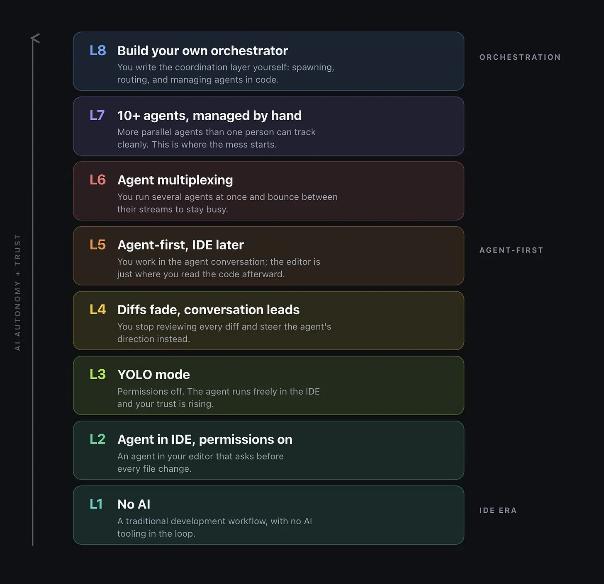
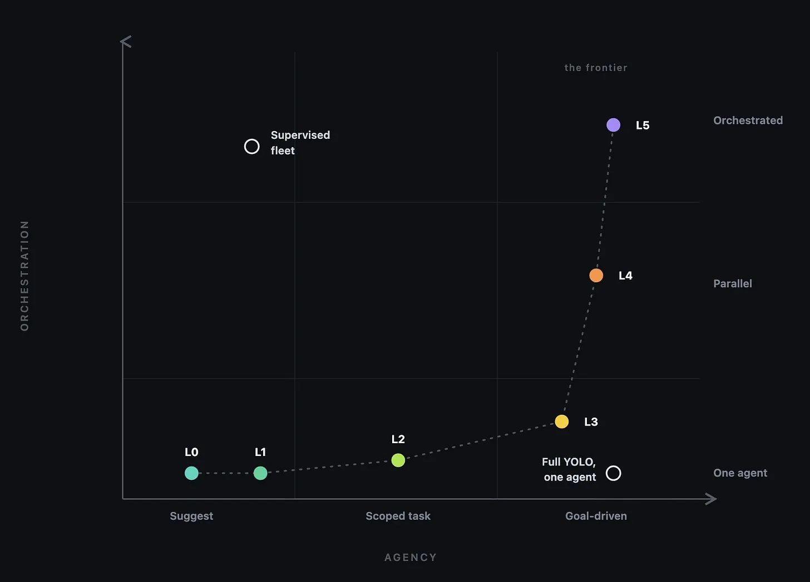
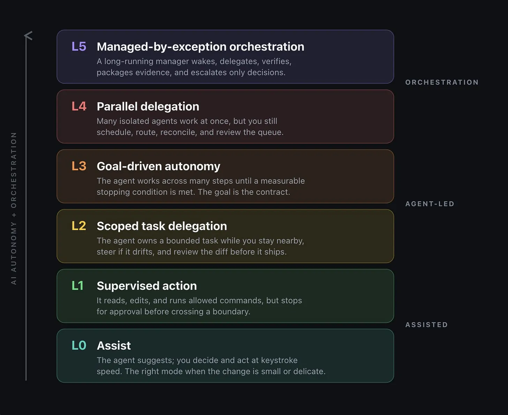
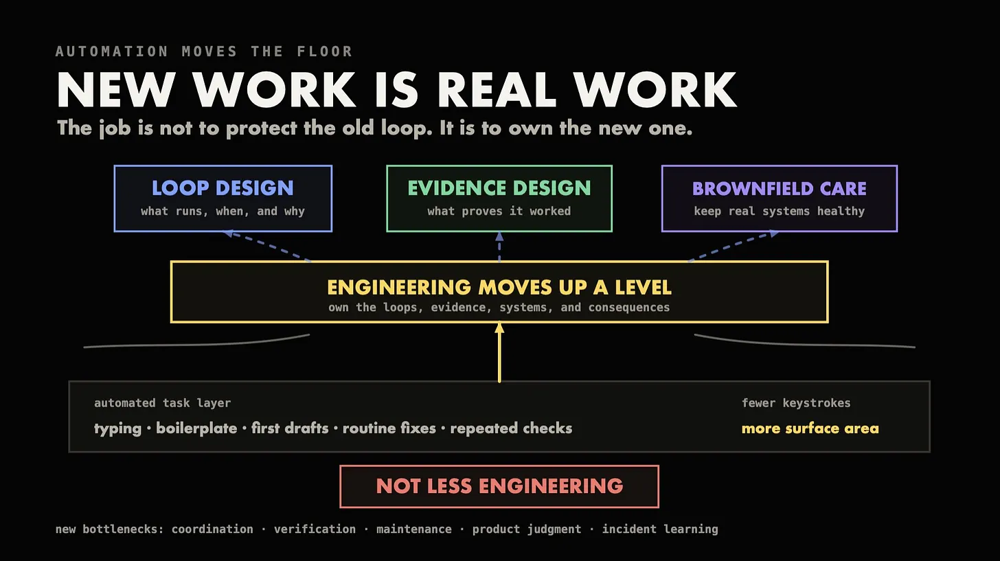

# 智能体自主性等级

> 原文：[Agentic Autonomy Levels](https://addyosmani.com/blog/agentic-autonomy-levels/)
>
> 发布日期：2026-07-02

---

在大多数关于智能体工程的对话里，行动的重心已经从提示词转向了**操作**。眼前是一片探入迷雾的前沿：**软件工厂、目标、循环、后台会话、子智能体、钩子、沙箱、给智能体做审批的智能体**。对未来的许多创造者来说，这种行为会在产品第一天就内置进去：Claude Code 和 Codex 直接暴露了这种转变。

从工程师的立场看，你会用**低自主性**来限制风险、提高可逆性，但对定义明确的活动使用**更高的自主性**，以及用成群的并行智能体安全地重构庞大的代码库。关于一个行动，核心问题永远是：**这个任务值得哪一级自主性，以及什么样的验证能让这一级站得住脚？**

前沿的最边缘是**管理者智能体**：它在自己的触发条件上醒来，把工作委派给助手，同时**持续验证它们的产出**，并且**只带回那些必须由人做的决定**。使用这类配置的人，可能确实已经在运行数百甚至数千个智能体，且大多是在常青（evergreen）代码库上。就像几乎所有关于自主性的思考一样，**你如何感知这把标尺，对每个人来说仍然不同**。

最常被提到的标尺来自 **Steve Yegge 的单轴阶梯**，出现在他的《[Welcome to Gas Town](https://steve-yegge.medium.com/welcome-to-gas-town-4f25ee16dd04)》以及 The Pragmatic Engineer 上。如果你想要一个数字来告诉你自己有多 AI 原生，这是个不错的参照：这把阶梯给你一个单一数字，衡量的是你对单个智能体的信任程度。下面是其中一版：

在 2026 年初，即便工作重心已开始从委派转向编排，这仍然是一个相当好的风险度量代理。然而今天，**当你能同时运行许多智能体时，许多技能组合的意义和杠杆都可能上升。**单独一级阶梯无法帮你定位多智能体技能。

相反，我见过的几乎每一场自主性讨论都把两个应当分开的问题混在一起：**我们让这单个智能体离你自己多远，以及我们协调多个智能体的技能有多高？**

为了分别刻画这两个维度，我们用两根轴：**能动性与编排。**

在能动性轴上，低端包括建议候选行动，然后**等待决定**。

中段意味着智能体在处理某个具体任务，但会**限定自己的工作范围**，并**不断回报**自己做了什么、附带证据，好让你能持续操纵方向。

在**高能动性**这一端，智能体**朝着一个目标工作**，试验、学习、测试、寻找解决问题的办法、被卡住、提问、尝试不同的路径，并把所有这些工作以**证据**的形式交回来。

在编排轴上，低端意味着一个智能体、一个线程。中段，你有若干个智能体，各自在自己的 worktree 里工作，可能朝向不同目标，但彼此隔离。高端，你有一个编排器，它可以接管一个待办清单、issue 跟踪器、排期或其他队列，把它变成持续的工作，你只在出问题时才需要介入："按例外管理"。把这些想法融进产品与特性的有：

- Claude Code 的 /plan、/goal、/loop、/background、/batch、/code-review、/security-review 模式，子智能体，钩子，检查点，智能体委派与管理实践，后台会话，智能体团队模式，/schedule 参数
- Codex 的本地/云端线程、Goal 模式、worktree、Automations、子智能体、评审面板、GitHub 代码评审、钩子、沙箱、Auto-review 以及重新运行

这些能力放不进单一一根阶梯。

## 攀登：三个时代与同一套栈

如果你自下而上读这把阶梯，你其实是在想象同时攀爬能动性和编排。实际上，这六个等级代表我们所有人都会经历的三个不同时代：

第一，你坐在驾驶位，智能体大多只是帮忙，等你去操纵它。

第二，智能体接管一个有界的任务或目标，但你仍在旁边操纵它、验证它做了什么。

第三，在编排时代，系统有能力主持全局，把工作分派给许多智能体，你大多只在出问题时才需要介入："按例外管理"。

这让事情变简单了，因为阶梯上的纵向位置恰好同时刻画了两根轴（编排只在接近顶端时才起作用），使它成为一次穿过各梯级的单一、稳定的攀登。然而，这次攀登仍然是我们所有人正在经历的那场转变的一部分。

做工程顺利的一天会碰到好几个梯级，有时更多：在一个任务过程中于几个时代之间来回切换，是正常的。

## 六个等级详解

**等级 0：辅助**

智能体给出的建议大多不错，往往还很完美，但永远由你决定它们是否好到可以照做。想想自动补全、行内编辑建议，或者泡在聊天会话里讨论一个还没人接手的改动。适用于代价高昂的错误、极小的改动，或者你正在形成自己的判断时。验证大多在本地进行。

**等级 1：受监督的行动**

**智能体代你编辑或运行命令，在执行任何有后果的操作之前先问你。**这是大多数人的默认姿态。可以在本地沙箱中做，在应用改动前逐次批准——每一次批准都是对"这个改动可以应用"的独立验证——也可以在交互式会话里做。失效模式是审批疲劳：所有批准感觉都一样，不管批的是什么。你也许可以通过眯着眼看 diff、遵循某些启发式、批准前找另一个人确认，或者干脆同意让智能体自己负责来解决。Codex Auto-review 的解法是把边界条件的最终批准交给一个独立的评审智能体。

**等级 2：有界任务委派**

**把一个有界的任务交给智能体。**这个任务会有清晰的目标、约束，以及一份可用的"完成是什么样"的定义。你会待在附近，能随时打断，但基本不参与。这是软件工程世界的重心所在。验证正从你身上转移开（你可能需要休息和睡觉），转向智能体能产出的证据：通过的自动化测试、正确的类型、lint 建议、截图、复现步骤、以例为证的可追溯性等等。

**等级 3：目标驱动的自主性**

**智能体为实现一个目标不惜一切，只在某个条件被满足时才停下。**在提示词模式下，这意味着提示词本身就变成目标（例如"你能把这个页面的可交互时间降到 1 秒以下吗？"）。在 Codex 里，这就是 Goal 模式：智能体在 plan-\>act-\>test-\>review 这几步之间循环，直到满足成功标准为止。在 Claude Code 里，是 /goal、/loop 和 /schedule 命令。要让这个等级有用，停止条件必须能以可自动化的方式度量。

不要让你的智能体去处理含糊、虚浮的目标，比如"整体上改善用户体验"或"让代码库更可测试"。挑具体的、可度量的、可自动化的：找出生产环境中躲过静态分析的 bug、缩短加载时间、确保我们有一个严格且没有显式 any 的 TypeScript 构建、梳理所有依赖，只保留我们理解且能通过测试的那些，等等。最后，要在生产环境里找 bug，智能体就需要待在一个类生产环境里。

**等级 4：并行委派**

**让许多智能体并行工作。**每个智能体负责任务中一个隔离的切片。这个等级最大的瓶颈是分解：定义要委派出去的合适切片。支撑手段包括：子智能体、后台会话、/batch、worktree、智能体团队等。失效模式是虚假并行：同时让许多智能体去处理相互重叠的切片，结果不是更多工作，而是合并冲突和重复的决策。要做好这件事，智能体之间需要彼此隔离，各自拥有自己的文件和状态。每个智能体还需要有自己的评审队列。最后，每个智能体都会产生一份成本——以消耗的 token 计——与同时运行的智能体数量成正比。在人的这一侧，编排税使得过了几个智能体之后，再加一个的边际成本开始上升。

**等级 5：按例外管理的编排**

**定义成功是什么样子，以及应适用哪些策略。**一个管理者智能体会基于触发器（例如新 issue、新任务、时钟）醒来，分派工人智能体，监控它们的进度，验证产出，失败时重试，在条件满足时升级给更有能力的智能体或人，汇总结果，最终把工作产物（例如 PR）和证据交回外部系统。想想工厂：issue 跟踪器或待办清单是输入，工厂的产品是输出（也就是大量被修掉的 issue、bug）。智能体在一个有大量围墙（必要时还有逃生舱口）的适当隔离环境中工作，而只有一个操作系统——由管理者智能体定义——规定这座工厂被期望做什么。

这个操作系统的设计留给人；OpenAI 为 Symphony 提了一份[规格](https://openai.com/index/open-source-codex-orchestration-symphony/)，其核心是一个 Linear 看板：**每个 issue 都有自己的智能体工作区，智能体持续确保自己在朝着按其自己工作区内某个规格文件所定义的目标前进**。人工评审可以在证据产生的那个高度上进行，但前沿（也就是编排世界里最强的东西）是构建拥有数百甚至数千个智能体的持续运转的智能体工厂。在攀登到这一步时，拥有独立验证变得越来越重要：实现者与评审者分离、测试运行者与 QA 分离、安全检查分离、验收的流程闸门分离。

## 风险与可逆性决定天花板。

我记得读过早先一项 [Anthropic 研究](https://www.anthropic.com/research/measuring-agent-autonomy)，考察用 Claude Code 处理一些最难的任务，其中它请求澄清的频率是用户打断的两倍以上。有经验的用户（约 750 次会话，对比不到 50 次）更倾向于自动批准，并通过打断来盯着进展。

他们还做了大量更广泛的[分析](https://www.anthropic.com/research/claude-code-expertise)，研究人们如何使用 Claude Code。他们考察了 2025 年 10 月到 2026 年 4 月之间约 23.5 万人的约 40 万次会话。从每次会话里，他们能看出一个人做出的决策，比如每个提示词里要求多少个动作、其中哪些选择自动批准、多久打断一次等等。人做了约 70% 的规划决策，但 Claude 完成了约 80% 的执行。**高自主性不是把人踢出循环，而是从让人做每一步，转变为让人决定下一步往哪个方向走。**

**如果我们想判断一个大型 AI 系统是否在高自主性下运行，应该问三个问题**：

- 我们要多久才能知道自己对它在做什么的判断错了？
- 我们能多干净地撤销它正在做的事？
- 什么能证明我们对它在做什么的判断是对的？

如果这三个问题的答案都是：不够快、极其困难、只能相信摘要——那就不是高自主性。

**智能体的每一次运行之前，都应该有一份契约，定义它试图做什么。**

目标：我们试图达成什么（不是一项活动，不是某种技术，而是一个结果）。

范围：我们在哪个领域内操作，允许使用哪些技术。

非目标：哪些不属于目标的一部分。

工具与权限：智能体如何与外部世界互操作。停止条件：何时停下；理想情况下是一个可度量的变量。

证据：具体的测试、截图、日志、数据库记录或其他可以用来确认某事已完成的指标（独立于智能体）。

升级路径：在什么情况下谁介入（包括谁负责运行这个智能体）。

以及预算：投入到这个任务上的时间、精力和 token 的上限（token 是大型 AI 模型的预算——你也可以加上尝试任务次数的上限，以及并行度的上限）。

## 指标让自主性稍微更可靠一点

事后才决定指标，大概是不够的。指标可以事先写进一份简洁的文档里。这会让自主性感觉更可靠，也会让那次信念之跃稍微更容易迈出。

虽然衡量成功的方式有很多，但可以考虑针对每一级自主性跟踪以下指标的某种版本：

- 两次干预之间的平均时间
- 无人值守且产出被接受的最长成功运行时长
- 在沙箱中执行与升级出去的动作占比
- 自动批准与拒绝的动作百分比
- 每条人类指令对应的智能体动作平均数
- 澄清请求率，打断请求率
- 每个被接受变更的评审时间
- 每个置信水平上的返工率
- 每个置信水平上的缺陷逃逸率
- 每个被接受变更的 token 成本

这样的指标能讲出一个故事：一个靠人工交接才被喂饱的单个智能体，是配了仪表盘的等级 4。一个保守、没有自动受理、重试和像样证据就不肯继续的智能体，是装了真闸门的等级 5。

## 想想就绪度

按风险、以及按工作有多容易被撤销来给工作分类。保守地施加自主性，只在支持更高等级的证据积累起来时才往上走。一个由强测试和评审智能体保护、并有干净回滚路径的支付引擎重构，能支撑比一个缺少任何权威事实来源的文档自动化任务高得多的自主性。自主性等级应该跟着验证流程走，而不是跟着任务名称走。

## 四种反模式

每一个系统都很容易落入这四种自主性反模式，除非被警惕地避开。

**把自主性当身份** —— 智能体的自主性评分变成了毫无意义的身份徽章。更高的自主性被当作能力证明，而不是安全证明，智能体被开得比验证所能支撑的更猛。修法：赞美并奖励那些选定正确自主性等级、并坚决不越界的人。

**权限洗白** —— 审批疲劳的暴政让我们给 AI 智能体和工具授予远超必要的访问权限。修法：更好的边界始终是解法，比如沙箱配置文件、限定范围的可写根目录、白名单命令、钩子以及 Auto-review。

**摘要替代** —— 智能体的工作摘要取代了评审，默认摘要已经足够。修法：打包与完全人工评审同等规格的证据包（diff、测试、日志、截图、评审者的发现、风险、缺口等），同时避免认知投降。

**集群角色扮演** —— 几十个智能体并行跑，但人仍然坚持手动编排每一个依赖。修法：共享状态、所有权规则和更好的依赖跟踪，会逐步降低手动协调的必要性。更小的在制品（WIP）上限会迫使你专注于把协调步骤编码并文档化，直到编排本身自动化。

**一次校准练习**

回顾你最近十次在智能体协助下完成的任务。对每个任务，记录：实际使用的自主性等级、涉及的风险、工作有多容易被撤销、为满足验证要求而产出的证据、评审时间、是否需要返工，以及所选的自主性等级下次是否仍然合适。

**如何安全地往上爬**

一次只沿一根轴往上走。从一个受监督的单个智能体开始，做一件有界的任务，产出能为成功辩护的证据（如果够干净，就是自主性等级 1）。然后朝三个正交方向逐步扩展。把读多写少的探索任务并行化（自主性等级 4）。加入在独立 worktree 上工作、受文件所有权规则约束的写智能体（自主性等级 4）。加入周期性自动化，再基于 issue、语音等做智能体主导的编排。杠杆每向上一步，都需要一套新的安全机制（例如新的失效模式）。

把它们命名出来：更长的单智能体运行会导致漂移、上下文腐坏、沟通丢包或目标走偏。后台工作会导致假设过期和交接薄弱。过多的并行工作会导致合并冲突或重复决策。过多的周期性工作会导致无声的 token 消耗或提示词过期。按例外管理会导致长长的评审队列和告警疲劳。修法不是更用力地去信任；而是收窄范围、确保更好的证据、铺更便宜的回收路径、加固闸门、定义更清晰的所有权规则。

**如何使用自主性等级：**

- 等级 0 最适合精细的工作，以及判断力仍在形成的时候。
- 等级 1 最适合大多数探索，前提是工作在已被充分理解之物的边界附近进行。
- 等级 2 最适合大多数有界的任务，同时要清楚可能存在未知的依赖和预料之外的坑。
- 等级 3 最适合成功条件能被足够清晰地表述的场景。
- 等级 4 最适合工作能被干净地按这些成功条件切分的时候。
- 等级 5 最适合跨各个成功条件所需的协调与沟通被完全编码之后。

**验证永远会是瓶颈。**

尽管眼下有不少逞强之词和现有工具，一个与 AI 智能体协作的工程团队的成熟姿态是**校准过的自主性**。

在不远的将来，我们会想要设计出知道何时工作、何时验证、何时请教的循环——但**工程师的技能仍然在于选出正确的自主性等级，并构建能防范其阴暗角落的模式和站得住脚的证据**。

*注：Pangram 将这篇文章标记为 100% 由人类撰写：<https://www.pangram.com/history/87531e13-cd12-4cb0-9e02-9579719ddc26>*
