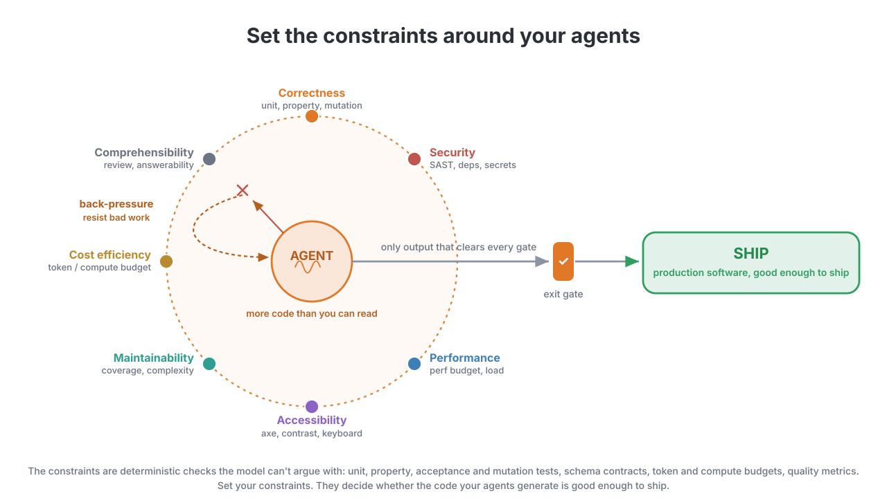
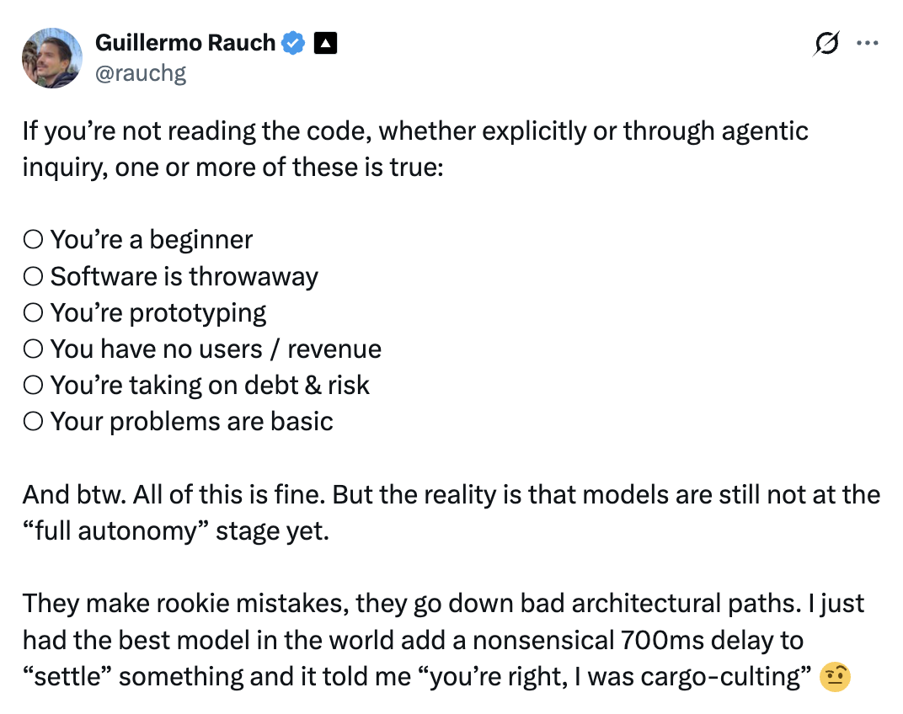

# 智能体化代码质量

> 原文：[Agentic Code Quality](https://addyosmani.com/blog/agentic-code-quality/)
>
> 发布日期：2026-08-08

---

在人类历史的大部分时间里，我们通过代码评审来评估代码质量：有人读你写的东西，确保它干净、有想法、够快、可理解、测试到位。对智能体来说，这种做法扩展性很差；代码太多了，没人读得完。结果就是，我们越来越多的质量检查必须发生在智能体周围的 harness（承载框架）、环境和操作系统里。我仍然会读代码、评审代码，但我非常清楚自己在哪些地方可以接受用约束来做检查。

**软件质量现在取决于你在智能体周围设下的约束。**

约束通过向智能体的提案抛出测试和确定性检查，来界定系统被允许做什么。正是通过设定并维护这些约束，我们才建立起能可靠交付高质量生产软件的循环，即使智能体每天在制造几十万甚至几百万处改动。

我们把这些约束叫作质量闸门，它们有很多形式。包括常规的单元测试、属性测试和验收测试。也包括变异测试——我们生成代码的各种变体，用同一批测试跑一遍，确保没有人在里面偷偷塞进我们漏掉的 bug。还包括围绕代码质量的度量，比如圈复杂度和行长度，帮助保持可读性。约束在「系统会接受哪些提案、并把它们作为代码改动应用下去」这件事上也扮演重要角色。当一个改动提案从运行智能体的解释器，走到智能体控制器，再走到生产环境时，我们已经对它做了足够多的检查，有信心它可以安全交付，且它改动的影响完全落在智能体的职责范围之内。

*Guillermo 这份清单是检验你能否承担「不读代码」的好测试。注意每一个「可以」其实都在说明风险有多低——没有用户、用完即弃的代码、原型。一旦风险升高，就得有东西去读代码。如果不是你逐份 diff 去读，那就只能是约束。*

**智能体可以提出任何东西。你的约束决定一个提案对你和你的团队来说是否足够安全、正确、范围清晰、值得交付。**

这个模型提供了很多，但也漏掉了许多部分，而这些遗漏今天值得想一想。一个问题是**自主性**；智能体也许能很好地执行它们的意图，但在信息缺失、或者它们要做的事本身模糊时就会失败。这既适用于任务本身，也适用于 harness、环境和其他组件如何为任务设定参数。人类没能交付优秀代码的许多原因，和智能体可能犯的错是共通的：在脚本驱动的压力下撑不住的脆弱环境、不确定的构建、缺失的权限、以及弱测试。这就促使我们去追求一个更好的环境：给智能体可信的反馈，允许低损害式的失败，并让成功可以被逐步累积起来。

**我们想要的环境是这样的：智能体能做真实的工作，拿到能信任的反馈，并且在失败时不会造成多大损害。**

另一个重要问题是信任。我们不能不加辨别地把意图交给某个东西——哪怕它像现代智能体一样聪明、鲁棒——而不做正确性检查。我们从信任出发，但信任必须是辛苦赢来的。

**有些约束在工作开始之前就塑造它。有些在智能体工作时给出反馈。还有些决定它的产出究竟能否跨越生产边界。**

关于如何在一个系统周围架设验证结构，有很多种建模方式。

以我的经验，为你的约束准备一组更宽、但经过刻意挑选的检查，而不是只依赖单元测试，是有帮助的。思路是每个检查都有明确的职责，范围可以从类型安全和性能一直到后期的安全扫描。人们也可以定义自己的约束，包括 ESLint 这类 lint 工具能强制执行的架构规则。这些工具里很多都有内置的 hook，可以在出问题时把智能体或人拉进来。

**就目前而言，有用的智能体产出和垃圾产出之间的差别，很大程度上仍然取决于操作这个循环的团队的手艺。**

AI 给了我们高体量的代码生成和速度，但这也意味着人类更难评审每一处改动。你必须刻意安排注意力往哪里去。如果你把一个人类检查塞进一个本来以机器速度运转的系统，别惊讶它会拖累生产力。人的注意力稀缺而宝贵，所以我们应该主动把它导向那些最需要判断力的细微问题。下游的人只应该在约束的自动化护栏失效时才被拉进来。

**未来的「代码评审」会看起来非常不一样**

正确性是一个重要维度，但你可能也关心其他维度，比如可维护性、性能、安全性、效率和可理解性。正如正确性可以分解成许多信号类型，质量的其余部分也一样。而尽管我们设下多少约束很重要，更重要的是这些约束是否足够有挑战性，能达到我们对质量和生产就绪的标准。

**软件质量不是一个单一指标。把它看作一组信号，对你和你的团队而言重要性各不相同。**

背压可以通过很多工具实现：编译器拒绝非法代码、测试失败、安全策略拦住坏做法、CI 拒绝部署。理想情况下它贯穿整个循环，而不是在所有工作最后做一次单一评审。

**约束和背压让智能体在坏工作变成问题之前就抓住它**

如果改动的体量高于我们工具能消化的时候，会发生什么？我们最终会建起一个队列，依赖一个以人类速度运转的验证系统。为了扩展，我们要尽可能把所有东西推进贯穿全程的验证循环，而不是等到最后。如果能在自动化检查内部扩展，我们就能提高整个交付系统的速度和吞吐量。如果验证循环里没有余量了，我们需要做几件事之一。第一，扩展验证系统，创造更多容量去约束和推回进来的改动。第二，降低智能体生成新改动的速率，让验证能赶上工作量。第三，降低质量门槛，让验证不像原本那样用力推回。从扩展的角度看，我们需要准备好做所有这些事。同时，我们也不该止步于此而没意识到：在某些方向上解除约束，其实可能让我们完成更多。也许我们可以通过提供智能体开发者集群或自动化软件工厂，来提高智能体生成改动的速度，让它们不必等我们逐个评审。

而在某些地方，我们可能想给它们更多自由，只要在另一些地方保持更紧的约束。在我们最在意的地方给出更紧的约束，就能在不牺牲质量的前提下最大化吞吐量。贯穿这些决策有很多选项。最明显的是，我们必须在质量的不同维度之间做取舍。正如我们强调的，安全性非常重要，但我们也一直不得不在交付安全和按时交付产品之间做取舍。一端是聚焦创新，另一端是聚焦质量，中间是一个光谱。在这条光谱上的某处，我们必须选择自己想站在哪里。

我们想把来自环境和系统的清晰反馈送回给智能体或团队，这样人们就能专注于品味、意图和架构这些更主观的关切。如果我们能帮助人类待在约束的安全范围内，就能免去他们费力去搞清楚到底哪里出了错。

软件质量包含的不只是正确性。软件质量也意味着可维护性、良好性能、安全性、效率，以及易于理解。所有帮助我们达到这些标准、让生产顺畅流动的约束，都在我们的交付管道里制造背压。

我们需要有意识地决定在哪里施加强约束，在哪里移除或放松它们。在同时服务于这两个目标的地方施加强约束。如果它们不能服务于其中一个或两个，就不要支持它们。准备好按情况需要提高或降低标准。并且记住，软件系统不同位置上的这些约束，才是让软件质量可被执行的东西。

我们应该在最强地服务于这个双重目的的地方施加强约束，并考虑移除或放松那些两个目的都服务不好的约束。我们也应该准备好按需要上调或下调质量门槛。实际上，正是软件系统里各个位置上的这些约束，让质量长出了牙齿。在很多情况下，我们可以通过部署新工具或强化已有工具，制造更多背压和更多约束。所有这些都可以用来推回大多数改动请求。我们想把它们建在整个管道里。我们不想等到管道的末端，让 CI 系统简单地告诉我们：不修好问题就不许部署。我们要尽可能早地使用这些信号，通过每一条可能的通路。这个系统里最终的约束，是我们给自己设下的那个：为我们搭建和运营这个系统所做的决定与行动负责。但就像所有其他约束一样，我们也需要就「想让自己的判断力约束多少、背压多少、作为最后一道检查介入多少」做出深思熟虑的取舍。

**质量就藏在我们围绕智能体设下的约束里。所以当你在为自己的应用考虑质量时，把这个问题的表述拿走，想出你自己的约束驱动方案。**

这篇文章被 Pangram 4 评为 100% 人类撰写。

本文最初发表在我的 [Substack](https://addyo.substack.com/p/agentic-code-quality) 上。
