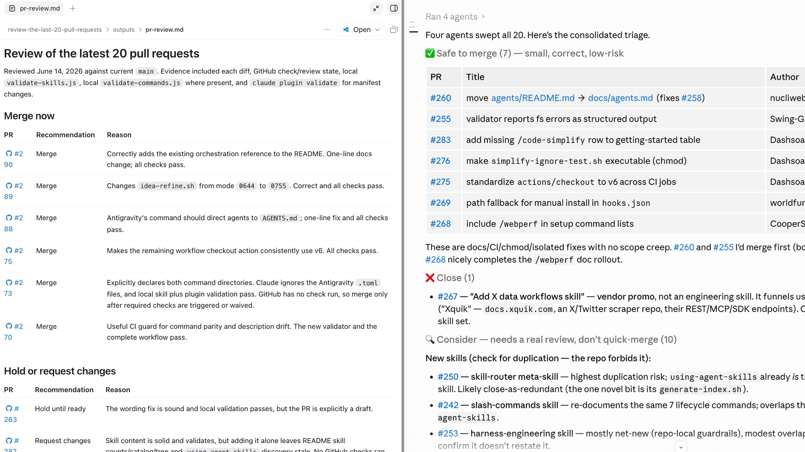

# 智能体时代的代码评审

> 原文：[Agentic Code Review](https://addyosmani.com/blog/agentic-code-review/)
>
> 发布日期：2026-06-15

---

*编程智能体现在已经强得惊人，而且还在快速变强。由此带来的一个耐人寻味的后果是：工程中困难的部分已经从写代码，转移到了判断这段代码是否值得信任，这让评审成了当下软件领域杠杆最高的技能。你怎么做评审，很大程度上取决于你是谁：一个没有用户的独立开发者，和一个维护着十年老应用的团队，根本不是在解决同一个问题。*

---

我对智能体工程的乐观程度前所未有。这些智能体确实很强，每个月还在变强，如今一个平常的日子里，我能交付一年前根本不会尝试的东西。这篇文章是一张地图，标出那些有意思的工作都流向哪里了——因为它确实转移了，而大多数团队还没完全跟上。

代码评审过去之所以行得通，是因为相对速度上的一个幸运的巧合。资深工程师读代码比初级工程师写代码更快，于是评审无需任何人刻意设计就能跟上节奏，团队也顺带地、作为读彼此 diff 的副产品，吸收了系统是如何拼在一起的。这其中的很多东西并非有意为之。它源自一个简单的事实：写代码是缓慢、昂贵的那部分，而读代码又便宜又快。

这个事实不再成立了。智能体产出一千行往往扎实、格式规整的代码，花的时间比我读完这一段还短；而人类的阅读速度，大约自我们开始整天盯着屏幕谋生的那天起就没变过。于是瓶颈向下游移动，落到了唯一没有变快的那一步上：一个人确信这个改动是对的。我不觉得这是损失。这是当下软件领域最值得做好的、杠杆最高的地方，也是我今年大部分注意力所在。

这里还有一个令人愉快的转折，它塑造了本文余下的部分。那些生成额外代码的工具，同时也是我跟上这些代码的最好帮手。在我自己的项目里，包括那些热门的开源项目，我现在会把一批进来的 PR 丢给 Claude Code 或 Codex，让它们替我分诊排队，这确实改变了我分配时间的方式。所以这不是一篇反 AI 的论点，我会回头讲清楚我到底是怎么用的。

这也不是一堆数据倾倒，更不是又一轮「让模型写你的代码到底是美妙还是手艺的终结」的争论，因为那种框架毫无用处。唯一经得起真实代码库检验的答案是：完全取决于你是谁。一个在 vibe coding 副业项目上折腾、全世界只有十来个人会运行的开发者，和一个要让十年老企业系统再撑一个季度的团队，几乎没有值得并列的约束条件，而流传中的大多数建议，本质上都是其中一种人在教另一种人该怎么活。

## 2026 年的数据到底说明了什么

**AI 带来的生产力提升是真实的，但原始产出会夸大它：大约四倍的代码，换来多一成左右的交付价值。这两个数字之间的差距就是评审工作，这也正是评审如今成为杠杆所在的原因。**

这件事有两年的时间只是轶事和争论。现在它已经在大规模上被测量了，测量方彼此没有共同议程，有些还是商业上的竞争对手，而测量结果总是指向同一个方向：AI 把产出急剧推高，同时把质量和可评审性都压低。

[Faros AI](https://www.faros.ai/blog/ai-acceleration-whiplash-takeaways) 对 4000 个团队的 22000 名开发者做了埋点，追踪团队从低 AI 采用率走向高采用率时发生了什么。这是 2026 年 3 月的数据，已经算本文里最新的了。好处是真实的，值得直说：开发者合并的 PR 明显更多，完成的工作更多，每位工程师的吞吐量在上升。然后是报告剩下的部分：

- 代码流失率上升 **861%**
- 事故与 PR 之比上升 **242.7%**
- 每位开发者的缺陷率从 **9% 升到 54%**
- 评审中位*时长*上升 **441.5%**，首次评审等待时间和平均评审时间都大约翻倍
- 零评审即合并的 PR 增加 **31.3%**

最后一个数字是我最难无视的，因为没有人主动选择它。没有人决定停止评审。评审者只是跟不上这个量，于是代码开始未经阅读就被合并，而这就变成了常态。我一直回想的细节是：那些工程实践成熟、纪律严明的团队，受到的冲击和其他人一样重。好的流程没有保护他们，因为代码涌来的速度超过了任何流程在设计时能吸收的速度。

有一个前提要全程记着：CodeRabbit 和 Faros 都在向这个市场卖东西，所以它们的叙述并非毫无利害关系。这不代表数字是错的——效应量很大，而且在互不相关的来源之间保持一致——但厂商研究值得带着这层意识去读。

[CodeRabbit](https://www.businesswire.com/news/home/20251217666881/en/CodeRabbits-State-of-AI-vs-Human-Code-Generation-Report-Finds-That-AI-Written-Code-Produces-1.7x-More-Issues-Than-Human-Code) 在 2025 年 12 月研究了 470 个开源 PR，其中 320 个有 AI 参与合著，150 个是纯人类提交，发现 AI 改动带来的问题大约多 **1.7 倍**：逻辑和正确性问题多约 75%，安全问题常见 1.5 到 2 倍，可读性问题增至三倍以上。他们的 AI 总监 David Loker 称这些是「可预测、可测量的弱点，组织必须主动加以缓解」。可预测是这里的关键词。这些是已知的、可定位的弱点，这是好消息：意味着评审流程，无论人工还是自动，都可以直接对准它们。

[GitClear](https://www.gitclear.com/research/ai_tool_impact_on_developer_productive_output_from_2022_to_2025) 有一个数字是我会优先引用的。在他们截至 2025 年的生产力数据里，每天使用 AI 的人产出的原始输出约为非使用者的 **4 倍**，但与自己一年前的产出相比，真实的效率提升只有约 **12%**。你用大约四倍的代码，换来多一成的交付价值，而仍然得由人来评审这四倍的全部内容。值得肯定的是，Bill Harding 明确指出，即便这 12% 里也有部分是选择偏差，因为更强的开发者集中在 AI 组。4 倍的代码和多半成价值之间的差距，就是评审问题的一行表述。

[GitHub](https://github.blog/ai-and-ml/generative-ai/agent-pull-requests-are-everywhere-heres-how-to-review-them/) 报告称，Copilot 评审如今已运行了超过 6000 万次评审，不到一年增长了 10 倍，平台上每五次评审就有超过一次涉及智能体。这不再是冷门做法。这就是代码如今被制造出来的方式。

四份数据，四种方法，一个结论。我们把机器速度的产出灌进了一个为人类速度工作而建的系统。瓶颈并没有消失，它[转移到了验证](https://addyosmani.com/blog/agentic-code-quality/)上，而评审就是这张账单到期的地方。

## 每个人都在解决不同的问题

**一个改动需要多少评审，几乎完全取决于它的影响半径，而你读到的大多数建议，都出自一个所处半径与你截然不同的人之手。**

上面所有吓人的数据，几乎都来自企业级遥测和不堪重负的开源维护者。如果你的处境就是这样，那它们完全属实。如果你是单枪匹马交付一个只有少数人会运行的东西，其中大部分根本不适用于你，你也不该因此觉得自己做错了什么。

你在哪个位置由三个变量决定：

- **影响半径**：它出问题时会怎样。什么都不发生，还是用户愤怒、金钱和 PII 岌岌可危。
- **代码能活多久**：下周可能就重写的废弃原型，还是你要维护好几年的代码库。
- **有多少人需要理解它**：只有你把整件事装在脑子里，还是一个必须长期共享所有权的团队。

把同一份 diff 套进这三条，「好评审」的含义就真的不同了。

如果你在没有用户的绿地项目上单干，评审的第二项职责——在团队中分发知识——对你并不存在。你就是团队。合理的做法是重度依赖[测试和自动化](https://addyosmani.com/blog/agentic-code-quality/)，只评审真正重要的部分，其余部分接受更轻的处理。当代码可能一个月后就不存在、出问题也不会有人在凌晨三点被叫醒时，重复和代码流失的代价要小得多。陷阱在于，而且人们往往是痛苦地学到这一点：只有测试是真实的，这套做法才成立。没有安全网却跳过评审，并不会消除工作，它只是以更高的代价[把它推迟](https://addyosmani.com/blog/intent-debt/)，而且在没有人反驳的时候，标准会下滑。没有用户，是允许你推迟评审，不是允许你跳过验证。

然后项目有了用户。这是危险的中间地带，而这次跨越在当时很少被注意到。评审的捉虫职责突然变得重要，因为 bug 现在会伤到人；它的知识分享职责也启动了，因为不再只有你一个人。团队会把单干时代的习惯多保留几个月，然后来一次事后复盘，Faros 的那些数字就不再是一张图，而成了他们自己的仪表盘。

最远端是拥有老旧代码库和大量用户的大型组织。在这里，每一个吓人的数字都是全力命中。一个重复的辅助函数不是风格小毛病，而是一个未来的 bug 面，以及会年复一年复利累积的维护成本。一个没人理解的改动是[理解债](https://addyosmani.com/blog/comprehension-debt/)，会变成某人的值班事故。评审同时在干好几件事，而智能体产出的洪流会悄悄把这几件事全部弄坏。Faros 关于成熟团队的发现，正是指向这里。

所以重点不是「企业该谨慎、独立开发者可以放松」。重点是评审的目的会随你的位置改变，因此规则也必须随之改变。把一个企业的锁死式、多智能体、必须提供证据的流水线硬装到一个两人的原型上，你只是白白增加了摩擦。对一个支付系统运行「测试通过，就发」，你造出的是一台事故生成器，只是顶上挂了个绿色对勾。这个领域里大多数糟糕的建议，都是光谱上的一个位置在给另一个位置开药方。

## 评审现在到底是为了什么

**评审原本是为了核对作者的推理。智能体确实会推理，但这种推理通常被丢弃，而不是附在代码上，于是评审者不得不重建一段从未进入 diff 的理由。好消息是：这是个工具问题，而把推理捕获下来会让评审轻松得多。**

这是真正变了的那部分，而我觉得它被低估了。

当人写代码时，意图是免费附赠的。推理过程、权衡过并否决掉的备选方案，活在作者脑子里，评审就是你核对这些推理。现代智能体确实会推理，而且往往是可见的，会产出思考轨迹、权衡选项、边做边解释自己。问题在于，这份推理通常在 diff 生成的那一刻就被丢弃了。它很少被捕获，很少被附到 PR 上，而且无论如何，它是智能体关于如何实现任务的推理，而不是一个人关于这个任务最初是否正确的判断。于是评审从核对摆在眼前的推理，变成了重建一段从未被写下的意图，这更难也更慢，而我们却还在惊讶它为什么要多花 [441% 的时间](https://www.faros.ai/blog/ai-acceleration-whiplash-takeaways)。

2026 年的一篇论文，[《AI Slop and the Software Commons》](https://arxiv.org/html/2604.16754v1)，分析了 15 个 Reddit 和 Hacker News 帖子里的 1154 条发言，那里开发者们在讨论「AI slop」。其中一位开发者的一句话一直留在我心里：评审一个智能体的 PR，让他成了「第一个亲眼看到这段代码的人」。

这句话值得琢磨一下，而且它直接指向了解法。在正常评审中，作者已经理解了改动，你是在核对他们的工作。而在智能体 PR 里，还没有人重建过那个「为什么」，评审者是第一个尝试的人。正如论文所说，评审「并不是为了恢复缺失的意图而设计的」。令人鼓舞的是，缺失的意图是可以恢复的：推理存在过，只是我们把它丢弃了。让智能体说明它想做什么、又排除了什么，把它[作为决策日志](https://addyosmani.com/blog/intent-debt/)记录在 PR 上，很大一部分重建成本就消失了。这是个工具问题，而工具问题总会被解决。

这一切并不能让「让 AI 来评审 AI」单独成为完整答案。一个先验不同的第二个模型确实能抓到真 bug，而且能抓很多，所以你应该跑一个。它提供不了的是人的判断：这到底是不是该做的事情。这个判断留在人身上，而它恰好是这份工作里最有意思的部分，是值得保留的部分。

## 这些工具很好，但并不总是因为它们宣传的理由

**当下的 AI 评审者确实很好，而且它们彼此之间常常不会标出同样的代码行，所以正确的做法不是挑最好的那一个，而是运行两个构建方式不同的。**

专门的 AI 评审工具现在很好用，我认为你应该在所有东西上至少跑一个，包括副业项目。[CodeRabbit](https://www.coderabbit.ai/) 部署最广，在独立的 [Martian 基准测试](https://www.coderabbit.ai/blog/coderabbit-tops-martian-code-review-benchmark)（2026 年 1 月至 2 月）上以 F1 居首，精确率约 49%，召回率是该领域最好的。[Greptile](https://www.greptile.com/) 用精确率换召回率：在一个基准里 bug 捕获率约 82%，而 CodeRabbit 是 44%，代价是更多误报。[Anthropic 的 Code Review](https://claude.com/blog/code-review) 报告称，被他们工程师标记为错误的发现不到 1%，而那个我真正会拿给管理者看的数字是：它把他们内部获得实质性评审的 PR 比例从 16% 提到了 54%。过去只被瞄一眼就批准的长尾改动，现在有东西会真的读它。

我今年看到的最有用的结果不是来自厂商。一位工程师[并行跑了四个评审工具](https://dev.to/_vjk/best-ai-code-reviewer-in-2026-we-ran-4-in-parallel-for-3-weeks-146-prs-679-findings-1c0f)——CodeRabbit、Sentry Seer、Greptile 和 Cursor BugBot——在三周半里覆盖 146 个真实 PR、679 条发现：

> 在 617 个被标记的不同位置中，**93.4% 只被四个工具中的一个捕获**。6% 被两个捕获。被三个捕获的几乎没有。**四个全都捕获的，一个都没有。**

这四个工具从来没有一次标出同一行。每一个都在不同类别的问题上很强：Greptile 在正确性和架构上近乎零误报，CodeRabbit 网撒得最宽并支持一键修复，Seer 在生产故障的严重性判断上最好。这就是在真实代码库上、而非论文里演示的对抗式评审论点。异质性才是关键。同一模型的四个副本，就是一个账单更高的评审者；而四个真正不同的评审者，会浮现出一组任何单个成员——包括人在内——都无法独自找到的 bug。

实践上：不要为「最好的单一工具」纠结，并不存在这样的工具。在高风险的一端，跑两个刻意不同性格的（上面的实验把 Greptile 用于日常正确性、Seer 用于生产故障严重性，两者几乎不重叠）。如果你是单干，一个好评审者加上真实的测试就够了。而且不管营销怎么说，要在你自己的代码上测量，因为这些结果每一个都特定于某个代码库，你的也会一样。

## 我们该不该干脆让 AI 评审更多？

**机器已经在评审你的代码，而且比你评审得更多。剩下真正要做的决定是：你要不要刻意这么做，而你保留多少人类，应该随影响半径缩放。**

我不断听到一个一年前还是异端的问题，现在连有经验的工程师也在问：机器是不是应该承担更多评审，也许是大部分？我不再觉得这是个愚蠢的问题了。

令人不安的部分是，AI 评审确实有效。Anthropic 的发现中被标错的不到 1%，这些工具能抓到人一扫而过漏掉的 bug，而且它们不会在一天里的第 30 个 PR 上疲惫，而那恰恰是人最不可靠的时候。与此同时，人类显然跟不上：零评审合并上升 31%，评审时长上升三位数。从实际意义上说，机器已经在评审比我们更多的代码了。诚实的表达不是「我们该不该让 AI 评审更多」，而是「AI 已经在这么做了，我们要刻意地做这件事，还是让它在默认中发生、同时假装人类还在读所有东西」。

[循环工程](https://addyosmani.com/blog/loop-engineering/)让这一点更尖锐。循环的前提是，你不再是那个给智能体写提示词的人，而是构建一个给智能体写提示词的系统，而这个系统的核心之一是一个裁判：一个决定工作是否完成、然后才继续往下走的智能体。评审者就是下一个被有意从内层循环里设计掉的角色。我们花了一年自动化写作，现在这些循环正在自动化检查，而人不断被往上推、往外推。「人留在哪里」不是研讨会上的问题，而是你每次接起一个循环时都在做的决定，不管你有没有意识到自己在做这个决定。

我目前的落点（而且我对此并不固执）：答案不是「由人读每一行」。那已经结束了。体量终结了它，任何坚持相反说法的人，描述的都是一个不再存在的世界。但也不是「让循环自己评审自己然后走开」。当智能体写代码、另一个评审、第三个裁决时，你就得到了一个模型闭环，它们的盲区大体相关——尤其当它们来自同一家族时——会在同样的地方自信地达成一致。一个没有任何人类参与的、自信的「看起来不错」，是[借来的信心](https://addyosmani.com/blog/cognitive-surrender/)：系统的确定性变成了你的，而实际上没人理解任何东西。循环可以既非常确定，又非常错误，而且没有人类留下来分辨这二者。

所以人并没有离场；人往上走了一层。你不再评审每一份 diff，而是开始拥有那些无法转移到模型身上的部分。问责，因为你没法在凌晨三点呼叫一个模型。判断这是否是值得做的改动，这与代码是否正确是两回事。高影响半径的关口，那里出错的代价昂贵。还有最棘手的那个：没人明确规定过的行为，因为模型评审的是已经存在的代码，很少会标出那个没人想到要写下来的需求，这仍然是一个[人形的缺口](https://addyosmani.com/blog/comprehension-debt/)，我不指望它很快被填上。Human in the loop 变成 human on the loop：抽样、抽查、审计系统，而不是读每一个 PR，把有限的注意力花在出错真的会痛的地方。

这已经是我在自己项目上的工作方式，包括那些开源项目——它们一天的 PR 比我一个晚上能仔细读完的还多。我把一批进来的 PR 丢给 Claude Code 或 Codex，要它做第一遍处理：高层地读一遍，哪些看起来可以安全合并、哪些还需要打磨、哪些是真正高风险的。我不会根据结果自动合并，也不会它批准什么就顺手合并什么。它给我的是分配注意力的方式。我可以花几分钟确认它认为低风险的改动，把真正仔细的时间投在它标为危险的那些上。真正重要的细节是：这不是我原来那一小时评审被稍微加速了。这是形状不同的一小时，而在我现在面对的体量下，它是队列得以勉强可承受的主要原因。

 *Codex 和 Claude Code 给我一份按风险排序的第一遍 PR 阅读。分诊是帮助。合并决定仍然是我的。*

同一种做法的更极端版本是 Kun Chen，一位[前 Meta L8 工程师，现在作为独立构建者每天交付约 40 个 PR，基本上已经不再评审代码](https://creatoreconomy.so/p/how-this-ex-meta-l8-engineer-ships-40-prs-a-day-with-ai-kun-chen)。这很容易被一笑置之，但他是 L8，在他停止做的这件事上异常出色，这才让它变得有趣。他并行运行 20 到 30 个智能体，把精力转移到计划上：他事先写详细的计划，智能体对着计划跑好几个小时，而他说计划质量决定它们能无人看管地跑多久。这就是我在上面描述的那种做法的最纯粹形态。值得精确地说清楚到底发生了什么，因为并不是他停止验证了。意图没有消失，他自己把它写进了计划里，所以「第一个亲眼看到这段代码的人」这个问题被解决了一半：确实有人理解了那个「为什么」，只是事前而不是事后。而且他也不是在没有安全网的情况下工作，他建了一个自动评审闸门（他称之为 No Mistakes），在代码合并前检查，智能体卡住时他会介入升级处理。人在代码存在之前做昂贵的思考，机器在之后做逐行的处理，这很可能就是这件事未来的形状。

但他是独立构建者，没有大团队，脚下也没有一个满是地雷的十年老系统。那些让他每天 40 个 PR 且不评审变得合理的具体条件，是大多数读者没有的条件。把他的工作流复制到一个向大量用户交付的团队上，你会在自己的仪表盘上复现 Faros 的数字。他没有错；他只是处在光谱某一端的很远位置。

这又回到了光谱这个点。没有用户的单干：让 AI 评审几乎所有内容，是 2026 年站得住脚的立场，你不该为此愧疚。为很多人维护一个大系统：让机器处理第一遍、第二遍和无聊的那 90%，但在承重路径上保留真正的人类，并且不要让循环在任何可能伤到人的东西上完全闭合。你保留多少人类是一个旋钮，你按影响半径来调，不是按愧疚感来调。

## 实际该怎么做

**不要再以同样的深度评审所有东西。把稀缺的人类注意力只花在出错代价高昂的地方，让廉价的确定性闸门和 AI 评审者处理其余部分。**

组织思路是：让评审投入与出错的代价相匹配，把廉价的确定性工作尽量前移，把人类注意力留给只有人类能做的事。

**按风险分层，而不是按作者分层。** 一个配置改动配得上一个 linter 和一眼扫过。一条支付路径配得上全套：类型、测试、两个不同的 AI 评审者、一个拥有那个系统的人，以及一次安全审查。不要把重度评审花在样板代码上，也不要因为测试是绿的就把一个鉴权改动放过去。[分层做法](https://addyosmani.com/blog/agentic-code-quality/)到处都一样；变化的是某份 diff 需要穿过多少层。

**让昂贵的尾部快速失败。** 对于被智能体 PR 淹没的团队，最近最有用的发现是[评审工作量的早期预测](https://arxiv.org/html/2601.00753)（2026 年 1 月），它研究了 33707 个智能体撰写的 PR。智能体擅长小而定义清晰的改动，约 28% 几乎立刻合并，但它们一旦收到主观反馈就容易「玩消失」，放弃评审真正需要的来回沟通。（一篇 2026 年的配套论文发现[评审者被放弃占了被拒绝的智能体 PR 的 38%](https://arxiv.org/html/2601.15195)。）研究者造了一个「断路器」，在人看之前就用文件类型和补丁大小这类廉价信号预测高维护量的 PR，效果很好。要对智能体 PR 事先分诊，给琐碎的开绿灯快车道，不要让一个人在一份庞杂的改动上耗掉一小时，而智能体一被反驳就放弃。

**提高你愿意评审的门槛。** 被淹没的解法不是锁死仓库，而是[拒绝评审那些没有证据就送来的改动](https://www.builder.io/blog/developers-drowning-in-ai-prs)。评审前要求：说明这个改动是为了什么、一份不是 3500 行且毫无注释的 diff、测试输出，以及它确实被运行过的证据。这就是你不再当第一个读这段代码的人的方式。你把重建意图的工作推回给提交它的人，在那里它很便宜，而不是自己吸收，在那里它很贵。

**有意保持 PR 小。** 智能体 PR 偏大，在 Faros 的数据里平均[大 51%](https://www.faros.ai/blog/ai-acceleration-whiplash-takeaways)，而评审者的参与度是 PR 最终能否合并的最强预测因素之一。一份大到无法评审的 PR 要么被[直接拒绝](https://addyosmani.com/blog/comprehension-debt/)，要么更糟，被橡皮图章放行。指示你的智能体产出小的提交。一份人能真正读懂的 diff，如今是一项设计约束，不是礼貌。

**读测试改动要比读代码更仔细。** 这是要警惕的智能体失败模式。智能体改变行为，然后通过重写断言去匹配新的、坏掉的行为来「修复」测试。200 个被改动的测试上挂一个绿勾毫无意义，直到你确认这些改动是对的。把任何重写大量测试的 diff 当作红旗，先读这些。变异测试在这里很有价值：覆盖率告诉你某行被执行了，变异测试告诉你如果那行错了，测试会不会发现。

**把 CI 当作不会移动的那堵墙。** 留意 [GitHub 现在会提醒评审者的那些模式](https://github.blog/ai-and-ml/generative-ai/agent-pull-requests-are-everywhere-heres-how-to-review-them/)：被删掉的测试、被跳过的 lint、被调低的覆盖率阈值、一个在别处已存在的重复辅助函数，以及不受信任的输入流入提示词。最后一条值得强调，因为智能体构建的功能是[提示注入](https://simonwillison.net/series/prompt-injection/)的新来源：如果某个改动把用户可控的文本送进一次 LLM 调用，却没有考虑这段文本能指使模型做什么，那么这个漏洞并不在 diff 里可见，它潜伏在之后才会到达的数据里。智能体还会削弱 CI 来让自己通过，不是出于恶意，只是梯度下降在找通往绿色的最便宜路径。确定性闸门是流水线中唯一不会被一段自信的说辞说服而改变判决的部分，所以要保持它们严格。

**由人来拥有合并。** 模型无法被呼叫待命，也无法为它交付的东西负责，所以点下合并的人就拥有它。当 AI 评审用平静、自信的声音说「看起来不错」时，它递给你的是[它未必赢得的信心](https://addyosmani.com/blog/cognitive-surrender/)。把每一次 AI 评审当作传感器，而不是判决：是数据，不是决定。

如果你是单干且没有用户，分层、测试改动的纪律和 CI 就是你需要的大部分；其余的在人出现之前都是开销。如果你是大组织，以上全部都是基线，而分诊和准入门槛，决定了一个评审流程是会扩展，还是会悄悄崩塌。

## 如果你在带团队，这意味着什么

**瓶颈不再是你能多快写代码，而是一个可信的人能多快对一次评审建立信心。因为「AI 让我们更快了」就裁掉提供这份信心的人，只是把省下来的钱转换成未来的事故。**

交付的约束条件不再是你写代码的速度。而是一个可信的人能多快确信一个改动是对的。任何把生成当作瓶颈、把评审当作免费的方案都会悄悄停滞，而速度仪表盘全程保持绿色。

Faros 的报告对此很直接：即便产出上升，QA 和评审工作也在上升，所以除非你先填上评审的缺口，否则因为「AI 让我们更快了」而削减工程人力是危险的。资深工程师税——评审时长上升三位数——最重地落在那些你最承受不起其成为瓶颈的人身上，而它对任何只统计已合并 PR 的指标都是不可见的。

开源维护者最先、也最重地撞上这堵墙。[源源不断的、看似合理却空洞的贡献](https://arxiv.org/html/2604.16754v1)即便出于善意，也要消耗真实的分诊时间，而这就是金丝雀。公司是下一个。处理得好的公司把评审能力当作一种真实资源来测量、保护和有意识地支出，而不是当作 AI 释放出来的余量。

## 写代码变便宜了，理解没有

智能体到来后，代码评审并没有变得不那么重要。它成了核心活动。写代码正日益被解决，而且每个月都更便宜；持久的优势是那套让你能信任所写内容的系统。

不要在两个方向上接受一刀切的答案。如果你单干且没有用户，那些关于代码流失和重复的企业恐怖故事对你来说是未来的风险，不是今天的火，所以依靠你的测试、评审重要的部分，并诚实面对被推迟的工作仍然欠着。如果你为很多人维护一个大系统，这里每一个吓人的数字都关于你，而唯一站得住的是分层、要求证据、刻意异质的评审流程，并由人拥有合并。

在整条光谱上不变的是底层的经济学。我们把写作变便宜了，而理解仍然和一直以来一样昂贵。未来几年做得好的团队，不会是生成最多代码的那些，而是那些建起了一套自己真正能信任的评审系统、并且从不会把「测试通过了」和「有人理解这段代码做什么、为什么」混为一谈的团队。

或者，正如 Simon Willison 一直说的，[你的工作是交付你已证明能工作的代码](https://simonwillison.net/2025/Dec/18/code-proven-to-work/)。智能体没有改变这一点。它们让「证明」成了工作的中心，而不是事后的补充，我认为这是一笔好交易。足够深入地理解一个系统，好让自己能为它背书，是软件里最持久也最有意思的技能，而现在正是把它练到极好的最佳时机。
