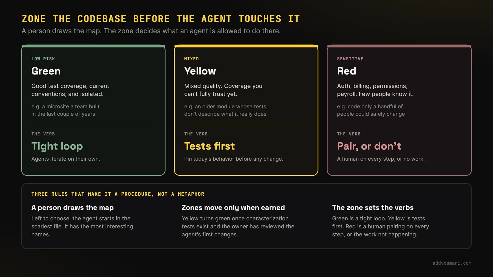
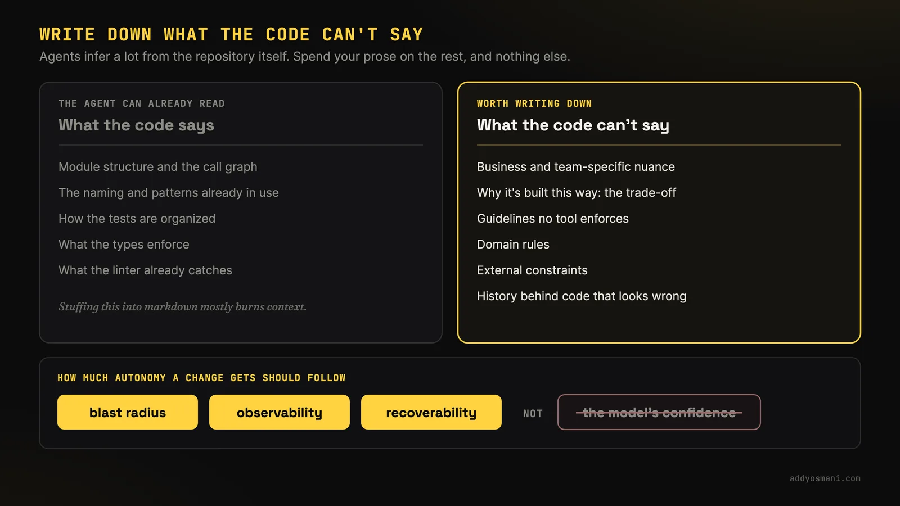

# 棕地智能体工程

> 原文：[Brownfield Agentic Engineering](https://addyosmani.com/blog/brownfield-agentic-engineering/)
>
> 发布日期：2026-09-14

---

**在老旧代码库里做智能体工程，要的是让隐藏的约束变得可见，让廉价的改动变得可信。下面聊聊在棕地代码库里该做些什么。**

在我的职业生涯里，我待过一些代码库已经存在很久的团队。那些就是棕地系统：仓库不再是「这东西实际怎么运作」的完整描述。机构知识、胶带式补丁、遗留服务，以及其他团队所依赖的预期，都活在代码树之外。你必须在写新代码之前学会这些约束，并且必须证明某项改动没有破坏它们。我很喜欢用智能体写代码，但把它们在无人监督的情况下扔进一个更老的棕地代码库，你最后可能得到某种「能跑」的东西，可系统设计是错的，测试也是脆的。

即使在 AI 之前就想做现代化改造的团队里，你通常也得很细碎地推进，要有强力的测试、强力的信心层，来确保你没有破坏任何东西。你心里大概清楚，除了真实的用户旅程测试之外，你做的任何迁移都必须靠一连串可重复的测试，让系统按原意继续工作。如今有些人会说，只要智能体落下了不是你逐项决策写出的代码，你就已经处在一个棕地项目里了。不管怎样，你要优化的是：让廉价的改动能被安全地做出。

而如今，尤其是最近——我猜大概五到十年——这种更在意测试、更在意验证、更在意如何以不破坏东西的方式做改动的想法，我感觉得到了更多关注。但这不改变一个事实：如果你正投入大量工作去引入智能体工程，接着是软件工厂，以及其它各种在大型代码库里自主推进的模式，你就必须在其中额外加上相当多的用心，否则就有签下一整个世界技术债的风险。

**在我们深入之前，先假设代码应该是事实来源。我们在其上添加的任何东西，都是为了补上那些不容易推断出来的部分。我想用分区（zones）、影响半径和另外几个模式来谈这件事，我觉得会有帮助。**

## 分区

**如果我要进入一个已经存在了很长时间的老代码库，我大概想先弄清楚：哪些代码是我不该碰的？** 你可以把它们看作分区。比如绿色区域 = 安全 / 测试良好 / 隔离，黄色 = 质量混杂，红色 = 敏感 / 认证 / 账单 / 权限。

代码库的哪些部分非常非常敏感，或者不是每个人都理解得很清楚？也许你会用不同的分区把它们画出来。也许你有一块绿色的区域，测试覆盖率很好，用的又是当下流行的现代约定，隔离性也好。那么对于系统里的这些部分，智能体可以自己去干活，在一个紧凑的循环里迭代。

有些站点，尤其是我合作过的电商站点，很容易出现五六个部门各自拥有自己的微型站点，而终端用户感受到的整个体验却像是一个东西。而且表面之下其实有很多内在的复杂性。一个团队可能对自己的部分有很好的测试覆盖率；也许那是最近几年建的。其他团队可能就没有。所以你有了这块绿色区域。

也许你有黄色，质量混杂，也许是各种东西混在一起，智能体可以在表征测试写好之后在那里改代码。

然后你还可以有红色区域，那里是些敏感的东西，比如认证、计费、权限、薪资，任何你通常不会去碰、也不会草率改动的东西。比如只有少数人理解它到底怎么运作。那种系统里你不想要无人监督的重写。

三条规则让分区成为一套操作规程，而不是一个比喻。地图由人来画，不是智能体；如果让它自己挑，智能体会从最吓人的那个文件开始，因为最吓人的文件里名字最有趣。分区只有在赢得之后才会移动：一旦表征测试存在、模块的负责人也审过智能体的头几次改动，黄色才变成绿色。而分区决定动词：绿色是紧凑循环，黄色是测试先行，红色是每一步都有人结对，否则这项工作就不发生。

## 把代码说不出来的东西写下来

**自主性应当跟随影响半径、可观测性和可恢复性。模型的信心是很差的向导。**

所以我觉得，至少要有一种感觉：你怎么想象这个世界的地图，智能体能自己从代码库里推断出什么？**智能体其实能从代码本身推断出相当多的东西。** 有那么一段时间，人们试图为几乎所有事情都写 markdown 文件，然后统统塞进上下文窗口里。智能体其实相当擅长理解系统的地图。**你真正要给它们的，是那些从代码本身看不出来的东西。** 有约定吗？有模式吗？有不在其中的细微差别吗？我觉得这很重要。

具体来说，这意味着：业务或团队特有的细微差别、解释系统*为什么*这样构造的取舍、静态分析或工具并未显式强制执行的准则、领域特定的规则、外部约束，以及反直觉实现背后的历史背景，等等。

**把代码说不出来的东西写下来，别的都不要写。**

## 让研究活过这次会话

**如果你的智能体的探索没有产出任何可留存的东西，下一个智能体就要为同样的考古再付一次钱。**

我会在这张地图上加一块：一份可留存的研究产物。对黄色和红色的工作，我喜欢单独做一轮只读的探查，产出一份简短的「理解备忘录」：入口、负责人、调用方、已有的抽象、测试、生产信号、相关历史和未解问题。每条论断都应该引用一个文件、issue、归属记录或看板。

否则默认的循环就会浪费掉它的研究。智能体弄明白了认证流程怎么运作，完成任务，然后会话结束时丢掉了这个模型。聊天记录不是一个好的记录系统，尤其是在压缩之后。

研究之后，我会用干净的上下文开始规划。问哪些文件是各个可行方案会碰到的，它们各自保住哪些不变量，以及你会怎么把它们回退。由人来选路径。实现过程中如果发现地图是错的，就该停下。评审从零开始，从验收标准往回推。一个干净的评审者更可能注意到：测试证明了实现，却漏掉了需求。

## 当指令变成 harness

**每一次重复的纠正，都是 harness 缺失的一块。**

把各块东西该放在哪里说清楚是有用的。指令记录仓库里不寻常的事实。技能（智能体技能）打包可复用的流程，比如检查影响半径或验证一次 schema 变更。插件可以提供对归属目录、事故档案或看板的受管访问。

harness 是智能体周围的工作环境：上下文、工具、权限、测试、日志和恢复。工厂则调度许多可靠的循环，保存可留存的状态，把新出现的情况交回给人。

实际的检验是：当智能体做错了事，会发生什么。如果你悄悄把 diff 修好，下个会话还会重犯。当同一条评审意见再次出现，就把它变成一条 lint 规则、一个 hook、一个类型、一个测试或一项技能。文字留给那些无法机械强制的约束。

一条 deny 规则、一个限定范围的凭证、一项 CI 检查，它们不需要记忆。随着时间推移，harness 变成一份记录：记录团队决定不再为之付第二次钱的失败。

## 从零风险的工作开始

**在你让任何东西去改进它之前，先把今天的行为锁住。**

如果你要把智能体带进一个既有代码库，那和其他方式的现代化改造非常相似。也许你从零风险的工作开始。它不该是「嘿，我们用 Rust 把这个单体重写一遍」之类的。也许是：先把这些东西怎么运作讲清楚。

**生成能把当前行为锁住的表征测试。**

> 表征测试是用于记录系统当前实际行为的自动化测试，这样你才能安全地重构或修改遗留代码

所谓表征测试，我指的是把模块今天做什么钉下来的测试，包括难看的部分，因为在老系统里，某些难看的行为正是业务赖以运转的东西，而智能体会很乐意在一个绿色的套件背后把它「修好」。机器老旧是因为问题老旧。Netflix 在其 GraphQL 切换中，把这个思路用到了生产规模——对旧路径和新路径做重放和影子流量，对比 payload，只有匹配时才放量。当一个首页级别的界面没有像样的单元测试套件时，这就是放量路径：别猜；两边都跑，然后比较。

当是智能体本人在让它们通过时，别让同一个会话成为这些测试的唯一作者。先把行为钉住，单独做一轮，或者由人来做；然后再让智能体干活。否则你得到的绿色套件，编码的只是你刚刚发明出来的那个实现。

然后你才开始走上做机械变换这条路。你可以做死代码和未使用导出的清单。你不该从系统里最棘手、最毛糙的部分开始。而最终，你希望在任何这类迁移中都拥有那份信心。

我记得在大型代码库上做过好几种不同的迁移，人们在修东西时都格外谨慎，即使修的是本来就坏掉的东西。

我参与过的较老的代码库之一是在 AOL。有一天我本该休息，我在办公室附近逛一家漫画书店，正好我老板给我发了条短信，问我能不能顺路来一趟。AOL.com 的首页彻底挂了，而我们身边没有足够的 JavaScript 专家去把它搞清楚。于是我说，行，我过来看看。你可能会想，如今嘛，一个首页，能有多复杂？但当你面对几十个部门，每个部门都拥有许多不同的组件、许多不同的标准、许多不同的脚本、A/B 测试，所有这些，你就想避免把其他所有人的世界搞崩，因为你不一定能在各处都拥有你想要的那种测试覆盖率。那次我把它修好了，但我们基本上至少得对那些没有自己单元测试的东西做用户测试。它们运作得怎么样，同时又不会对所有人造成问题？所以那挺重要的。

这仍然是这份工作。智能体并没有消除「几十个部门」的问题；它们只是让对着这个问题尝试一次改动变得便宜了。一个只有生产流量才真正理解的界面，从定义上说就是红色区域；而除非你为那份流量建了一个替身，我在休息日做的那种用户测试仍然是那道闸门。

## 以完整的单元迁移

**迁移的完成标准是：新路径能工作，且旧依赖可被证明已经消失。**

半途而废的迁移对智能体来说尤其令人困惑。搜索在四十个文件里返回旧做法，在十二个里返回替代方案，还有一个把两者都呈现为现行的 shim。智能体看到的，是自相矛盾的前例。

我宁愿把一条路由端到端做完，包括删掉旧路径，也不愿转换三十个文件却让两种模式都活着。如果删除是未来的一张清理工单，那这个迁移单元就没完成。

测试可以保持绿色，而替代实现仍然在调用遗留实现。[SWE Refactor Bench](https://arxiv.org/abs/2608.23564) 把这种迁移称为「盲区（Blindness）」。在 520 次智能体运行中，只有 28 次通过了它的迁移审计、行为测试和独立验证。

如果 codemod 能做这种例行改动，就让智能体帮忙写它、检查它。把异常队列交给智能体。Stripe 的迁移在这里之所以有用，恰恰因为它没有涉及任何智能体：可留存的产物是那台迁移机器。

## 更大规模迁移带来的经验

[Bun 的 Zig 到 Rust 移植](https://bun.com/blog/bun-in-rust)在 11 天里跑[大约 50 个工作流](https://bun.com/blog/bun-in-rust)，处理了一个 53.5 万行的代码库，每个生成的单元配两名对抗式评审者，整个既有测试套件作为合并闸门；值得抄的那部分是：在任何智能体开跑之前，先花几个小时写了一份把 Zig 惯用法映射到 Rust 的移植指南。Anthropic 自己的[迁移流程](https://claude.com/blog/ai-code-migration)会在一次用后即弃的小型迁移上压力测试它的规则手册，并在大规模运行开始前把试验产出丢掉。

一项[受控的 VB6 到 C# 研究](https://arxiv.org/abs/2608.28972)测得简单特性上 92% 的行为等价性，复杂特性上 47%：单元大小就是那根杠杆。这个形状远在智能体出现之前就存在：Stripe 通过数月的 codemod 工作，[在一个 PR 里把 370 万行迁到 TypeScript](https://stripe.dev/blog/migrating-to-typescript)，没有涉及任何智能体；Google 的[大规模改动章节](https://abseil.io/resources/swe-book/html/ch22.html)解释了为什么代码库变大后，原子改动要变小。Spotify 现在报告每月合并 650 多个智能体 PR，跑在 Backstage 多年前铺好的轨道上。

[Asana](https://openai.com/index/asana/)用两个日历周清掉了一个积压多年的 Enzyme 债务，模型和基础设施成本约 \$12,000。那 \$12,000 只是 token 账单，不能替代他们账本上那份五年的人力估算；把它当作厂商报告的生成成本，而不是一项受控的节省研究。可迁移的部分和 Bun 一样：一次范围狭窄的机械迁移、一个既有的测试套件、人仍然在评审每一处改动

**在公司之间可迁移的，是围绕智能体的那套结构。**

![幻灯片标题为「更大的迁移拿出的凭据：在公司之间可迁移的是围绕智能体的那套结构，而头条数字很少可迁」。Bun 的 Zig 到 Rust 移植在 11 天里搬了 53.5 万行，跑了大约 50 个动态工作流，每个实现者配两名对抗式评审者，每个平台上的合并闸门都是既有套件的 100%；Bun 归 Anthropic 所有，Zig 的 Andrew Kelley 对这些测试证明了什么存有异议。一项受控的 VB6 到 C# 研究测得简单特性上 92% 的行为等价性、复杂特性上 47%，12 个特性平均 70%，而复杂特性还要烧掉约六倍的 token，所以单元大小就是那根杠杆。Stripe 在一个 PR 里把 370 万行迁到 TypeScript，没有涉及任何智能体，此前花了数月构建并迭代 codemod，可留存的产物是那台迁移机器。Spotify 每月合并 650 多个智能体 PR，跑在 Backstage 和 Fleet Management 早已铺好的轨道上。Asana 用两周清掉了 Enzyme 到 React Testing Library 的积压，成本约 \$12,000，而原本的估算是五年，这是厂商报告的 token 账单，不是受控的节省研究。结论：抄结构，不要抄头条数字。](../images/brownfield-agentic-engineering-08.webp)

## 真正改变了什么

**智能体改变的是尝试几种可行实现的代价。它们没有改变选定其中一种所需的证据。**

然后我觉得你可能也看到了，今年我们开始读到越来越多成熟公司用智能体做大型重写的案例。我和一些 CTO 聊过，他们允许团队让智能体用不同的语言或框架尝试多种重写，因为现在这样做更便宜、也能评估取舍，所以变得可行了。

Shopify 用十二周、一个小团队，加上由智能体把关、以屏幕为单位的检查点，把 Shop 消费者应用从 React Native 重建为原生 Swift 和 Kotlin。大得多的商家应用仍然是那个棕地问题：数百个屏幕、深度的平台集成、同样的闸门、更长的时钟。

你也见过其他重写到 Rust 的例子。你见过人们做框架级的迁移。各种迁移都有人做过。而在很多情况下，这些是人们本来要用长得多的时间去做的迁移。如今，如果你有足够的 token，你完全可以让智能体去尝试在一系列不同的技术栈或语言上完成一次迁移。

你可以让智能体真的用若干互相竞争的方案分别实现某个东西。不是让一个团队选定一个方案然后 all in，而是让他们把所有方案都实现出来。它们都可以对你的单元测试做检查。你可以对它们全部做性能剖析，然后再做决定，这在某些情况下比原本要便宜得多。我觉得对今天的团队来说，这完全是另一种游戏。

## 最后再并行化

**更多生成的代码应该带来更有选择性的人工评审，而不是更少的人类归属。在你开始琢磨循环 / 目标 / 并行化之前，认真考虑一下什么能让你的棕地项目成功。**

软件工厂可以同时跑很多改动。我只会在一个单元已经拥有可靠的裁判、恢复路径，以及人们能吸收的评审格式之后，才去抄那一部分。

并行化会放大你已经存在的那个瓶颈。自动化验证能处理五个已检查的改动。一位资深工程师逐行读，得到的是队列、被切碎的注意力，最后是仪式性的批准。

我更希望自动化评审先给出意图、被改动的不变量、测试结果、一致性差异和回滚路线。完整的 diff 仍然可查。人的注意力先去影响半径最大、裁判最弱的地方。

worktree 隔离的是改动，不是行为。它们可能共享 Git 元数据、凭证、本地服务和网络访问。可信的工作或许可以接受这个取舍。无人看管、又在消费不可信内容的智能体，需要真正的沙箱和限定范围的凭证。

## 智能体给模糊性标上了价格

生成的代码行数并不能告诉你代码库是否变好了。我会跟踪前置时间、评审分钟数、人工干预次数、逃逸缺陷、回滚、裁判不一致，以及被留下的抑制项。

对一次迁移，跟踪剩余的旧 import、新路径承载的流量、一致性差异，以及被移除的遗留依赖。测试全绿但所有流量还走旧路径，那是白忙。

**智能体给模糊性标上了看得见的价格。部落约定变成了反复出现的评审意见。**

这份成本一直都在，只是在入职、评审和事故恢复时付出。智能体让其中更多部分变得可计数。这给了我们一个更强的理由，去做团队早就知道有价值的维护工作。

下一次智能体在相当于首页那样的东西上工作时，我希望它留下不止是修复：一条合成的用户旅程、一份归属记录，和一个回归测试。

下一个工程师和下一个智能体继承什么，同样重要。

