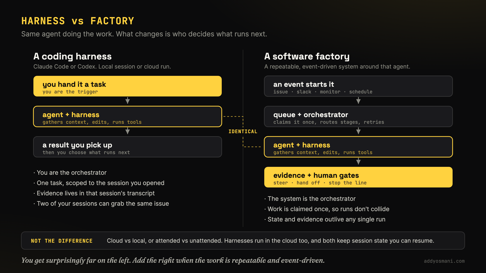
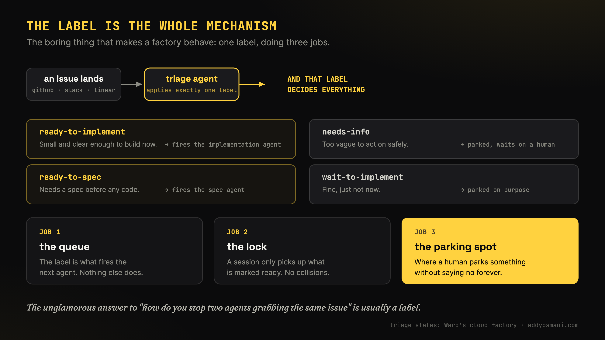
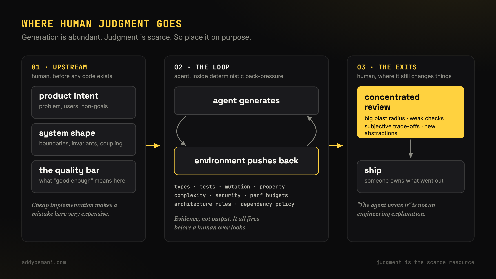
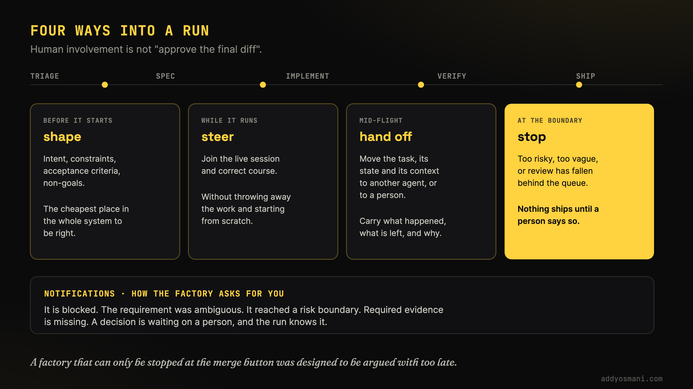
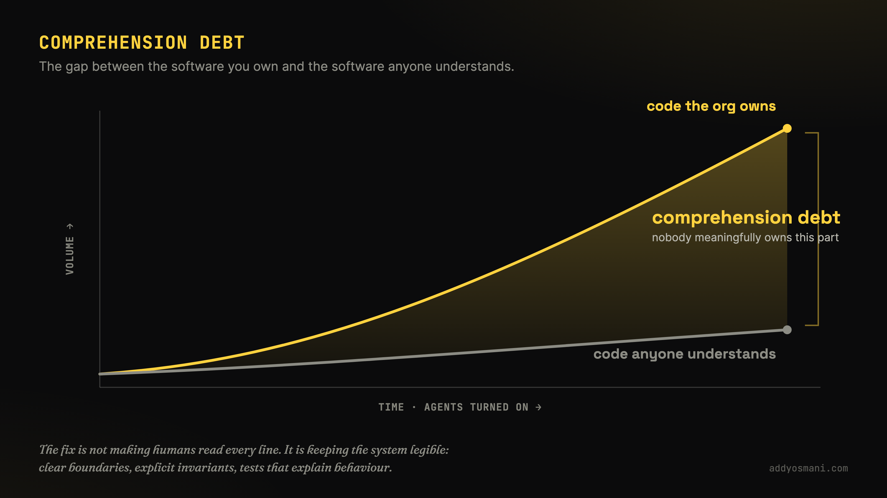
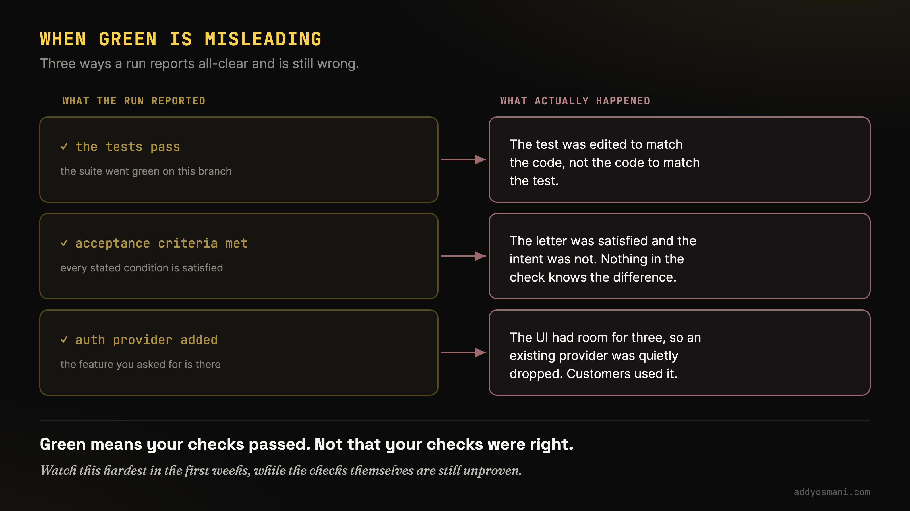
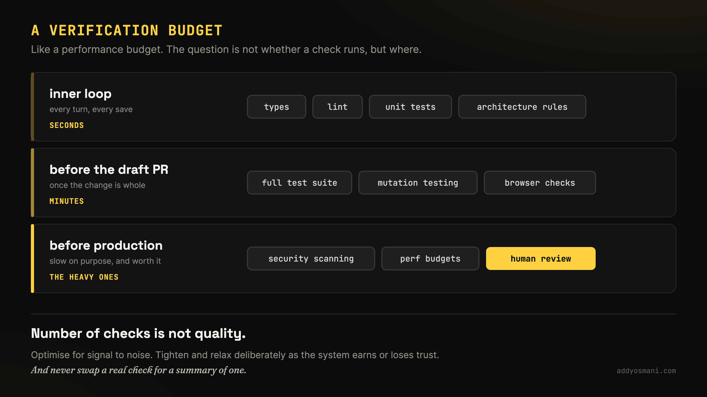
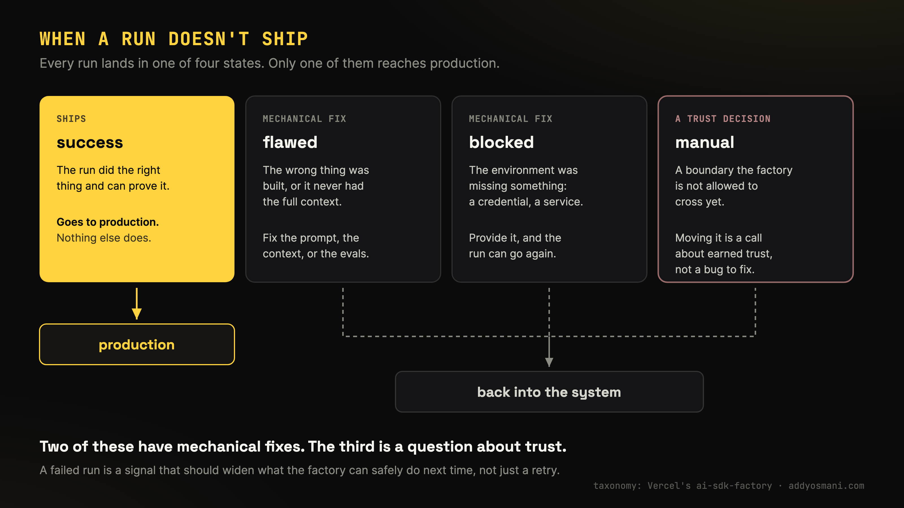

# 人类的判断力从未离开软件工厂,它只是换了位置。

> 原文：[Human judgment doesn't leave the software factory. It relocates.](https://addyosmani.com/blog/human-judgment-doesnt-leave-the-software/)
>
> 发布日期：2026-08-21

---

**软件工厂是围绕软件工作构建的一个可重复循环。如果你正在搭建软件工厂,那么「好到足以交付」的代码依然需要人类的品味与主人翁意识。下面我们聊聊这一点,也包括你现在是否*真的需要*一座工厂。**

如果确实如此：

- 你很可能需要在一开始就把人放进循环里,由人来决定产品意图、系统设计（如果你在意的话）以及你的质量门槛。

- 一定要做代码评审（也就是「亮灯」工厂）,但要有意识地把评审放在最需要它的地方。我的经验是,要盯住自动化反向压力会在哪里失效,或者哪里需要做可维护性上的取舍。

- 尽量让质量检查发生得尽可能早、尽可能持续。并非所有检查都必须如此,但这包括类型系统、自动化测试、变异测试、安全扫描器,以及针对架构规则的 lint。

- 检查项的数量 != 质量。你很可能需要试验一下,哪些检查能给你最好的信噪比。要准备好有意识地收紧或放松你的约束。

你搭建工厂时,目标应该是：把人类品味的一部分编码进环境里,让智能体拿出证据证明它的工作是对的,同时明确哪些环节仍然由人「拥有」——也就是最终交付到生产环境的东西由谁负责。

## 你真的需要一座软件工厂吗?

**以我的经验,光靠你手头现成的编码 harness 就能走得比想象中远得多！** 我说的就是 Claude Code 或 Codex、多个并行会话、写得好且内嵌了验证与约束的规格。你甚至可以把一批 GitHub issue 丢给它们,附上实现标准和需要人工介入的条件。但只有当这套系统需要成为**可重复、事件驱动**的东西时,工厂才有帮助。



所以我在开头说,**软件工厂是围绕软件工作构建的一个可重复循环**。其实,看一个提示词就能看到一个极小的工厂循环：

> >
> >
> ``` highlight
> Read GitHub issue #123 and the repository instructions before changing code.
>
> Implement only the stated acceptance criteria. Do not modify authentication,
> billing, migrations, or existing test assertions. Work in a branch and keep the
> diff reviewable.
>
> Run npm run lint, npm test, and npm run build. If a required check cannot run,
> stop and explain why. Open a draft pull request with the checks you ran, the
> remaining risks, and any decision a human still needs to make. Do not merge.
> ```
>
> </div>
>
> </div>

一个目标就能让这套流程持续运转,直到所有检查通过;我们也可以每天早上轮询带有特定标签的 GitHub issue,或者查看那些开放的 PR。分支保护可以强制出一条合并边界,而人则通过决定什么进入就绪状态、做评审、下最终的合并决定等方式留在循环里。

**当你需要一条事件驱动的工作队列（比如 Slack 触发、GitHub issue、Linear、待办列表）,让它在隔离的云环境里跑起来,处理分诊、实现和测试,并且明确安排人来盯着的时候,才该加上软件工厂。有些人把循环的末端交给一个监控智能体：它盯着生产环境,发现问题就开 issue,这些 issue 再回到分诊环节。**

以我的经验,工厂真正变得有用,是在这些难点出现的时候：让你的多次运行表现一致、在智能体之间交接工作、避免不同会话抢同一个 issue、保留证据,以及在人工评审跟不上时停住不让它进生产。

解决这些问题的办法听起来可能有点无聊。比如 Warp 提到,把每个进来的 issue [分诊](https://www.warp.dev/blog/how-to-build-a-cloud-software-factory-the-automatic-triage-skill)到四种状态之一——ready-to-implement、ready-to-spec、needs-info、wait-to-implement——而标签本身就是触发下一个智能体的信号。



这个标签一次干了好几件事：它是队列,是锁;又因为会话只会捡起被标记为就绪的东西,它还是人可以「先把事情停在这儿」、而不必永久说不的地方。

从工作流的角度看,它和单纯用 Claude/Codex 有几处相同,也有几处不同：

- **引导（Steering）**：智能体需要纠偏时,你可以给出输入,把它拉回正轨

- **通知（Notifications）**：工厂如何表达它被卡住了。可能是因为某个需求有歧义、它开始做了有风险的事,或者它需要人来输入（也就是引导）

- **交接（Handoff）**：把任务、任务状态和上下文在云工厂 / 另一个智能体 / 人类评审者之间传递。好的交接会记录清楚发生了什么、还剩什么要做、为什么需要交接。

**在一座好的工厂里,人不只是在最后评审并批准最终的 diff。人可以在早期塑造工作,在实现过程中引导它,帮它走完一次交接,或者阻止它被交付到生产环境。**

验证,是一座负责任的工厂投入大量时间的地方。后面我们会展开讲。



如果你确定自己确实需要一座软件工厂,自建并不是唯一选择。把支撑一座工厂的基础设施搭起来是件很费力的事,你可能需要权衡自建还是采购。[Factory](https://factory.com/product/software-factory)、[Warp](https://www.warp.dev/blog/how-to-build-a-cloud-software-factory-the-automatic-triage-skill) 和 [HumanLayer](https://www.humanlayer.dev/) 都在做这件事。

## 我现在的日常是什么样的

过去一年,我日常做软件开发的方式变了很多。我一直在讲自己越来越多地和智能体并行做事,逐步走向一座「亮灯」的软件工厂。很多人问我：这些东西到底是什么意思？你在搭什么？你在哪些项目上用这些？大致是这样：



所以在一个再普通不过的日子里,我有一座更简单的亮灯软件工厂。我可以有一些在云端跑着的任务。这些任务里也许有一半是在做和我合作的小公司的生产客户端应用。这些应用有真实用户,有真实的身份认证、支付、订阅,有实实在在的大风险,你必须小心。你不能只说一句「喂,智能体,你去把这事儿干了吧」,却没有测试、约束和质量检查。

我也可能在弄自己的开源项目,可能在做书的配套站点,可能在弄工具,也可能在写自己的应用。这些应用彼此的差异极大,有时候它们唯一的共同点,就是我用来处理它们的那个工具,对吧？有时我在做一次迁移,有时我在做真正重头的功能开发,而工作的影响半径也可能天差地别。

所以当你开始想着走到「大量并行做事」这一步,想着提高速度、提高生产力、提高自主性——也就是让系统走到你更信任它的程度——你就必须想清楚：哪些地方绝对需要人来评审代码、需要人来输入。

而其中很大一部分必须放在前期,对吧？你在定义规格、定义需求、定义产品设计长什么样、产品意图是什么的时候。然后是：你怎么验证智能体真的把活干对了？你怎么验证它没有破坏已经存在的系统？你怎么确保它达到了你的质量门槛？

所以生成代码未必是你最该担心的部分。只要给足上下文,智能体能替我们写实现、跑测试、检查失败、修代码。**我们要走到这样一个状态：环境里编码了足够多的人类品味,以至于我们可以信任正在被构建的东西,从而把人的注意力集中在最需要它的地方。**

当然,也有人反对,说：我不信你能把这一大堆东西都自动化掉。这并不是说我们要把所有环节都自动化掉,对吧？但考虑到代码的产出量,我不认为让人把全部代码都读一遍是现实的,尤其我们大部分时候又不是在造火箭,对吧？我们在做 UI,在做全栈应用。

我们的判断力、我们的品味,最好聚焦在最需要它的地方。比如：系统里风险最高的部分在哪？哪里需要我们施加人类品味？这可能在前端,可能在系统的工作方式上。它不必覆盖 100% 的部分。

## 我的认知带宽不会随智能体一起扩展

现实是：是的,我们现在可以并行启动几十、几百、几千个智能体,但你自己的认知带宽不会以同样的方式扩展。这会累积成我之前讲过的认知债或理解债。



如果你回想五到十年前,工程社区里有大量关于上下文切换及其代价的讨论。我们会说,当同事或某个人在你正专注做事时走到你桌前,你有多讨厌这件事。之后你要花很久才能回到心流状态,因为你得重新追上：我刚才做到哪了？我在做什么？即便还留着一点残影,也仍然要花时间。

而我们现在切换上下文的频率比过去更高。随便哪一天,如果我不在软件工厂里工作,我可能同时在用智能体推进五个或十个不同的项目,或者同一个项目上的五个或十个不同功能。你可以说,我同时开着五个或十个会话。

这意味着我至少得跟得上其中几个。如果我有信心自己把任务定义得足够好、把结果定义清楚、把「怎么验证它做得够好」定义得足够好,我确实有可能给某些任务更高的自主性。但也会有一些任务,我并不那么有把握,风险更高、或者细节更多——那些我就必须盯着。

试着为你的评审者去优化这座软件工厂。既然上面每一种做法,产出最终都汇到同一个人的注意力上,你就该问：这座工厂让你仍然必须做的那些决策,变便宜了多少？

## 一次「搞错项目」的失误

我记得自己在用智能体并行处理多个项目的时候,有几次不小心干了这样的事：比如我在做一个 Web 应用,想给它加深色模式,脑子里已经想好了它该长什么样。但我误切到了另一个项目的会话,把同一段提示词敲了进去。

于是我开始在一个完全不需要深色模式的东西上实现深色模式。我自己会犯这种错,但我不希望我的软件工厂犯这种错。

你得真正从系统的角度去想这件事。你实际上是在把一种软件工程文化、一种团队文化编码进系统里,让它具备同样的行为方式,让责任有明确的归属,让仍然有人为结果负责,并且让你对这些事情的思考方式变得非常明确。

## 当绿灯会误导你

即便在这些系统里,你也要非常小心,对吧？我们很多人都见过：当你让 AI 帮你通过一个测试——比如一个编程测试、一个单元测试——它可能会改掉那个单元测试来满足条件,也可能改掉代码逻辑来通过条件。这不代表它真的遵循了你的意图,让功能行为和这个测试本来要测的东西都对上了,对吧？



软件工厂显示一切皆绿,并不意味着它真的绿了,尤其是在你刚开始搭这些系统的阶段。你需要投入很多注意力,确保你的检查、你的验证,所有这些都被塑造成正确的样子,确保它们做的是你期望它们做的事。你不希望它们误导你。

你不希望出现这样一种情况：测试告诉你——其实,我确实把你支持的身份认证提供方改掉了。比如你让我把 GitHub 加成认证提供方,但我的 UI 只有三个位置,所以我把原来其中一个删了。顺便说一句,那恰好是你的客户真正想要的那个。所以你必须非常明确地表达你希望这些系统怎么工作。

顺便说,安全也极其重要。如果你的工厂会读取不可信输入,比如 GitHub issue 或 Slack 消息,那它可能是对抗性的,可能夹带供应链攻击之类的问题。所以一些对软件工厂的探索,比如 [Vercel](https://vercel.com/blog/building-a-software-factory-for-ai-sdk),会把智能体跑在隔离沙箱里,只持有某个任务需要的那些密钥。这样即使某次运行被攻破,也够不到这个任务不需要的东西。你的防御最终是分层的。

## 哪些老项目值得再活一次?

我还觉得,如今我们工作方式中很大的一部分,是决定什么东西应该存在。你回想很多年前、AI 之前,有那么多被放弃的软件工程项目、那么多被放弃的周末项目、个人项目,它们就是发不出去,因为我们没时间做完。我们没有带宽去优先把东西推出去,因为它们对我们没那么重要,或者我们挤不出时间。

现在完成这些项目对我们来说相当轻松了,但同样的人类判断问题随之而来：那些项目值得存在吗？应该被发布吗？因为你把它丢到世界上,哪怕只有五个用户,也许你就得维护它。也许你现在有了一个想守住的质量门槛。

我知道自己这些年有一大堆 GitHub 项目,现在有了智能体,我做的第一件事就是把它跑起来。因为显然,你克隆下来,它已经构建不了了,所有依赖都变了。一半的东西过期了,或者到处是安全漏洞,所以你得更新。

然后,如果原来没有测试,你得补测试,这样你才能知道：当你以某种方式升级这个项目,或者把它迁移到更现代的语言、框架之类的东西上时,至少行为还在。

接着你就开始问自己：也许是个傻例子,但我当年这个项目用的是 Twitter Bootstrap,而现在大家都在用 Tailwind 和 shadcn,所以我得重做 UI。你会发现,突然之间这事儿花的时间更多了,对吧？是的,智能体能更快地完成其中很多东西,但你现在得把产品感觉、品味这些东西都算进去。

你还是会问：这东西是给谁的？有市场吗？是给我自己用的,还是给别人用的？如果我把它丢到世界上,在如今任何人都能飞快地把这种东西做出来的情况下,它还有意思吗？

所以我觉得,「这些东西值得存在吗」这个人类问题,以及我们如何把自己的品味和判断力算进去——我认为这些依然极其重要。人的注意力这一稀缺资源,恰恰还是在这里发挥作用。过去,我们一天只有有限的小时。我们要开会,要留出时间做设计和编码,诸如此类。

现在我们有了智能体帮忙,我觉得你就必须非常明确地说清楚：你把时间花在哪里,以及为什么。

## 我搭了一个样例之后发生了什么

那来说说那次 82 分钟的工厂运行。很长一段时间以来,一直有人问我：「我该怎么搭一座软件工厂？」或者「我习惯用 Claude Code 或 Codex,怎么把我的配置演进成软件工厂？」

所以我一直说的第一句话是：「你可能挺好的。你的工作可能完全不需要一座工厂,也照样挺好。」但我确实想给人一份可以参考的配置。于是我搭了一个叫 [Factory](https://github.com/addyosmani/factory) 的仓库,你可以去看看。我还做了一个[演示应用](https://github.com/addyosmani/factory-demo/)和一份[工作坊](https://github.com/addyosmani/factory/blob/main/ADVICE.md#:~:text=step%2Dby%2Dstep%20workshop)。

过去几年,我很多演示都用同一个电影应用。我是个大影迷,爱看电影,经常看,所以我有一个演示应用,起点就是一个非常简单的电影应用。我想让工厂能做的事,是去实现若干功能。有几个不同的功能：我想要一个收藏功能;希望它还能做搜索;也许还想加一套深色主题,诸如此类。

于是我让工厂开始处理这些东西。你可以去看看那份实现。它的一个好处是,真的抓到了真实的问题。如果我只是一次性让它实现,这些问题我可能根本抓不到。

大概到 60 分钟的时候,我感觉：「哇,这次慢得有点反常。」我用工厂向 harness 提问：「为什么这么慢？」它说：「这其实完全正常,所有验证器还在跑。」

你可能预期单个任务花 10 分钟、15 分钟、20 分钟,但一旦把验证、重试、浏览器检查、人工评审这些额外延迟算进去,它们可能要花两到四倍的时间。

我确实认为这些加起来能换来更好的质量,以及对系统更多的信任。从度量的角度,你可能会看「每个已合并 PR 的成本」和「代码保质期」这类指标,把它们当作理解债的度量。

你还需要想清楚什么是有用的延迟,什么是工厂的额外开销。在我的例子里,验证器确实抓到了真实问题。有一小部分时间,也许是花在了产出我想要的证据上。也有一部分是工厂运行本身的开销。我并没有真的花时间去优化它,但一座只是跑一堆你自己都不觉得有价值的检查的工厂,并不意味着它质量高。

对于那些反复运行的检查,你要去研究：它们是不是无关？是不是噪声太大？它们真的让系统更安全了吗？

## 验证预算

我思考验证预算的方式,基本上就是我们在谈的这件事。我们说的是验证预算。我用的是自己过去思考性能预算时的同一套方式。



有些检查你可以在软件开发生命周期的早期就跑;也有些东西非常重,但价值极高,你会想把它们放到后面跑。还有一类是快检查,比如 lint、类型检查,这些相对快,可以放在早期跑。

完整的测试套件可以放在草稿 PR 快要成型之前、或者之后跑。这可以包括变异测试、浏览器测试、安全检查,诸如此类。

我觉得你未必想用摘要去替代这些。你要的是真实的测试,只是你得确保在正确的地方为它们预留预算,因为你不希望拖慢开发循环。我当然从不想拖慢自己的开发循环。有一个快速迭代的循环对我来说很重要,但我同时仍然想要那些制衡。

## 当一次运行没有交付

我上面写的很多内容都围绕检查。

在 Vercel 的软件工厂里,他们把每一次智能体运行[标记](https://vercel.com/blog/building-a-software-factory-for-ai-sdk)为「success」「flawed」「blocked」或「manual」,只有「success」才交付到生产。其余的重新回到系统里。我也一直用类似的思路来思考一次运行。



这里的「flawed」指实现的东西不对,或者它没拿到完整上下文,所以必须修。「blocked」指环境可能缺了某个凭据,你得补上。「manual」指撞上了一条工厂暂时还不允许越过的边界。

这三类里有两类可能有机械性的修法,最后那一类则关乎信任。

这很好,但分类不会告诉你成本。

回到我用 TMDB 应用做的工厂实现：那个没有任何驳回的快速查找功能花了 7 分钟。收藏功能经历了两次驳回、中间还有一次人工决策,花了 56 分钟。同一座工厂。所以我会把这套分类法和每个阶段的耗时配在一起看,否则你只知道某次运行是 flawed 回来的,却不知道查明这一点花了你多少代价。我还会修的另一件事是边界处的交接：我的样例工厂在第一个 issue 上停了下来,把它移到了 factory:needs-info,这没错,但我不知道该把答案放在哪儿。一次 manual 运行,不是在工厂停下时结束,而是在人知道下一步该做什么时才结束。

## 自主性不是单一开关

几周前我写过一篇文章,讲[智能体的自主性](/blog/agentic-autonomy-levels/),以及该怎么思考自主性,因为自主性不会对每个项目都是同一个设定。

验证买到的是信任,也买到了给你的智能体授予更多自主性的能力。所以,比如我在做一个不简单的改动,但我布了一些检查,所有东西都被正确验证了,也许我自己还手工核过一遍。下次在同一个项目里做类似任务时,也许我就愿意给智能体多一点自主性。

这就是你搭这些软件工厂时要想的事。你的验证会随风险变化。你的目标是尽可能好的信噪比。你要的不是一张很长、只管照着跑的清单。

## 一个我不得不重新学的功能

有一天我在用 Claude 开多个会话,同时在几个项目上工作,每个项目上又同时推进几个功能,有个功能我一直拖着没做。后来 Claude 把那个功能实现了。看起来测试都过了。我当时没在验证上花太多心思,但测试过了,我就以为它能用,合并了。

那是个收藏功能。我当时觉得还挺不错。我在浏览器里试了试,看起来没问题。但几天后我回到了代码,因为我想对它做一些微调。

我不想直接让智能体去改,因为问题出在它工作方式的一个很细微的地方：你点那个图标,点击时的效果显示不对,所以我想自己微调一下。我想搞懂它是怎么工作的,这样我才能正确地指挥我的智能体。

我回到代码,却没法跟你解释这个功能是怎么工作的。这个仓库是我的,对吧？这个改动是我批准的。我理解其中很多部分,理解这个仓库的很多部分,但我的理解没有跟上不断堆积起来的代码。

我没吸收进去的,是这个新加的功能究竟怎么工作、UI 怎么工作、点击效果怎么工作。我不得不重做这个功能,真正一步一步地搞：「它是怎么工作的？我怎样才能理解它？」

## 并行工作对理解力的影响

当你并行做事时,这个问题会整体被放大;而当你在软件工厂里做时,它会被放得更大。当你同时开五个或十个会话,它们制造的不只是评审量的问题。它们制造出好几个心智模型,而你在别处忙的时候,这些模型会凉掉。

我们过去一直在谈上下文切换的挑战。一旦聊天被压缩（compaction）,你否掉了一些方案、试了不同的路子、和智能体结对,你就很难记住会话里发生的所有事。

你可以往上滚,但随着压缩不断发生,那里不会什么都有,你也不可能把它全装进脑子里。代码常常保留了一个决策,但不保留为什么做这个决策。

我觉得这一点对你可能是个有用的学习：在重要的地方,可以考虑让智能体把它自己的轨迹、或者它在解决某个问题时的有趣经验存下来,这样你以后能回头看。

你可以决定把它提交进仓库,也可以不。你想的话可以只留在本地,也可以分享给团队,但这样它以后就能被查阅。而不是靠它可能还在某个会话里,或者靠你以后也许能想起来。

## 责任不会消失

这一切底下有一条更宽的原则。

人亲手敲出来的代码占比可能会大幅下降。但我不认为人的责任归属需要跟着一起下降。

- 总得有人选择做哪个问题。

- 总得有人选择架构。

- 总得有人设定质量门槛。

- 总得有人决定哪些验证信号值得信任。

- 总得有人决定证据何时足以交付。

而当最终的系统出问题时,「这是智能体写的」这句话不管用。这就是为什么我不认为软件工程的未来最适合被描述成「人退出了循环」。相反,**人类的判断力正在被重新安置。**

我们应该把人从循环中那些机器能产出更强、更快、更确定信号的环节里撤出来。同时,我们应该把人集中到上下文、品味、风险和长期责任最重要的地方。

最好的软件工厂,不会被定义为「把人的参与消除得有多彻底」。

它们会被定义为「把人**安置**得有多聪明」。

让人的判断力留在上游,管意图、系统形态和质量门槛。在自动化反向压力变弱、或者后果变得主观的地方去评审代码。把每一个确定性信号尽可能早、尽可能持续地推进循环里。随着系统赢得或失去信任,有意识地收紧或放松约束。

**最终交付什么代码,仍然必须由人负责。好到足以交付的代码,仍然从这里开始。**

本文最初发表在我的 [Substack](https://addyo.substack.com/p/human-judgment-doesnt-leave-the-software) 上。
