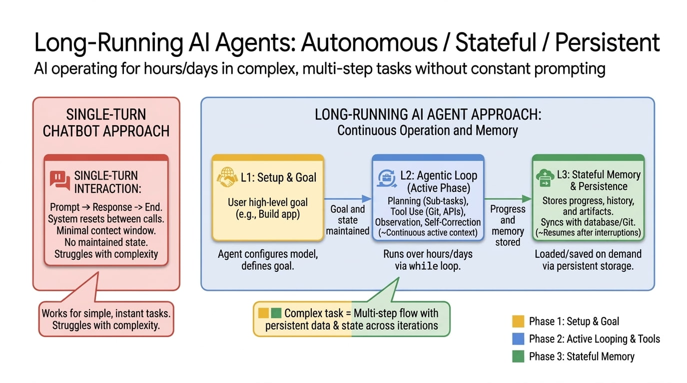

# 长时间运行的智能体

> 原文：[Long-running Agents](https://addyosmani.com/blog/long-running-agents/)
>
> 发布日期：2026-04-28

---

**一个长时间运行的 AI 智能体可以在数小时、数天乃至数周的时间跨度里持续推进。它能跨越许多个上下文窗口和沙箱，能从失败中恢复，会留下结构化的产物，并能在中断处继续。**

---

过去两年，「AI 智能体」在人们心中最主要的形象，就是一个带点聪明循环的聊天窗口。你输入一个目标，智能体调用几个工具，你看着 token 一个个流出来，等到这件事耗尽了你的耐心，或者上下文窗口被填满，你就停止观看。这个范式带我们走了很远，但它有天花板。模型会忘事。它会在任务没完成时宣布「任务完成」。它会重新引入九轮之前刚修好的 bug。整个东西是围绕「一次坐定」来设计的。

长时间运行的智能体就是下一步。这个想法很好陈述：一个智能体在一个目标上跨越许多会话、许多沙箱，可能是许多天或许多周，持续取得向前进展，同时把工作区留得足够干净，以便下一个会话能从上一次停下的地方接着做。工程实现则难得多。你得解决持久化、恢复与验证的问题，而且不能只是把裂缝糊上。你得构建一个存在于模型上下文窗口之外的状态层，还得设计会话之间的交接，好让智能体在醒来时发现自己身处另一个沙箱、面对另一个上下文窗口，也不至于失了神。

这篇文章是我尝试梳理：发生了什么变化，谁在推动它，以及工程师在今天如何在不从零写起整个东西的前提下，用上长时间运行的智能体。

---

## 「长时间运行」到底指什么

「长时间运行」在实践中至少被用来指三件不同的事，把它们分开看会有帮助。

**长程推理。** 智能体必须在许多相互依赖的步骤上做规划与执行。这主要是一个模型质量的故事：连贯性、规划能力、从十步之前走错的方向恢复过来的能力。METR 一直在用他们的*时间跨度*（time horizon）指标追踪这一点，该指标估算一个前沿模型能以 50% 的可靠度完成多长的任务。最引人注目的发现是，自 2019 年以来这个指标大约[每七个月翻一番](https://metr.org/time-horizons/)，而他们今年早些时候的 [TH1.1 更新](https://metr.org/blog/2026-1-29-time-horizon-1-1/)把评测集中 8 小时以上任务的数量翻了一倍。**如果这条曲线保持下去，前沿智能体将在 2028 年完成天级别的任务，在 2034 年完成年级别的任务。**

**长时间运行执行。** 智能体的*进程*会跑上数小时或数天。也许是编码任务，也许是研究扫查，也许是 7×24 的监控服务。模型可能在一次运行中被调用数千次。这主要是一个 *harness* 的故事，也是本文主要谈的那个。

**持续能动性。** 智能体拥有一个比任何单一任务活得更久的身份。它积累记忆、学习用户偏好，并且始终在线。这是长时间运行中 [Memory Bank](https://docs.cloud.google.com/agent-builder/agent-engine/memory-bank/overview) 那一派的风格。

在实践中这三者是混在一起的。一个真正的生产智能体是在*长时间运行执行*之*内*做*长程推理*，并由*持续能动性*支撑。但三者的工程问题不同，解决它们的产物也不同。

---

## 为什么这很重要

有两个原因让我相信这项工作在当下非常重要。

第一个是可委托工作的经济可行性发生了相变。一个跑十分钟的智能体可以回答一个问题、总结一份文档、修一个小 bug。一个跑十小时的智能体能承包一整个功能、完成一个在待办列表里躺了六个季度的迁移，或者做那种过去需要一名初级分析师熬夜完成的研究扫查。Anthropic 去年秋天的一篇 [Claude Sonnet 公告](https://www.anthropic.com/news/claude-sonnet-4-5)给出了具体数字：内部测试中 30 小时以上的自主编码，其中包括[一次运行](https://venturebeat.com/ai/anthropics-new-claude-can-code-for-30-hours-think-of-it-as-your-ai-coworker)产出了一个 11,000 行的 Slack 风格应用。**这已经越过了那条门槛——「这件事该不该委派出去」的答案不再显而易见。**

第二个是持久化改变了智能体*是什么*。一个无状态的智能体回答完你的问题就消失了。一个长时间运行的智能体会积累上下文：上个星期哪个竞争对手往哪个方向走了、哪个测试在周二挂了两次、你通常说的「那个仪表盘」指的是什么。Anthropic 的 [Project Vend](https://www.anthropic.com/research/project-vend-1) 是这方面最公开的早期演示。他们让一个 Claude 实例实际经营了一个月的办公室自动售货生意，管理库存、设定价格、和供应商沟通。它以很有信息量的方式失败了，而[第二阶段](https://www.anthropic.com/research/project-vend-2)跑得好得多，但重点并不在于盈利。重点在于观察：当一个智能体必须在数周而不是数轮之间维持身份时，会冒出哪些奇怪的连贯性问题。

这些也正是如今每个在生产环境构建智能体的团队都会撞上的问题。

---

## 每个长时间运行的智能体都会撞上的三堵墙

今年我读到的几乎每一篇相关文章里，都会出现三堵墙。

**有限的上下文。** 即便是一个 100 万 token 的窗口也会填满。而[上下文腐化](https://addyosmani.com/blog/agent-harness-engineering/)——随着窗口被填满，模型性能稳步退化——会远在硬上限之前就发作。一次 24 小时的运行不可能塞进这个领域路线图上的任何一个上下文窗口。总得有个东西让步。

**没有持久状态。** 新会话从空白开始。Anthropic 在[科学计算那篇](https://www.anthropic.com/research/long-running-Claude)里的表述是我见过最干净的：*「想象一个软件项目，工程师轮班工作，每个新来的工程师对上一班发生了什么毫无记忆。」* 没有明确的持久化方案，每一次换班都是一场生产力灾难。

**没有自我验证。** 模型给自己打分时，可靠地偏向正面。问它「你做完了吗？」，它说「是」的次数往往超出应有的程度。没有一个独立的信号来确认工作达到了标准，你得到的就是那个在 30% 完成度上满怀信心交付的智能体。

长时间运行智能体的设计，基本上都是对这三个问题的回答。**几家主要实验室已经收敛到相似的答案形态，但表面积差异极大。**

---

## Ralph 循环：实践者版本的长时间运行智能体中较简单的一种

有时也叫 Ralph Wiggum 技巧的**Ralph 循环**，是长时间运行智能体中「较简单」的实践者版本之一，由 [Geoffrey Huntley](https://ghuntley.com/ralph/) 和 [Ryan Carson](https://github.com/snarktank/ralph) 推广。参考实现[字面上就是一个 bash 脚本](https://ghuntley.com/ralph/)，它在循环：

1. 从列表（`prd.json` 或等价物）里挑下一个未完成的任务。
2. 用该任务、相关上下文和任何持久笔记拼一个提示词。
3. 调用智能体。
4. 跑测试或其他检查。
5. 把发生了什么追加到 `progress.txt`。
6. 更新任务列表（完成、失败、阻塞）。
7. 回到第一步。

它能奏效的原因，和下面任何一个 harness 奏效的原因是一样的：状态活在智能体的上下文之外。`prd.json` 是计划，`progress.txt` 是实验笔记，`AGENTS.md` 是滚动更新的规则手册。**智能体本身是失忆的，但文件系统不是。** 每次迭代都从干净状态开始，从磁盘读取足够的状态继续干下去。Carson 的 [Compound Product](https://github.com/snarktank/compound-product) 通过串联多个循环扩展了这个想法（一个读取日报的分析循环、一个产出 PRD 的规划循环、一个写代码的执行循环），这大致就是 Anthropic 独立得出的「规划器—生成器—评估器」三件套的开源版本。

我在[自我改进的智能体](https://addyosmani.com/blog/self-improving-agents/)里把这一切讲得更深：任务列表结构、进度文件、QA 关卡、监控，以及你实际会遇到的失效模式。简短版本是：用一个 bash 脚本和一个 JSON 文件，你一个晚上就能搭出一个能工作的长时间运行智能体。Google 和 Anthropic 产品化的绝大部分内容，是让这个模式在规模上可恢复、安全、可观测的工作。

下面几家大实验室的故事，是为这种生产就绪度付费的不同方式。

---

## Anthropic：先做 harness，然后是大脑／手／会话的拆分

Anthropic 在工程细节上是最公开的一家。有两篇文章值得从头读到尾。

第一篇是[《Effective harnesses for long-running agents》](https://www.anthropic.com/engineering/effective-harnesses-for-long-running-agents)，它给出了一个用于自主全栈开发的双智能体 harness。一个**初始化智能体**在项目开始时运行一次，负责搭建环境、把提示词展开成一个结构化的 `feature-list.json`，并写一个未来会话启动时会运行的 `init.sh`。然后一个**编码智能体**被反复唤醒，每次会话被要求在一个功能上做出增量进展、跑测试、留下一条 `claude-progress.txt` 笔记并提交。提示词里坐着一个测试棘轮（*「移除或编辑测试是不可接受的，因为这可能导致功能缺失或有 bug」*），用来阻止那个非常常见的失效：智能体删掉失败的测试来「让它们通过」。[InfoQ 的报道](https://www.infoq.com/news/2026/04/anthropic-three-agent-harness-ai/)把它扩展成规划器、生成器、评估器三件套，其逻辑同样是：把生成与评估分开很重要，因为模型给自己的作品打分过于宽容。

第二篇是[《Scaling Managed Agents: Decoupling the brain from the hands》](https://www.anthropic.com/engineering/managed-agents)，这是 [Claude Managed Agents](https://platform.claude.com/docs/en/managed-agents/overview)（Anthropic 的托管运行时，四月初上线）背后的架构文章。其论点是：一个智能体有三个应当可独立替换的组件。大脑是模型和调用它的 harness 循环。手是沙箱化的、短暂的执行环境，工具在那里真正运行。会话是记录每一次思考、工具调用和观察的仅追加事件日志。

这听起来抽象，其实并不抽象。Anthropic 的说法是：*「harness 里的每一个组件都编码了一个关于模型自己做不到什么的假设。」* 当你把它们耦合在一起时，一个过时的假设（比如模型以前需要显式的规划器，现在能原生规划）就意味着整个系统必须同时改动。当你把它们解耦，harness 变成无状态的，沙箱变成*牲畜而非宠物*，大脑崩溃也不会丢掉这次运行。一个新容器调用 `wake(sessionId)`，从日志里重建状态。他们报告说，仅仅因为能在沙箱就绪之前就开始推理，[首 token 时间在 p50 下降了约 60%，在 p95 下降超过 90%](https://www.anthropic.com/engineering/managed-agents)。

**把会话当作事件日志这个想法，是大多数团队低估的那部分。** 正是它让长时间运行的智能体可恢复。没有它，一次容器故障就是一次会话故障，你只能对着一个过时的快照调试。有了它，智能体的记忆就成了一件可查询的产物，活在当前恰好在跑的那个进程之外。

对科学计算圈子来说，Anthropic 的[长时间运行的 Claude 那篇](https://www.anthropic.com/research/long-running-Claude)把这一切化简成一个更简单的栈：`CLAUDE.md` 作为智能体边学边改的活计划，`CHANGELOG.md` 作为可携带的实验笔记，`tmux` 加 `SLURM` 加 `git` 作为执行与协调层，以及 **Ralph 循环**——一个在智能体声称完成时把它踢回上下文、追问它是否*真的*做完的 `for` 循环。他们的旗舰案例是 Claude Opus 4.6 用几天时间构建的一个玻尔兹曼求解器，与参考的 CLASS 实现达成了亚百分之一的一致性。数月到数年的研究者时间，被压缩了。

三篇文章里是同样的模式：一个显式的计划文件、一个显式的进度文件、会话之间的结构化交接、生成与评估分离，以及一个拒绝让智能体提前停下的循环。

---

## Cursor：规划器、工人、裁判

[Cursor 的《Scaling long-running autonomous coding》](https://cursor.com/blog/scaling-agents)是今年另一篇必读。他们撞上的墙，是 Anthropic 大多糊过去了的。

他们的第一次尝试是一个扁平的协调模型：地位平等的智能体通过锁写入共享文件。它变成了瓶颈，还让智能体变得风险厌恶，宁可反复折腾也不愿提交。第二次尝试用乐观并发控制替换锁，去掉了瓶颈但没解决协调问题。第三个设计就是现在跑在生产里的，也是他们描述为解决了大部分问题的：

- **规划器**持续探索代码库并产出任务。它们可以递归地生成子规划器。
- **工人**是专注的执行者。它们彼此不协调，也不操心大局。
- **裁判**决定一次迭代何时结束、何时重启。

文章里有两点很突出。第一：*「系统行为中惊人的一部分取决于我们如何给智能体写提示词」*，而不是 harness 或模型。第二：不同的模型适合不同的角色。他们报告的发现是，某个 GPT 模型比 Opus 更适合*长时间自主工作*，恰恰因为 Opus 倾向于提前停下、走捷径。**同样的任务，不同的角色，不同的模型。** 这种匹配正在成为设计面的一部分。

这跟 [Composer 2](https://cursor.com/blog/composer)（他们随 [Cursor 3](https://cursor.com/changelog/2-0) 发布的专有前沿编码模型）和他们的**后台云智能体**配套：后者是在 Anysphere 的云基础设施上、而不是在你的笔记本上运行的长时间任务。八小时的重构和全代码库迁移能扛住合上的笔记本盖。你可以在本地开始一个任务，意识到它要跑 30 分钟时点*在云端运行*，之后再从手机上重新接上。每个智能体跑在隔离的 git worktree 里，通过 PR 合并回来。本地与远程之间的交接是大多数团队还没搞明白的部分，而 Cursor 押注它必须成为一个独立的产品面。

最终的形态与 Anthropic 的很接近：角色被拆分，会话是持久的，裁判坐在工人旁边，长任务跑在云沙箱里，以 git 作为协调的基底。

---

## Google：Agent Platform 上的长时间运行智能体

Google 两周前在 [Cloud Next '26](https://cloud.google.com/blog/products/ai-machine-learning/introducing-gemini-enterprise-agent-platform) 的发布把 Vertex AI 折进了 **Gemini Enterprise Agent Platform**，并把长时间运行的智能体变成了一个有名字的产品，还带上了有名字的 SLA。

与本文相关的部分：

- **Agent Runtime** 支持*「一次自主运行数天」*的智能体，冷启动在亚秒级，沙箱按需供给。发布文章里的示例用例是一个要一周才走完的销售拓客序列，这大致就是它合适的形态。
- **Agent Sessions** 持久化对话与事件历史。你可以把它们钉到一个自定义的会话 ID 上，映射到你自己的 CRM 或数据库记录，这样智能体的状态就与业务状态相邻，而不是待在独立的 AI 孤岛里。
- **[Agent Memory Bank](https://docs.cloud.google.com/gemini-enterprise-agent-platform/scale/memory-bank)** 是持久化的长期记忆层，自 Next '26 起正式可用。它从会话中整理记忆，把它们限定到某个用户身份，并暴露一个搜索 API，好让下一次智能体调用能取出相关内容。Payhawk 报告说，通过一个由 Memory Bank 支撑的智能体自动提交报销，把提交时间削减了 50% 以上。
- **Agent Sandbox** 负责加固过的代码执行。
- **Agent-to-Agent Orchestration**、**Agent Registry**、**Agent Identity**、**Agent Gateway**、**Agent Observability** 和 **Agent Simulation** 基本上覆盖了你在生产集群里否则得手工搭建的每一个运维关切，包括企业真正需要才能上线的加密身份与审计日志那一套。

从架构上说，这就是 Anthropic 描述过的同一个大脑／手／会话拆分，只是以平台规模做了产品化，并和 [ADK](https://google.github.io/adk-docs/)（代码优先的开发套件）以及 Agent Studio（可视化那个）打包在一起。如果你在 Google Cloud 里构建，你不必再从零设计一个会话日志或记忆存储。你把一个 ADK 智能体接到 Memory Bank 和 Sessions 上，部署到 Agent Runtime，持久化的问题就有人答了。

注意这看起来多么像 Anthropic 和 Cursor 描述的模式，只是被拆成了带 SLA 的具名服务。三年前这些东西你得自己全建一遍。**现在你只需挑选想租用哪个版本的「解耦的大脑、手和会话」。**

---

## 生产环境里长时间运行智能体的五种模式

Shubham Saboo 和我[写了一篇](https://x.com/GoogleCloudTech/status/2046989964077146490)，讲我们见过的、把能用的长时间运行智能体和演示品区分开的五种设计模式。它们不是 Google 专有的，但能干净地映射到 Agent Runtime 现在暴露的原语上，所以值得在这里以缩短的形式过一遍。

**检查点与恢复。** 最常见的多日失效是上下文丢失。一个智能体在四小时里处理 200 份文档，在第 201 份上遇到错误，没有检查点你就得从头再来。把智能体当成一个长时间运行的服务进程：把中间状态写到磁盘，每 N 个工作单元打一个检查点，从失败中恢复。Agent Runtime 沙箱给你一个持久文件系统，但选择合适的检查点粒度（不是每一步，也不只是最后）是你自己的事。

**委派式审批（人在回路）。** 大多数「人在回路」的实现是：把状态序列化成 JSON，发一个 webhook，然后指望有人响应。状态过时了，通知被埋了，智能体重新反序列化时发现世界已经有点不一样了。长时间运行的运行时让智能体原地暂停，完整保留执行状态：推理链、工作记忆、工具历史、待执行动作。人类时间过去几小时，智能体消耗零算力，然后以亚秒级延迟恢复。Mission Control 是 Google 为此提供的收件箱。这个模式与厂商无关。

**分层记忆的上下文。** 一个跑七天的智能体需要的不只是会话状态。Memory Bank 处理长期的、整理过的记忆，Memory Profiles 增加低延迟查询，而你在生产里会撞上的失效模式是**记忆漂移**：智能体从几次非典型交互中学到一个流程捷径，然后开始到处套用。**像治理微服务那样治理记忆。** Agent Identity 控制谁能读写哪些 memory bank。Agent Registry 追踪哪个智能体的哪个版本在跑。Agent Gateway 在链路上执行策略。审计的问题不再是「我的智能体在干什么？」，而是「我的智能体在记什么，而这又如何改变了它们的行为？」

**环境式处理。** 不是每个长时间运行的智能体都在跟人说话。有些坐在 Pub/Sub 流或 BigQuery 表上，事件一到就行动：内容审核、异常检测、收件箱分诊。值得尽早做的架构决策是不要把策略硬编码进智能体。在 Gateway 里定义它，整个集群无需重新部署就能拾取策略变更。环境式智能体在长时间段里无人监管地运行，而要更新一百个这样的东西，唯一清醒的方式是更新一次策略层。

**集群编排。** 在真实系统里，你很少只有一个智能体。一个协调者把子任务委派给专家（一个首席研究员智能体、一个打分智能体、一个触达智能体），各自独立运行不同的时长。每个专家拿到自己的 Identity（这样触达智能体读不到本应给打分智能体的财务数据）、自己的策略执行、自己的 Registry 条目。这与分布式系统用了几十年的协调者／工人形态是同一个。新的是 ADK 用基于图的工作流以声明式方式处理它，而且某一个专家的坏部署不会级联到其他专家。

这些模式会组合。一个合规系统可能用检查点处理文档、用委派审批做评审关卡、用分层记忆做跨会话知识、用集群编排协调专家。开场问题永远是一样的：*你的智能体需要执行的最长不间断工作单元是什么？* 几分钟，那你不需要长时间运行的智能体。几小时或几天，那这些模式就是起点。[带代码示例的完整文章](https://x.com/GoogleCloudTech/status/2046989964077146490)深入覆盖了每种模式。

---

## 那么今天到底该怎么建一个？

这是个务实的问题，答案取决于你在建什么。

**你是想在自己的仓库上做长时间编码工作的开发者。** 直接用 [Claude Code](https://addyosmani.com/blog/agent-harness-engineering/)（或者 Antigravity、Cursor、Codex）。harness 已经在那儿了。把你的 `AGENTS.md` 当成飞行员的检查单：短，每一行都由一次真实失败换来。为 typecheck 和 lint 加上钩子，把失败呈现回智能体。在智能体开始之前写一个计划文件。当智能体声称完成而你不信时，用[那个 Ralph 循环](https://addyosmani.com/blog/self-improving-agents/)。对于数小时或过夜的任务，跑在 worktree 里，这样合上的笔记本不会杀掉这次运行，并让它每完成一个有意义的单元就提交进度。**这是大多数人该走的路，也是当下杠杆最大的地方。**

**你在构建托管的智能体产品。** 别自己造运行时，挑一个托管的。今天三个真正的选项：[Google 的 Agent Platform](https://cloud.google.com/products/gemini-enterprise-agent-platform)（Agent Engine + Memory Bank + Sessions）、[Claude Managed Agents](https://platform.claude.com/docs/en/managed-agents/overview)，或者在 [ADK](https://google.github.io/adk-docs/)、[Claude Agent SDK](https://www.anthropic.com/engineering/building-agents-with-the-claude-agent-sdk) 或 [Codex SDK](https://platform.openai.com/docs/codex) 之上自己搭、自己托管。权衡还是老一套。托管版开箱就给你大脑／手／会话的拆分、可观测性、身份和审计轨迹。自托管版给你控制权，以及为奇怪的角色使用奇怪模型的能力（Cursor 那个模式）。对大多数团队来说，正确的起点是一个托管运行时，加上你自己的 ADK 或 SDK 代码来做真正的循环。

**你在做某种自主的、运营性的东西**（监控、研究、运维）。你想要的是 Memory Bank 那一派的持久化，而这正是 Claude Code 里没有的部分。ADK + Memory Bank + Cloud Run + Cloud Scheduler 是我见过的、对「智能体每 N 小时跑一次、积累状态、超阈值就告警」最干净的栈。这也正是 Cursor 的规划器／工人／裁判拆分开始比在 IDE 里编码更重要的地方，因为工作是真的并行，失效模式也不同。

无论走哪条路，有几件事都很重要。

*在智能体开始之前，把完成条件写下来。* 对于长时间运行，这是单点杠杆最高的动作。Anthropic 的 harness 文章叫它功能清单；Cursor 叫它规划器的任务规格。不管叫什么，它是一个带明确、可测试的完成标准的外部文件，它存在的意义是让智能体不能在运行中途悄悄重新定义*完成*。

*把评估者与生成者分开。* 自评就是那个失效模式。规划器／工人／裁判的流水线，或者生成器／评估器这一对，是一种真正的架构模式，不是风格偏好。哪怕它是同一个模型在不同角色、不同提示词下。

*投资于会话日志，而不只是提示词。* 仅追加的事件日志才是让智能体可恢复、可调试、可审计的东西。如果你无法从持久存储中重建智能体过去 24 小时做了什么，你手里的就是一个恰好会调用 LLM 的长时间运行的 shell 脚本，而不是一个长时间运行的智能体。

*把压缩和上下文重置当成一等公民。* Anthropic 说得很明确：把摘要当作压缩，对于超长任务是不够的；他们必须做完整的上下文重置——harness 拆掉会话，从一个结构化的交接文件重建它。这基本上就是人类给新工程师做入职的方式。

---

## 现在还有一些真实的局限

有几件事仍然是真的没解决。

**成本。** 一次 24 小时、用前沿模型加几个工具的运行并不便宜。没有预算、熔断器和工具花费的硬上限，一个智能体可能在一个下午悄悄烧掉一周的 API 预算。这是可解的，但它是你必须显式迈出的一步。

**安全。** 一个持有 API key、云访问权限、还能执行 shell 命令的长时间运行智能体，攻击面比一个聊天会话大得多。大脑／手分离的模式在这里同样重要：凭证应当从运行模型生成代码的那个沙箱里不可达，这是 Anthropic 为 Managed Agents 列出的好处之一。

**对齐漂移。** 在许多个上下文窗口之后，智能体会漂移。最初的目标被摘要，再被重新摘要，然后失去保真度。这正是钩子和裁判存在的意义。它也是「智能体跑去做了我没要求的事」最常见的原因。

**验证。** 审计 24 小时的自主活动是一个真实的人力时间问题。可观测性和结构化产物（PR、提交、简报、测试运行）是让这件事可控的方式。没有它们，你就在翻日志，而你会错过重要的东西。

**人的角色。** 这是我反复回到的一点。把工作定义得足够清晰、让智能体能在上面跑一天，比自己动手做这件事更难。正在升值的那项技能不是写代码，而是写出能与自主执行者正面接触后仍然成立的规格。

---

## 这是要往哪去

Google、Anthropic 和 Cursor 已经收敛到大体相同的形态。**把模型循环、执行沙箱和持久会话日志分开。把规划、生成、评估分开。内建压缩、钩子和上下文重置。把记忆作为一项托管服务暴露出来，任何智能体调用都能查询它。**

差异在于表面积。Google 的 Agent Platform 是企业技术栈版本，身份与审计轨迹的故事都内建好了。底下的模式是一样的。Claude Managed Agents 是「Anthropic 的 harness，托管版」。Cursor 的后台智能体是「长时间运行的编码，从 IDE 里抽出来放进云里」。

接下来一年更难的问题，不在这些层里的任何单独一层。它们在它们之上的协调层。共享代码库上的许多个长时间运行智能体。读取自己轨迹并修补自己 harness 的智能体。为一个任务即时装配工具与上下文、而不是在启动时预先配置好的 harness。到了那里，智能体就不再像一个更聪明的聊天窗口，而开始像一个在项目上待得比你还久的同事。

模型仍然是承重的。但一个聊天窗口和一个你能放着过夜运行的智能体之间的差距，主要在于包裹在它周围的状态、会话和结构化交接。这也是我现在会投入学习时间的地方。

---

*如果你想补前置阅读，我的 [Agent Harness Engineering](https://addyosmani.com/blog/agent-harness-engineering/) 那篇讲了本文所依托的 harness 原语，而[自我改进的智能体](https://addyosmani.com/blog/self-improving-agents/)更深入地讲了 Ralph 循环模式。*
