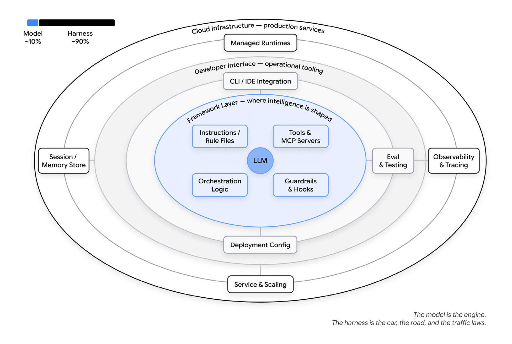
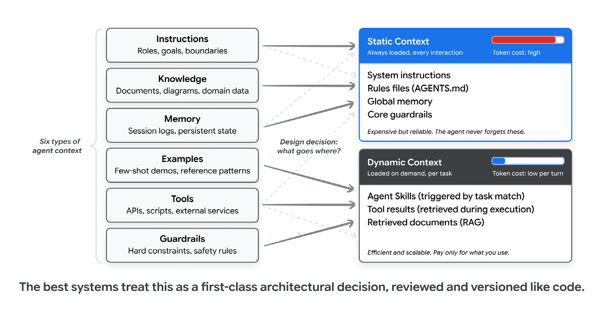
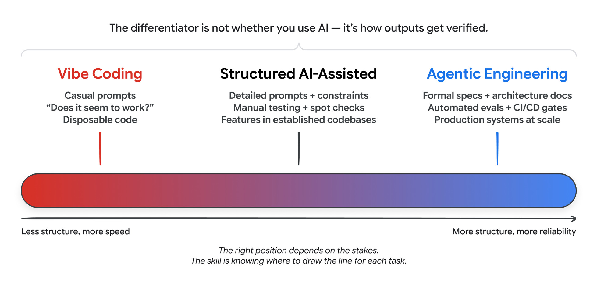
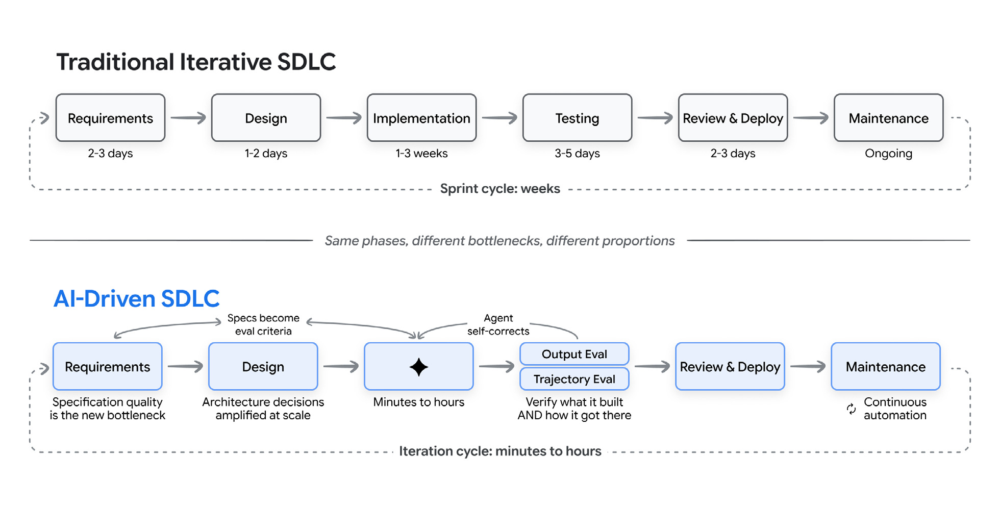
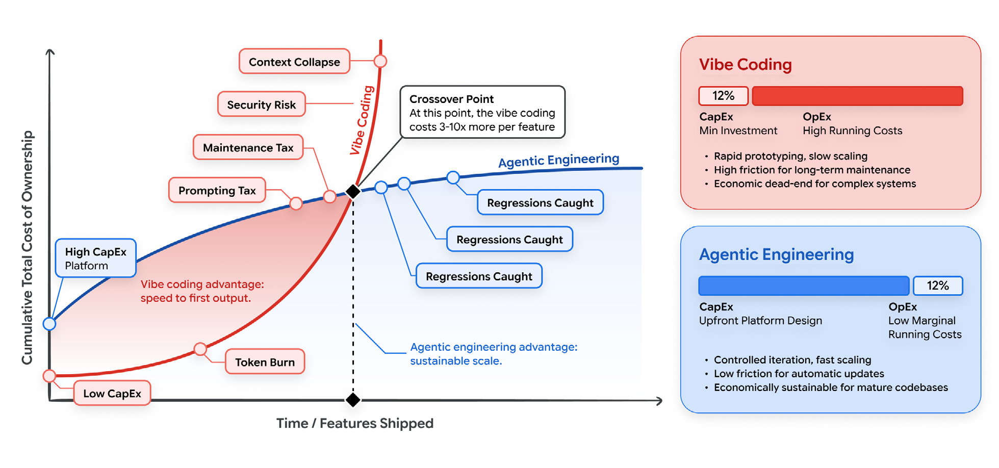
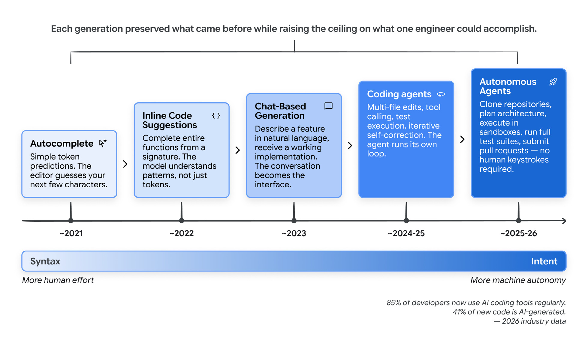

# 新的软件生命周期

> 原文：[The New Software Lifecycle](https://addyosmani.com/blog/new-sdlc-vibe-coding/)
>
> 发布日期：2026-06-16

---

*我和人合写了一篇 Google 白皮书,讲 AI 如何改变软件生命周期。我不打算把整篇总结一遍。这里只挑我认为真正重要的几个想法,另外附上六张图,欢迎随意取用。*

---

Google 本周发布了[《Vibe Coding 下的新 SDLC》](https://www.kaggle.com/whitepaper-the-new-SDLC-with-vibe-coding)。这是我和 [Shubham Saboo](https://www.linkedin.com/in/shubhamsaboo/) 以及 [Sokratis Kartakis](https://www.linkedin.com/in/kartakis/) 合写的,也是一个小系列的第一篇。

它是一篇「第一天」性质的文章,所以前面几页讲的都是基础：智能体是什么,「vibe coding」是什么意思,为什么这份工作正从写代码转向判断代码。如果你读这个博客,这些你早就知道了。我会跳过,只写我认为值得你花时间的部分,并把其中六张图单独拿出来。图随便用。

## 智能体 = 模型 + harness

白皮书里有一个我反复回到的框架：一个智能体 = 一个模型 + 一套 harness。

模型只是其中一个输入。其余都是 harness：指令和规则文件、工具和 MCP 服务器、它运行的沙箱、负责派生、子智能体和在模型之间路由的编排逻辑、在固定节点运行确定性代码的 hook,以及告诉你它什么时候开始漂移的可观测性。白皮书给出的粗略比例是 10% 模型、90% harness。这听起来很高,直到你为调通一个这样的东西花上一周。

 *模型是引擎。harness 是车、是路,也是交通规则。*

几个公开的数字能让这件事更具体。在 Terminal Bench 2.0 上,有一个团队只改 harness、底下用同一个模型,就把一个编码智能体从 30 名开外推进了前 5 名。LangChain 另一个实验在同一个基准上,只改围绕固定模型的系统提示词、工具和中间件,就多了 13.7 个点。两者都没碰模型。

所以当智能体干了蠢事,我学会的第一件事是先调试 harness。通常是缺了某个工具、我写的规则太松、我忘了某个护栏,或者上下文窗口里塞了一堆垃圾。大多数智能体失败都是配置失败。我觉得这挺让人安心,因为配置是我今天就能修的部分,不用等一个更好的模型。反正模型迟早会在 harness 底下被换掉。我把这些写得更长过,见 [harness 工程](https://addyosmani.com/blog/agent-harness-engineering/) 和[工厂模型](https://addyosmani.com/blog/factory-model/)。

## 上下文工程是决定你账单的那一环

如果 harness 是系统,那上下文工程就是里面最重要的那个旋钮。白皮书把智能体上下文分成六类：指令、知识、记忆、示例、工具、护栏。真正有意思的决策——也是最后体现在你账单上的那个——是什么放进静态上下文,什么放进动态上下文。

 *静态上下文每一轮都会加载,所以可靠,也贵。动态上下文按需加载,所以你只为任务需要的部分付费。*

静态上下文每一轮都会加载：系统指令、规则文件（`AGENTS.md`、`CLAUDE.md`、`GEMINI.md`）、全局记忆、核心护栏。它可靠,也贵,因为每一次调用你都要为它付费。动态上下文按需加载：任务匹配时触发的技能、工具结果、从 RAG 里取回的文档。你只为某个任务真正碰到的部分付费。

这个平衡往一个方向搞错,你就烧 token,还把信号埋了。往另一个方向搞错,智能体会忘掉那些保证它安全的规则。白皮书的建议——我也同意——是把这条边界当成真正的架构决策：在 PR 里评审,像代码一样版本化。

让动态上下文能扩展的技巧,是带渐进披露（progressive disclosure）的智能体技能。启动时智能体只看到一点点元数据,任务匹配时才加载完整指令,只有真正需要时才拉进那些重的参考资料。这样一个智能体可以带着几十个技能,却只为正在用的那个付费。

## 验证是 vibe coding 与工程之间的分界线

用同一个智能体,你可以坐在从 vibe coding 到智能体工程这条光谱上的任何位置。决定你落在哪里的,是验证。

 *光谱上合适的位置取决于赌注有多大。真正的本事,是为每个任务判断这条线画在哪儿。*

有两条机制。测试覆盖确定性的部分：这个输入,那个输出。评测覆盖不确定的部分,白皮书的拆法我觉得有用：输出评测问最终结果对不对。轨迹评测问它走到那里的那条路径——工具调用和推理——是否站得住。两者你都要。一个看起来对、但跳过了检查的答案,比一个明显坏掉的答案更危险。

如果只能给管理者一句话,那就是：把标准放在评测上,而不是演示上。演示只能证明智能体能工作一次。一套有真实评分标准的评测,才能证明它可靠地工作。我一直在讲这个论点,见[智能体代码评审](https://addyosmani.com/blog/agentic-code-review/)。

## 每个阶段到底怎么变

AI 压缩了生命周期,但不均匀,而不均匀才是全部故事。实现从几周缩到几小时。需求、架构和验证仍然慢,因为它们是判断性工作。于是规格质量成了瓶颈,验证移到了中间。

 *同样的阶段,不同的瓶颈,不同的比例。*

逐阶段看：

- **需求**不再是团队之间递来递去的一份文档。它变成一场对话,同时产出规格和第一个原型。智能体根据一份简述起草用户故事、翻出边缘情况,几分钟内把一段描述变成能跑的东西。
- **架构**是最顽固地属于人的阶段。一致性与可用性之间的取舍依赖业务上下文,模型看不全。开发者的工作变成做出并记录结构性决策,然后由智能体去实现。
- **实现**是收益和告诫同时存在的地方。调查把生产力提升定在 25% 到 39%。一项 [METR 研究](https://metr.org/blog/2026-02-24-uplift-update/)发现,如果把检查和修补的时间也算进去,有经验的开发者有些任务反而慢了 19%。两者都是真的。诚实的总结是：AI 把实现从「写」变成了「评审」。
- **测试与 QA** 翻转过来。你的测试和评测成了你告诉智能体「正确」是什么意思的主要方式,并被接进一个循环：对基准跑一遍、把失败聚类、修掉导致失败的提示词或工具、对回归套件再检查一遍、在生产里盯新的失败。
- **维护**是我认为最被低估的一个。那些因为只有作者才看得懂而「风险太高不敢碰」的代码,现在可以被智能体读懂、重构、现代化。那些因为枯燥又有风险而一直没做的迁移和废弃清理,开始发生了。

这一切的天花板,仍然是 [80% 问题](https://addyo.substack.com/p/the-80-problem-in-agentic-coding)：智能体能很快做出一个功能的前 80%,而最后 20%——边缘情况和系统之间的接缝——仍然需要模型通常没有的上下文。

## 经济学：上下文与路由是财务杠杆

对管理者真正重要的数字不是速度,是总拥有成本。AI 时代把它拆开的方式,会颠覆你对「哪个选项便宜」的通常直觉。

 *越过交叉点之后,vibe coding 每个功能的成本高出 3 到 10 倍。代码要活多久,决定了你到底会不会走到那一步。*

vibe coding 前期便宜,运行起来贵。开始几乎不花钱：一个订阅,几句提示词。然后你以后付账。token 燃烧,来自把一堆没有结构的文件丢给模型、再让它自己修自己的错。维护税,几个月后有人得去逆向理解这些临时拼凑的代码。安全清理,因为快速生成产生漏洞的速度,差不多和产生功能一样快。智能体工程反了过来：前期投入更多（schema、测试、结构化上下文）,之后每个功能的成本更低。

「vibe coding 每个功能贵 3 到 10 倍」这个交叉点是示意性的,不是一个测出来的常数。我想让开发者带走的是：上下文工程和模型路由是财务杠杆,不只是技术杠杆。你不能把 10 万 token 的仓库塞进每一次提示词,还指望它能扩展。把难的推理路由给大模型,把例行工作——生成测试、代码评审、CI 检查——路由给小而便宜的模型。质量守住了,账单下来了。这就是我所说的[编排税](https://addyosmani.com/blog/orchestration-tax/)在钱这一侧的体现。

## 原型正在变成生产级智能体

这是白皮书里我盯得最紧的部分。同一个能吐出一次性脚本的终端工作流,现在能在同一个地方产出一个生产级智能体,而且常常只是和你本来就在用的那个编码智能体对话。

构建、评测、部署一个真正的智能体——有持久记忆、限定范围的权限、评测覆盖和可观测性——过去是一套独立的栈、一份独立的工作。现在它折进你本来就在跑的循环里。Google 的 [Agents CLI](https://google.github.io/adk-docs/) 就是围绕这个做的。一次性安装之后,你的编码智能体就获得了覆盖整个生命周期的技能,你用日常语言驱动它：

```text
# 一次性安装
uvx google-agents-cli setup

# 然后,在你的编码智能体里：
> Build a support agent that answers questions from our docs.
> Evaluate it on the FAQ dataset.
> Deploy it to Agent Engine.
```

这一句指令背后,它搭好项目脚手架、写代码、生成评测集、跑评测、部署到托管运行时,然后回来汇报。昨天还在你笔记本上的原型,今天就成了服务用户的生产智能体,不需要重写。智能体之间的协作跑在开放标准上：工具用 MCP,把工作交给其他智能体用 A2A。

白皮书里有一个实验,我老是跟人提。一个 Anthropic 团队让一组智能体用两周时间、用 Rust 做出一个能工作的 C 编译器,人类负责定方向和评审,而不是写代码。这大致就是这件事正在走向的形态。

日常你会在两种模式之间切换,白皮书把它们叫作**指挥（conductor）**和**编排者（orchestrator）**。指挥是实时的、在 IDE 里、一个键一个键地做,适合探索和你还不熟的代码。编排者是异步的：你把一个目标交给一个或多个智能体,然后评审回来的东西,适合规格清楚的工作,比如迁移或生成测试。现在的工具两种都能做,有时一小时内两种都用。我认为从指挥走向编排者,首先是[技能上的转变,然后才是工具上的转变](https://addyosmani.com/blog/future-agentic-coding/)。

## 给其他人看的那张图

还有一张图,这张不是给你看的。是给你想带上路的人看的：那位还以为这只是花哨自动补全的高管,那位还没迈出这一步的同事。

 *每一代都保留了上一代,并抬高了一个工程师能做到的上限。*

它带着那些通常能终结「这玩意儿到底成不成立」争论的采用率数字。截至 2026 年初,85% 的职业开发者经常使用 AI 编码智能体,51% 每天使用,大约 41% 的新代码是 AI 生成的。

## 从哪里开始

白皮书结尾给个人、管理者和组织列了一组更长的建议。我不在这里重复全部。

如果只带走一句话,那就是：AI 会放大它所落进的任何一种工程文化,好的部分和坏的部分都放大。生成这件事现在基本解决了。剩下的工作是规格和验证,以及把它们撑在一起的那些系统。那才是我会去变强的部分。

[完整白皮书在这里。](https://www.kaggle.com/whitepaper-the-new-SDLC-with-vibe-coding)
