# 拥有外层循环

> 原文：[Own the Outer Loop](https://addyosmani.com/blog/own-the-outer-loop/)
>
> 发布日期：2026-07-15

---

过去一年里，围绕**智能体工程**的讨论已经转向 **harness**（承载框架）和**[循环](https://x.com/addyosmani/article/2064127981161959567)**、**集群（fleets）**以及**软件工厂**。我的浅见是：工程师需要**拥有外层循环**——为这些系统承担**责任**。随着 Fable 和 GPT-5.6 这类强大模型变得可用，这一点只会越来越成立。

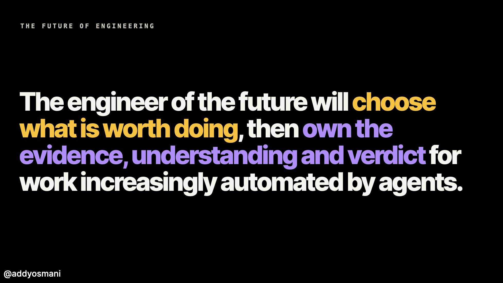

*这是我 AI Engineer World's Fair 2026 闭幕主题演讲的文字版。演讲视频如下：*

> 演讲视频：https://www.youtube.com/watch?v=n97BCfyFIvw

智能体拥有杠杆，而杠杆会产生义务。**必须有人能够准确解释：到底改动了什么、为什么这是安全的、以及如果他们判断错了会发生什么。**否则，它们的行动就无法被正当化。而这也意味着，组织一开始就不太可能请它们去做这些事。

所以我想谈三个词。第一个是**质量（Quality）**，指我们在放任系统运行之前安装的所有检查。这些检查产生证据，而我们从证据中得出裁决。

第二个是**裁决（Verdict）**，指工作在进入我们的依赖系统之前，我们所做的最终决定：我是这些内容的制片主任。我带的团队，其产出以我的名义交付。模型可以写这台词，但裁决是我的。没有我的决定，我团队的成果不会进入我们的依赖系统。裁决就是制作决策：我们应该交付、阻断、改道、收窄响应、加装护栏，还是直接拒绝？

第三个是**可回答性（Answerability）**，指这样一种保证：如果有人来问，我能解释为什么。

换个说法：我们的智能体（我把它定义为模型，加上由文件、工具、记忆、技能、沙箱、权限、可观测性和恢复机制构成的 harness）负责运行我们的循环（我把它定义为调查、实现、验证、重复）。也正是它造就了我们的软件工厂。

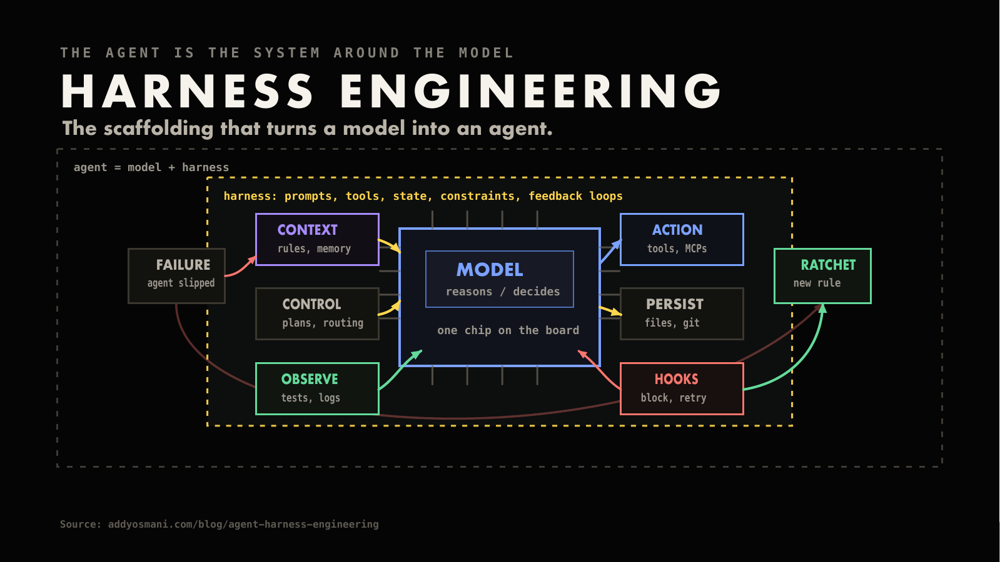

*模型只是引擎。harness——工具、记忆、权限、沙箱、测试——是你围绕它打造的车身，让它能安全地做真正的工作。*

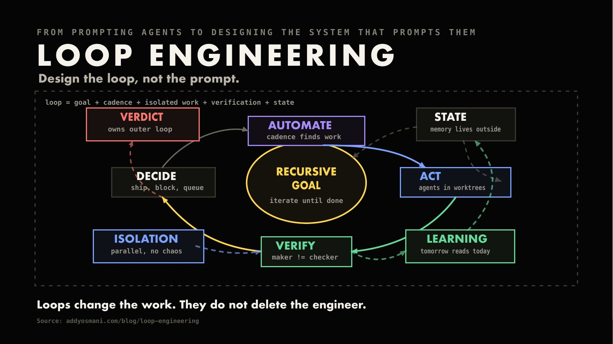

*把这个 harness 包进一个可重复的循环：调查、实现、验证、重复。循环就是让一次好的运行变成你可以放心再次运行的过程。把这个 harness 包进一个可重复的循环——调查、实现、验证、重复——由独立的检查，而不是模型自己的说法，来决定工作何时完成。*

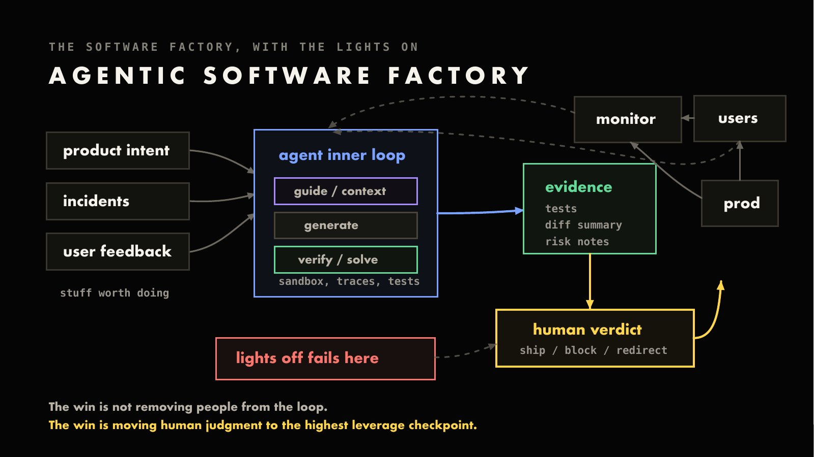

*现在同时运行许多个循环。工厂就是规模化的循环——智能体在内部交付工作，而人类拥有边界上的决策。*

而**这座工厂的核心，是系统内部与系统外部之间一条被小心划定的边界**。在系统内部：我们收集输入（来自产品团队的意图，或对以往已交付工作的了解，或对近期事故的了解，或来自用户的具体反馈）。智能体循环调查任务、实现计划、验证结果。然后，证据穿过这条边界。拥有依赖系统的人看到证据，决定是否继续。

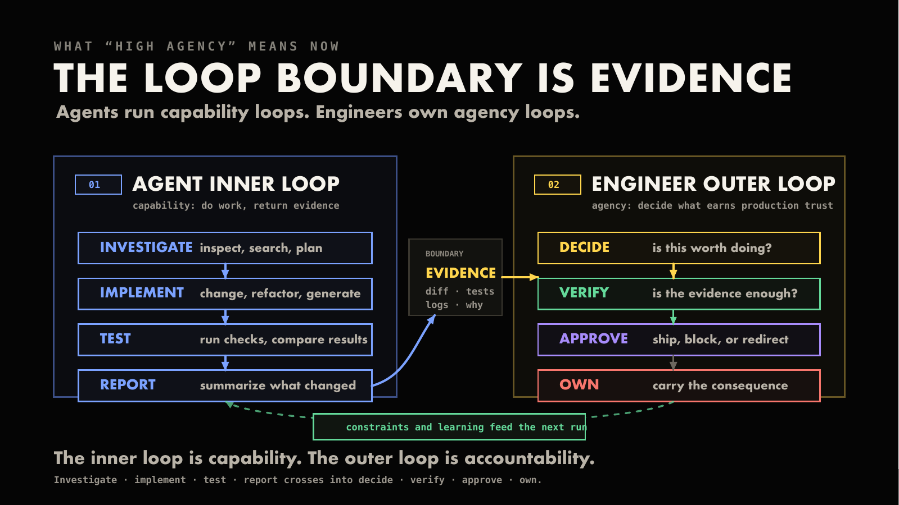

朋友们，这就是我们想要促成的那次转变。以前，我们的智能体做的是执行循环的内层循环。现在它们运行内层的执行循环。**工程师拥有外层循环。**

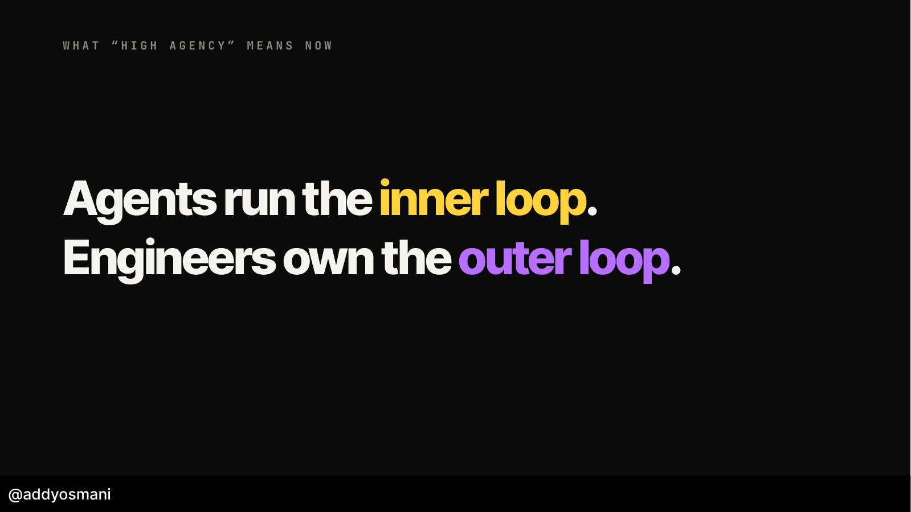

在系统内部，我们的智能体其实只做一类事：能力。调查任务、实现计划、测试结果并回报的能力。那是模型的能力。而正如我们所说，那个未来已经到来。

**在系统外部，只有一类东西：能动性。去决定、去验证、去批准、去担责的能动性。**

你看，我们谈的仍然是代码。它只是需要落在一个地方，由知道自己在做什么的人来执行。

AI 代码的潜力已不再是边缘性的。在 Sonar 2026 的一项调查中，我们询问了团队：他们的提交中有多大比例是 AI 辅助的。比例不大，但也绝非可以忽略。而且有几位受访者表示，他们预期 AI 辅助提交的占比会大幅增长。[Sonar 的 2026 年代码状况报告](https://www.sonarsource.com/state-of-code-developer-survey-report.pdf)发现，42% 的已提交代码是 AI 生成或经 AI 显著辅助的，并且预期这一比例会持续增长，而不是趋于平台期。

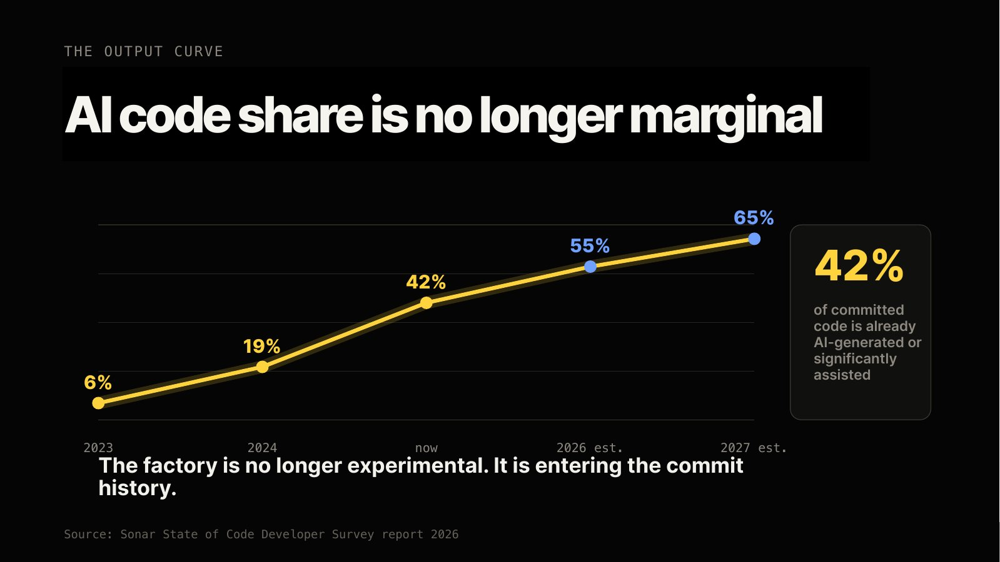

换句话说，创造正在变得廉价。更稀缺的资源是评审、验证、理解和维护。

我们把生成速度提得比控制速度快。于是我们有了一个信任—验证缺口。我们交谈过的很多人仍然对 AI 代码表达出某种程度的不信任。但似乎更少有人会把这种不信任稳定地做进他们的验证流程。

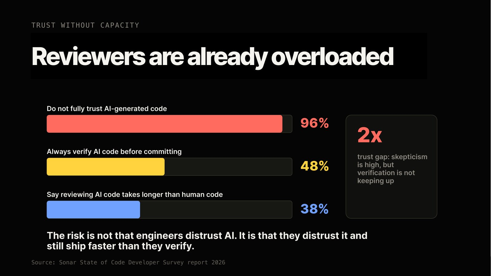

这是一个危险的处境。我们将需要更廉价、更清晰的方式来验证 AI 代码的可信度。

如果你去看 GitLab 2026 年 6 月的报告，会发现治理问题已经变了。[GitLab 2026 年 6 月的 AI 问责研究](https://ir.gitlab.com/news/news-details/2026/GitLab-Research-Reveals-Organizations-Are-Generating-AI-Code-Faster-Than-They-Can-Control-It/default.aspx)显示，评审与验证是当前使用 AI 时的瓶颈；更令人担忧的是，治理通常发生在代码创建之后——在我们已经接受了风险、失去了所有权控制之后。今天，问题不只是控制。问题是我们对系统设定了什么约束。是我们如何用证据去核查工作，以及如何让团队承担责任。是谁来拥有 AI 生命周期中的哪一部分。

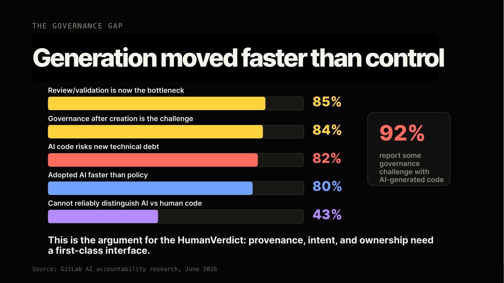

所以这一系列里最后一个区分是流程与质量之分。质量就是背压（back pressure）这个概念。我们是字面意义上这么说的。**我们并不想赋予智能体它们所能行使的全部自主性。**我们要赋予它们的自主性刚好够用——让我们有足够的背压去叫停它们、约束它们、核查它们的工作，并守住我们作为人的部分。

常规工程会举起大量信号，表明正在进行的工作方向是对的。类型检查、测试、钩子、沙箱上限、审计日志、监控。我们的工程系统里充满了这类信号，它们被设计用来提供足够的背压，让系统保持诚实。

所以，只要我们的智能体也在发出同样的信号，我们就可以信任常规工程能提供恰当的背压。

**信任我们的系统，并不意味着我们不想要人在环中。**它只是意味着，人不需要待在内层循环里。**我们要他们待在约束循环里**（我们应该设定什么样的输入、架构、指令或不变量？），**待在采样循环里**（我们应该对多少产出做采样和评审？），**待在审计循环里**（我们应该保留哪些证据，如何确保审计日志真的有效？），**以及待在所有权循环里**（生产边界中的哪一部分应该由我们拥有）。

但人不需要待在内层循环里。

智能体可以交付超出你评审能力的东西。

而稀缺资源是你自己核心的人类判断力——它由日志或测试这样的质量信号来支撑。

AI 2026 年 6 月的报告显示，在实验环境下，以小时为时间尺度的智能体化委派基本上已经到来。[OpenAI 今年关于智能体与工作未来的研究](https://openai.com/index/how-agents-are-transforming-work/)是这些想法的重要来源。所以，当我们的系统开始交付超出我们评审能力的东西时，我们需要开始思考如何建立这条所有权边界。

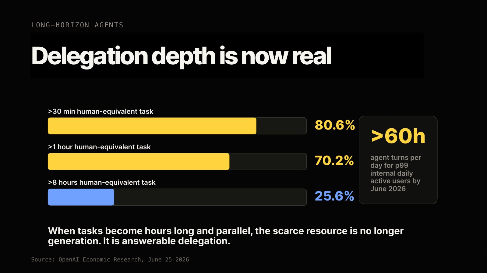

而可回答性正是在这里登场。

因为对于长时程智能体来说，在小时级时间尺度上做出的决定就是决定本身。而并非所有决定都会被记录下来。你无法把它们全部追溯回输入 token。如果你所做的只是相信你拿到的产出就是当前问题的正确选择，那么重建通向它的决策链所需的那数百甚至数千个人力小时，就变得不可能。所以，再一次地，**可回答性必须成为我们系统设计的核心**。

## 三种隐藏成本

共有三种隐藏成本：

**认知投降 ~ 盲目接受 AI 给你的东西。**当你把工作委派给智能体时，工作本身看起来像是智能体的工作。但它其实是你的工作。是你的声誉。是你的责任。是产出带有缺陷时受损的你的软件。也是需要为反映这份产出而修改的你的软件。于是智能体的产出变成了你的答案。随之而来的是全部问责。把这套东西梳理出来的[沃顿研究](https://executiveeducation.wharton.upenn.edu/thought-leadership/wharton-at-work/2026/05/thinking-fast-slow-and-artificially/)在 AI 正确时令人安心。但当它错了，消息就不妙了。当 AI 出错时，近四分之三的人仍然接受了它，并且比没有 AI 时更加自信。

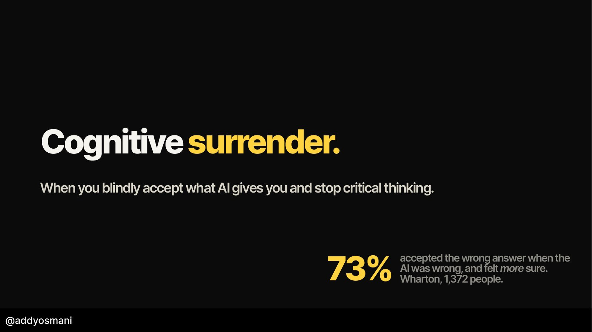

**认知债 ~ 你对如何解决问题的理解与记忆被侵蚀。**当你把工作委派给智能体时，你把全部的思考工作卸载给了它。而自己把所有事情想清楚要花时间和精力，在一个庞大代码库上把事情想清楚所需的资源，在你正努力爬学习曲线时根本不够用。所以你拿到的产出往往是你无法企及的。而智能体规划的时间跨度越长，智能体产出的代码与你对它的理解之间的差距就越大。差距会复利。债会累积。而爬学习曲线的成本几乎呈指数增长。Anthropic 有一项[随机对照试验](https://www.anthropic.com/research/AI-assistance-coding-skills)，考察那些依赖 AI 写代码的工程师，是否和亲手写代码的工程师理解得一样好。结论令人沮丧：在理解力测验中，经由 AI 工作的工程师比不使用的工程师低 17 个百分点，50% 对 67%。

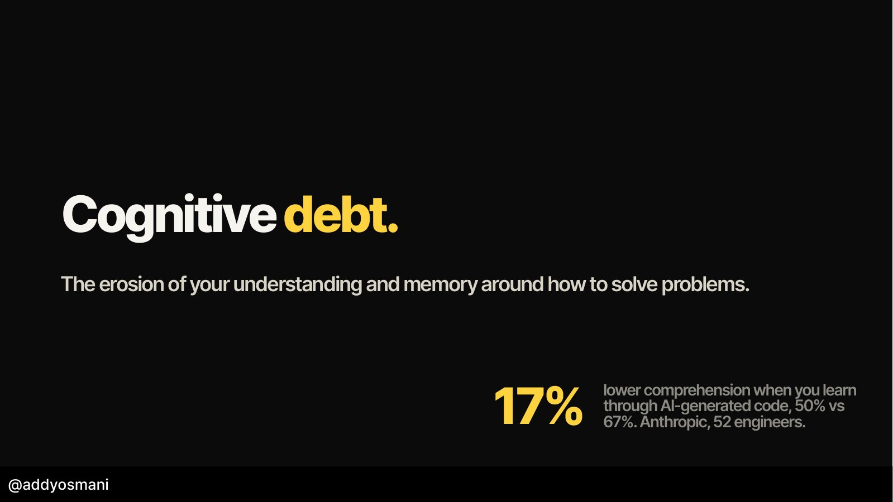

然后是**编排税 ~ 现在启动一堆智能体很容易，但你的认知带宽并不会以同样的方式并行。**把智能体从最糟的行为上引开，梳理智能体产出的工作以找出需要你注意的部分，引导它先聚焦你真正在意的工作，在放它跑起来之前验证你最重要的约束和最危险的假设……

所有这些都要花功夫，而且无法自动化。

人类判断力无可替代。

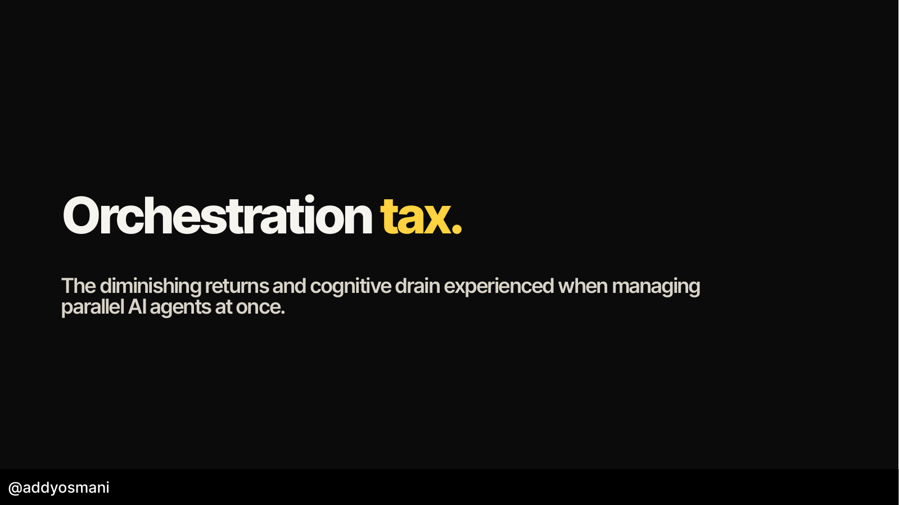

棕地系统在这里尤其危险，因为你需要审计的系统行为并不住在代码里。它住在伤疤里。

解法？把注意力作为架构决策中的优先项。用 worktree、作用域和证据，降低初始计划与由此涌现的工作之间的耦合。给解决无法行动之步骤的努力设定时间盒。并且，让软件中的变更严格成为一种需主动授予的权限。

**Alpha、衰减与品味：这是三个跨领域塑造职业生涯与表现的核心模式。**

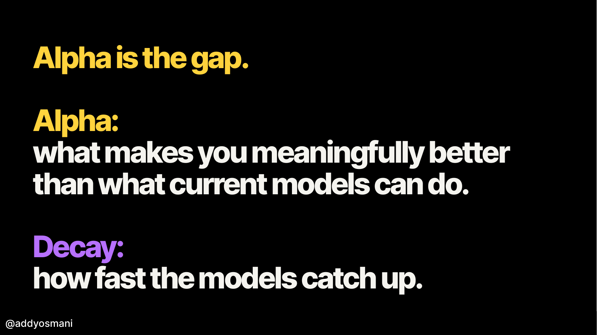

Alpha 是竞赛中最高成就者所占据的领先段位，也就是你打出最高价值的那一步棋。衰减是每个人都通过重复和观察他人而习得的既有模式（也可以叫平台期）。品味是我们能最早感知到 alpha 中的领先、或衰减中的变化的能力。它是在我们还没有任何证据表明有事发生时，对将要到来之事的判断。[Paul Graham 的观点](https://paulgraham.com/taste.html)是：当任何人都能做出任何东西时，选择做什么就更重要。而 Mitchell Hashimoto 的定义是可操作的那一个：在尚无客观指标存在的地方做出高质量的定性判断。从现在起，品味驱动一切：alpha 的转移就是品味的变化。而衰减之所以消退，是因为我们开始尝到不一样的东西。

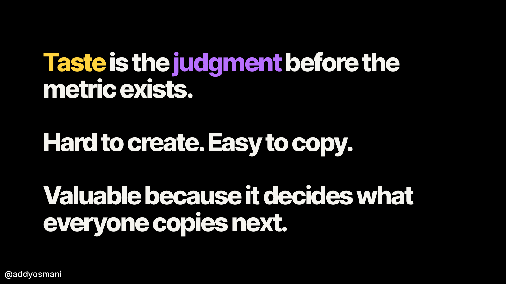

下一步？把你的品味操作化。怎么做？给它一个名字，反映出你想把什么从边缘系统搬到意识层面。在批评与范例中练习它。把它的理由讲清楚。

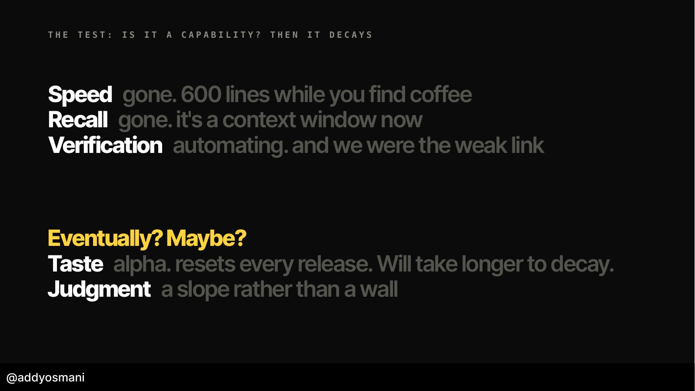

并且持续做出那个能在你所在行业带来最持久竞争优势的动作。那是什么？不断把边界往上推：从单纯完成任务，到把它教给别人、把它系统化、决定它何时该做，并拥有结果。

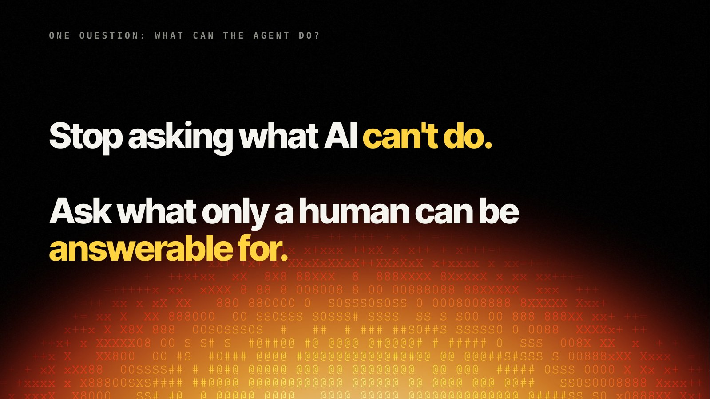

每个人都是开发者，但不是每个人都是工程师。工程是当一个开发者拥抱一种更严格的工作纪律时所变成的东西：周密且逻辑严谨的推理、对约束与权衡的考虑、对风险与暴露面的识别，以及切实的问责。

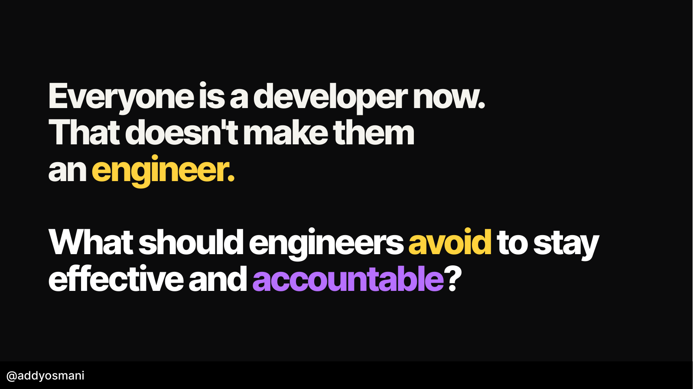

未来，人们会离开工程中的行政性工作，去拥抱随着工程要求变高而涌现的新角色。这些角色从"手艺精神"这个打包概念里解绑出来，但把每个人做什么讲得很清楚。会有人做原型。有人建造。有人清扫。有人培育。有人维护。

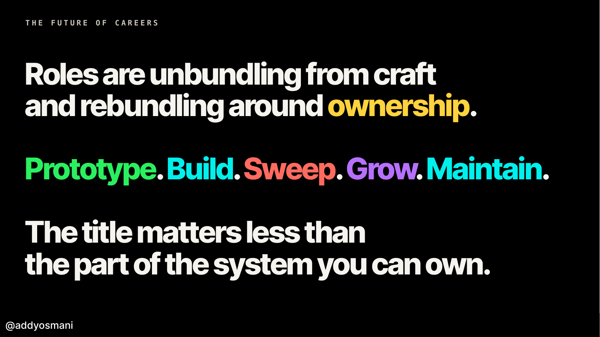

人类也从另一个方向握住系统的边缘。在另一个方向上增加 alpha：选择什么值得做、定义它应在什么约束内完成、判断证据是否足以继续、并照看结果。无论是一个团队还是一百个团队，这都是只有人类才能握住的边缘。

**问责才能让工厂规模化。**和注意力、品味一样，问责也是让一切运转起来的三个对偶之一。**没有问责，就没有规则。**没有人去跟质疑者掰扯。没有权衡。没有风险。没有安全网。如果没人拥有一个决定的后果，那么高能动性只会带来混乱。

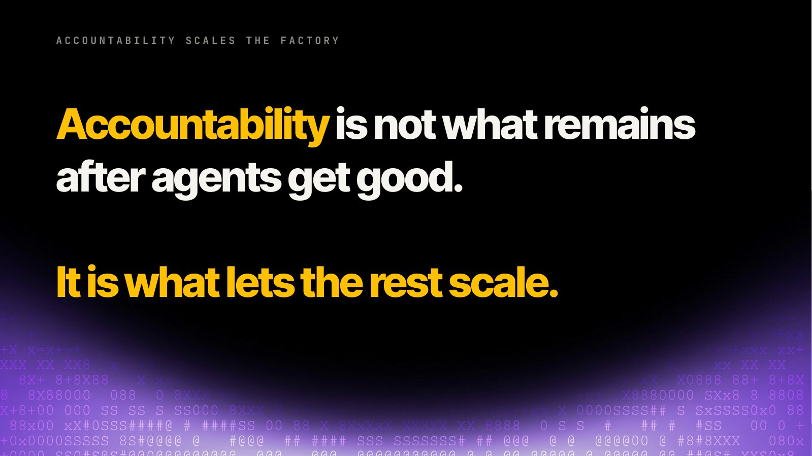

一项优势（edge）的半衰期是一个发布周期，但一个署名的半衰期是一段职业生涯。署名就是你的名字落在工作上，让你觉得自己能为交付出去的东西背书。技能给你杠杆；问责把杠杆变成信任。

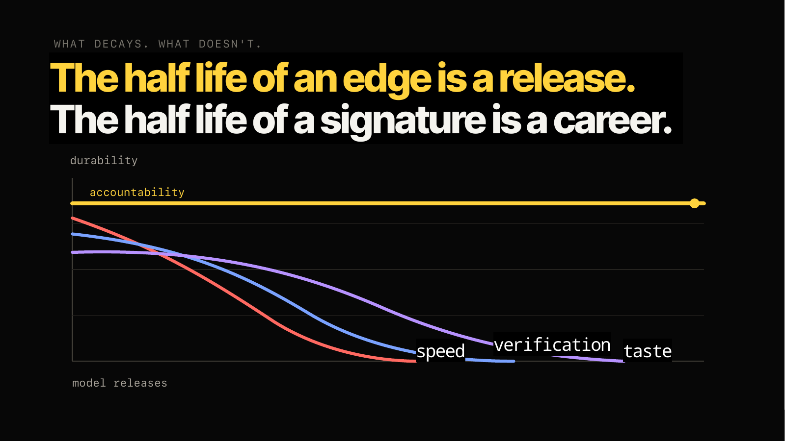

只有人能选择。只有人能继承后果。你可以要求智能体在某个策略内安全地选择、路由、合并、升级，但它们无法继承后果。

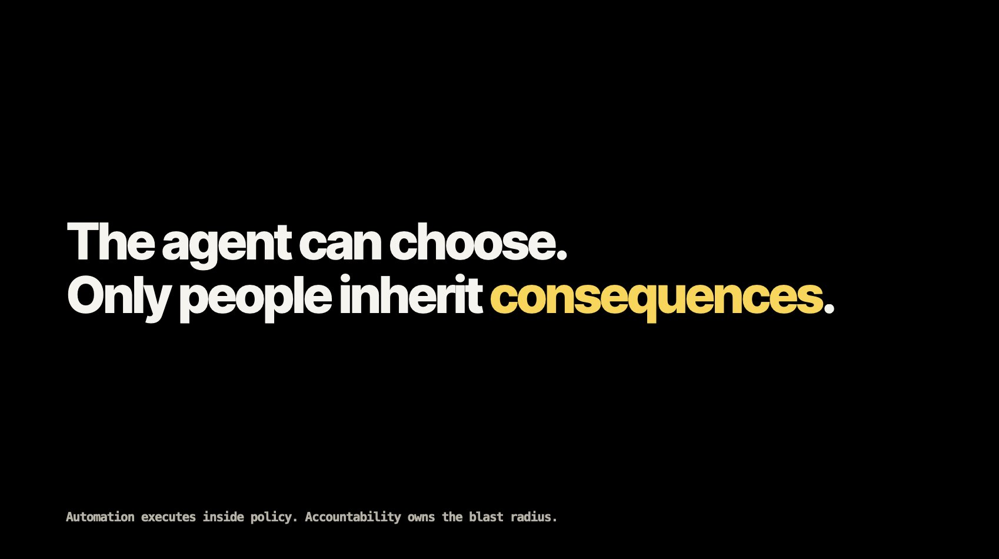

也许每个代码库都该附带某种问责契约，明确写明：接受该变更时所理解的检查清单、进入该决定的证据、谁为该变更负责，以及变更被阻断后的系统状态。就像这样：

- 你的注意力与品味
- 你的证据、裁决与所有权
- 你的 alpha、衰减与品味

## 高能动性

在一个典型的智能体化工作流里，**高能动性是一种艺术：知道何时委派、何时检查、何时停下、何时拥有一个流程的结果**。能动性的阶梯由低到高：标记一个潜在问题、调查它、对它动手执行、诊断它、提出方案、推荐修复、解决问题。能动性阶梯上很高的一级是辨别力：找到了，不值得修，继续往下走。

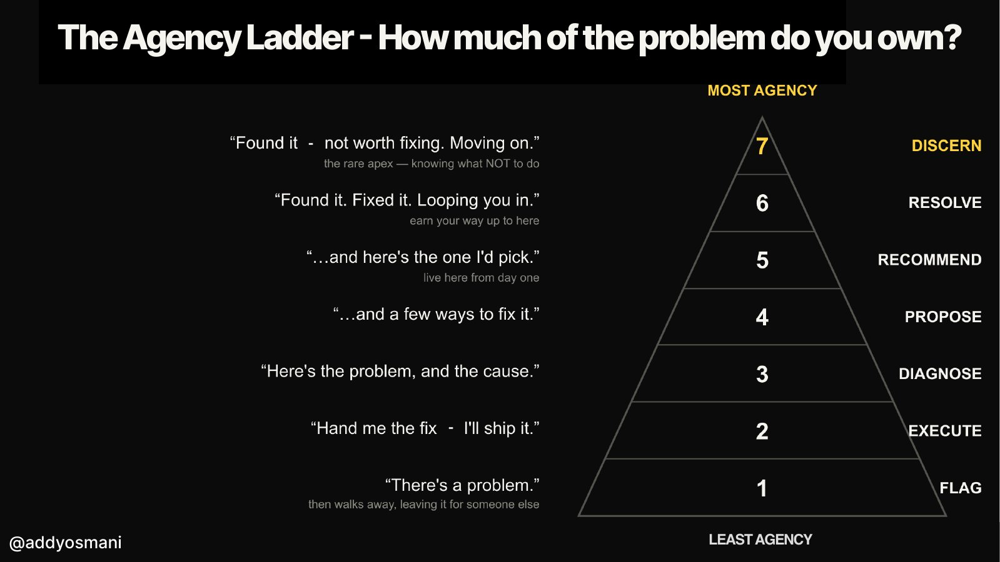

## 撑起软件工厂的十二根支柱

对于希望规模化的工厂来说，棕地才是前沿。那些聪明的小创新现在可能还感觉不算什么，但生产环境的体量很大。在构建一个全新系统时，规划和实现足够的背压机制要容易得多，因为你拥有完全的控制权。然而，当你把智能体加进一个遗留系统时，就完全是另一回事了。

遗留系统包含：生产行为的全部、客户未来的期待、迁移历史、发布与预算周期的时长、未言明的假设、边界情况、数据的怪癖、runbook 里的操作流程，以及在没有心力照料系统的情况下累积起来的所有伤疤。

要成为棕地的管家，需要一种持久工程。必须做的工作包括：把隐性知识变成显式约束，让它在团队之间、代际之间保持连贯，把那些知识形式化为测试流程和功能规格，并把知识与客观证据绑定。同时还要把失败棘轮式地转化成更多的学习。因为如果系统得不到它一贯得到的照料，一切都会崩塌。

## 新工作就是真正的工作

**随着规模扩大，工作会变得更有意思。因为当其他一切都被建好之后，人们会想要建造新东西。**他们会想要动用自己在手艺中日渐养成的 alpha 和品味，去设计可以嫁接进软件工厂的新循环。或者他们想要构建绿地系统，把软件工厂的全部知识投入到一个优雅、善意、有原则的努力中。他们会想要设计和实现新形式的证据，使其达到新系统所需的验证水平。他们会想要照料那些如今复杂到需要专门关注的棕地系统。他们会想要设计和管理新的背压机制。他们会想要设计新的智能体。而且他们会想要建造能动性。

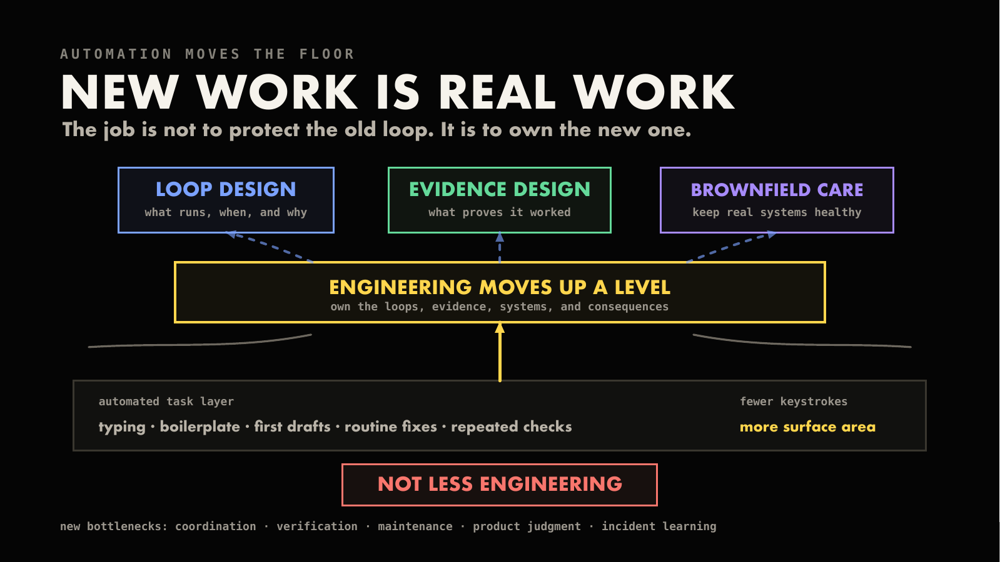

而在此过程中，他们会逐渐看到，这一切都是真正的工作。这是件好事。

自动化会制造瓶颈。是生产里值得被拥有的瓶颈。因为自动化给了我们控制工业规模的能力。但工业规模也会带来新的瓶颈。**瓶颈从"我们能不能造出这个"变成了"这东西应该存在吗，我们能为它负责吗？"**

我建议的是一套用于规模化智能体工程的实用运行模型。这里有内层循环和外层循环。内层循环是工作被完成的地方。循环被设计得尽可能独立。**把所有质量保证和验证放进循环内部。一旦你设计并验证了循环本身，你剩下要做的唯一一件事，就是通过设置一种背压机制来授予自主性——这种机制用来控制循环运转的速率和它的作用范围。并且把人放到他们该在的位置上，让他们做正确的决定。**不要把理解当成一次交接或一道发布闸门，而要把它当成一个决策点：人在那里已经准备好提供自己的洞察。然后，对于每一个存在并被反馈回生产、反馈给新团队和新工程师的产物，都给后来者留下更好的产物。

**建造工厂；让灯一直亮着；让工作可读、可验证、有人负责。**

智能体可以把它写出来。但在它到达用户之前，必须有人解释：它为什么应该存在、它为什么足够安全以致可以成为生产的一部分、以及当它出错时他们会怎么做。

那就是外层循环上的智能体工程——那就是现在的工作。

*Pangram 给这篇文章的评分是 100% 由人类撰写：[pangram.com/history/ae6caccc-b70f-4336-a019-5c3411516871](https://www.pangram.com/history/ae6caccc-b70f-4336-a019-5c3411516871)*
