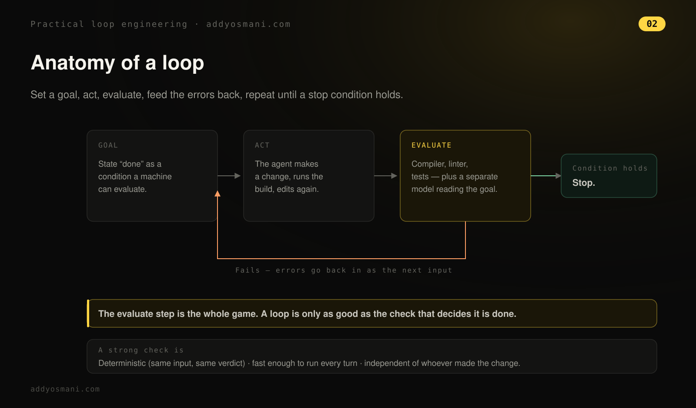
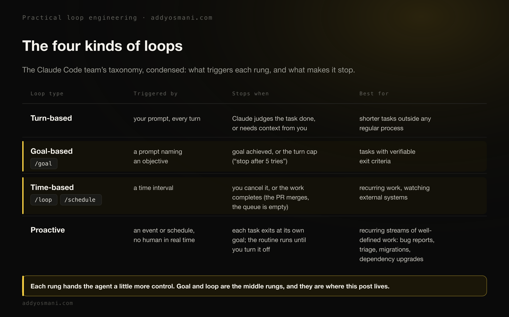
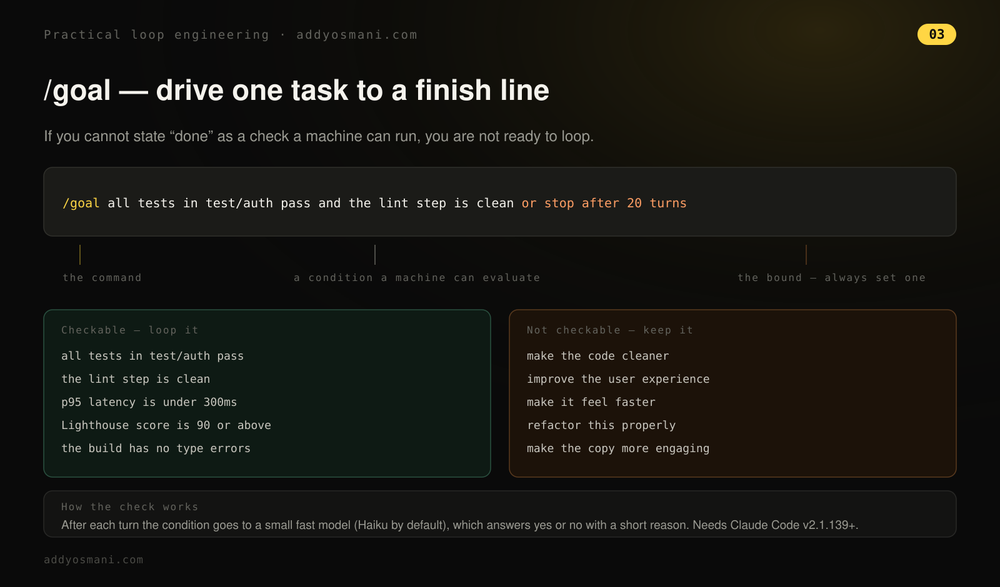
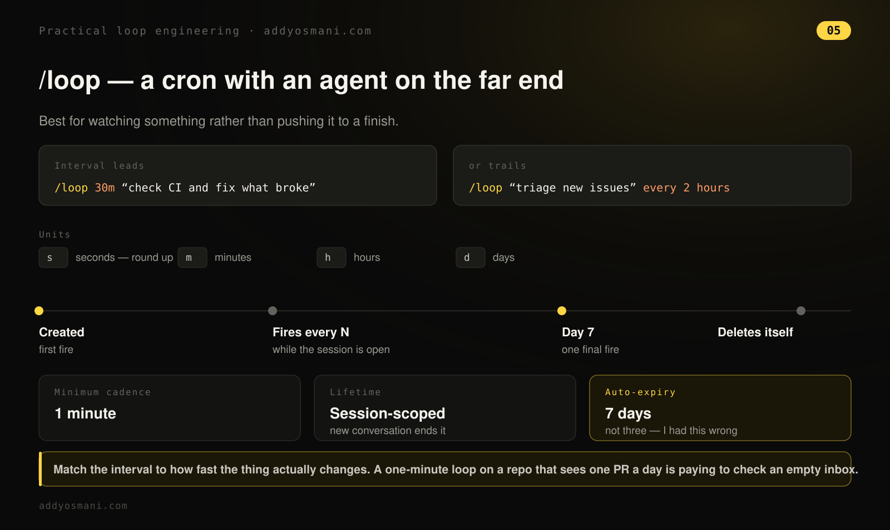
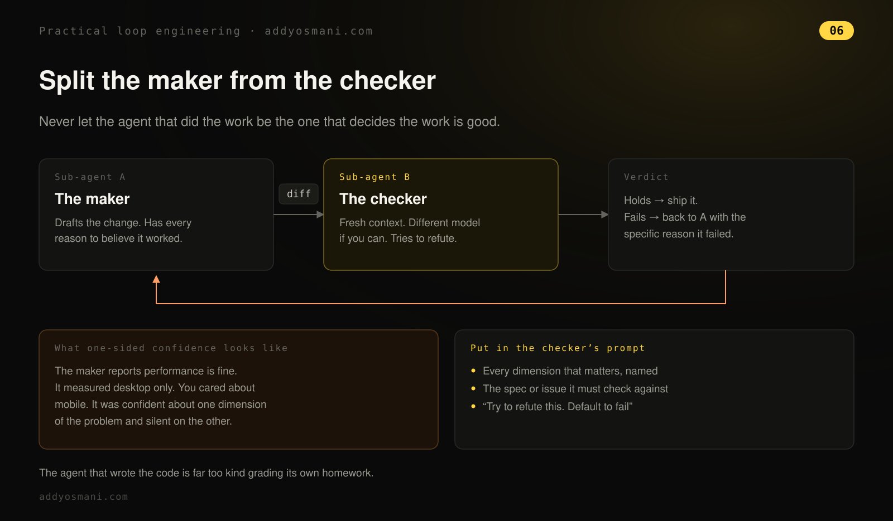
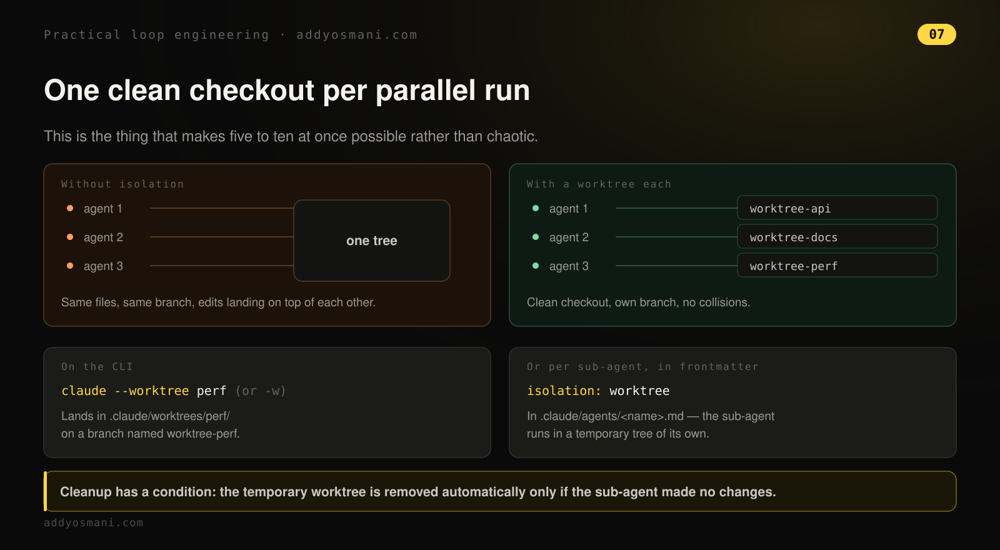
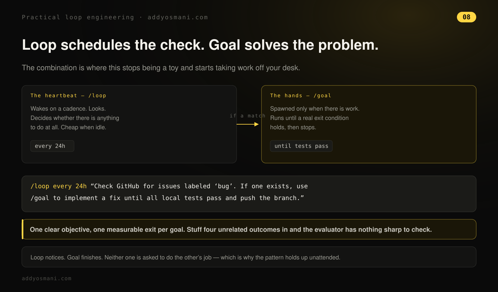
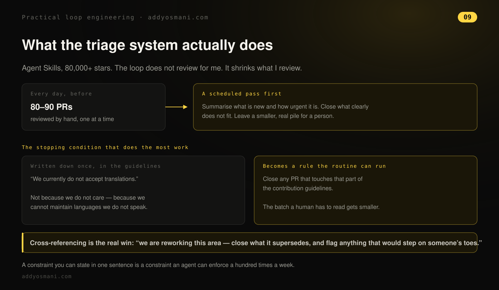
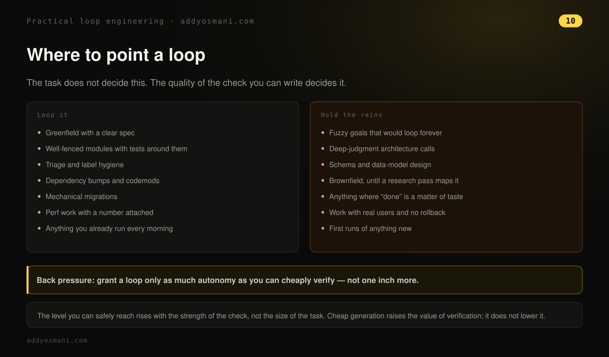
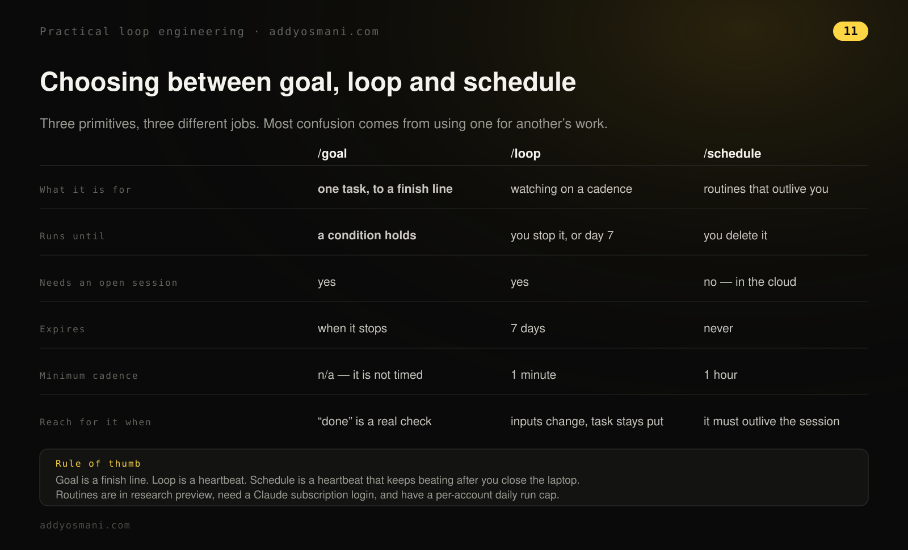

# 循环工程实战

> 原文：[Practical Loop Engineering](https://addyosmani.com/blog/practical-loop-engineering/)
>
> 发布日期：2026-08-14

---

我平时的工作方式是，同时并行跑五到十个智能体。有些任务我很乐意完全交给智能体，前提是我对停止条件和约束有非常清楚的把握。也有一些任务，我会想盯得更紧一些，亲自评审智能体在做什么。

在这个框架里，你可能听说过**循环工程**。几个月前我写过一篇长文专门讲这件事。

> 循环是一个自主的、能自我纠正的反馈周期：AI 智能体反复行动、检验结果、调整做法，直到某个具体目标达成

现在你基本只需要考虑两个核心原语。Claude Code 里有 **[goal](https://code.claude.com/docs/en/goal) 原语**，它能把一件有边界的任务不断推进，直到某个特定目标达成——就像一条可度量的终点线被跨过。而 **[loop](https://code.claude.com/docs/en/scheduled-tasks)** 会按定时器或固定间隔重跑，所以你可以用它来做类似定时变更的事。



## 在原语成为原语之前

我记得在 Claude Code 和 Codex 把这些原语内建进去之前，循环工程很大程度上就是自己搭一个 bash 循环，纯手工搓出来的东西。我当初就是这么做的。你可能还记得，今年早些时候我们中有几个人在玩 Geoff Huntley 的 [Ralph loop](https://ghuntley.com/loop/)。我们在试验、在分享各自的工作流、分享哪些行得通哪些行不通，但基本都是在自己的个人项目上——就算撞墙也没什么大代价，因为那是个人项目。

随着我们去观察哪些模式、循环工程的哪些方面现在稍微成熟了一些，我想我们对怎么照看它有了更清楚的认识。现在我大体上能依赖 Claude Code 和 Codex 里原语的输出。我们确实往前走了一点。但同时，你必须非常勤勉，因为如果你把循环工程就那么放着不管、又没有认真想过最终目标和约束是否定义清楚，它会把你留在一种很糟糕的状态里。这也是为什么，决定把它用在一个没有用户、历史包袱也没那么多的常青代码库上，还是用在比方说棕地（brownfield）的银行代码库上，是有细微差别的。

## Claude Code 团队如何定义循环

Claude Code 团队发表了他们对四种循环的看法，和我的用法基本吻合（[他们的文章](https://x.com/ClaudeDevs/article/2074208949205881033)）。在进入正题之前，先给一个我的快速总结：



> *在 Claude Code 团队，我们把循环定义为智能体重复工作周期，直到满足停止条件。我们根据以下几点区分出几种不同类型的循环：如何触发、如何停止、用到哪个 Claude Code 原语、各自最适合什么类型的任务。并非所有任务都需要复杂的循环；从最简单的方案开始，有选择地使用这些模式。*
>
> *你发出的每一条提示词都会启动一个手动循环，由你指挥每一轮。Claude 收集上下文、执行动作、检查自己的工作、必要时重复，然后回应。我们称之为智能体循环。举例来说，让 Claude 做一个点赞按钮。它读你的代码、做修改、跑测试，然后交回一个它认为能用的东西。然后你手动检查，再写下一段提示词。*

他们的文章逐级讲了每一档。

**关于基于目标的循环：**

> *有时候，单轮并不够，尤其是对更复杂的任务。智能体能够迭代时会表现得更好。你可以用 /goal 定义"完成"长什么样，来延长 Claude 持续迭代的时间。当你定义了成功标准，Claude 就不必自己判断什么算"足够好"从而提前结束循环。每次 Claude 想停下来，一个评估模型会检查你的条件，把它送回工作，直到目标达成或达到你设定的轮数上限。这就是为什么确定性标准如此有效，比如通过的测试数量、或达到某个分数阈值。例如：/goal get the homepage Lighthouse score to 90 or above, stop after 5 tries.*

**关于基于时间的循环：**

> *有些智能体化的工作是重复性的：任务不变，只有输入在变。比如每天早上总结 Slack 消息。还有些工作依赖外部系统，而与外部系统打交道的一个简单办法就是按间隔检查它、对变化做出反应。比如一个可能收到代码评审或 CI 失败的 PR。对这类情况，你可以用 /loop 触发 Claude 运行，它按间隔重跑一段提示词。例如：/loop 5m check my PR, address review comments, and fix failing CI。/loop 运行在你自己的电脑上，所以关机它就停了。你可以用 [/schedule](https://code.claude.com/docs/en/routines) 创建例程，把循环搬到云端。*

**至于主动式循环，也就是最高一档：**

> *触发方式：由事件或时间表触发，过程中没有真人实时参与。停止标准：每个任务在目标达成时退出，而例程本身一直运行到你关掉它。最适合：重复出现的、定义清晰的工作流：bug 报告、issue 分类、迁移、依赖升级。用量管理方式：把例程路由到更小更快的模型，把最强的模型留给需要判断力的环节。*

他们关于验证的建议值得整段照搬，因为它把人工检查变成了 Claude 自己会执行的东西：

```text
---
name: verify-frontend-change
description: Verify any UI change end-to-end before declaring it done.
---
# Verifying frontend changes
Never report a UI change as complete based on a successful edit alone.
Verify it the way a human reviewer would:
1. Start the dev server and open the edited page in the browser.
2. Interact with the change directly. For a new control (button, input,
   toggle): click it, confirm the expected state change, and screenshot
   before/after.
3. Check the browser console: zero new errors or warnings.
4. Use the Chrome Devtools MCP, run a performance trace and audit
   Core Web Vitals.
If any step fails, fix the issue and rerun from step 1 - do not hand
back partially verified work.
```

## 目标（Goal）

我用 goal 的方式，是拿它把某件具体工作做到可证明完成。比如你可以用 goal 说：确保这个体验在五秒内加载完，一直做到达成为止。它会持续使用一个独立的评估检查，不断确认完成标准是否满足。更好的做法是把用的是什么工具讲得更具体。

至于我真的跑到数字结果的目标，有几件事我做过。我用 goal 处理过 GitHub issue：评审并关闭最近 10 个 issue，或者评审并推进最近 10 个 issue，诸如此类。这种事有点半开放，对吧？或者：让这个页面加载快 50%。有时效果不错，有时不行，但关键就是多试。



## 循环（Loop）

loop 更像一个调度器，它盯着某样东西，或者按某种节奏重复执行一个模式。所以可以把它想得有点像 cron。它最适合做轮询日志、监控外部状态这类事。你也可以用它来做定期查看。如果你发现自己按某种节奏在重复做某些任务，loop 挺适合的。



## 我委托什么，我盯什么

对我来说，我大概每天用五到十个智能体，通常并发最多也就五个左右。其中有些任务可能相对安全一些。比如：嘿，我实现了这个功能，你去给它写文档。或者去复查我们的测试覆盖率够不够。诸如此类。如果我在处理更复杂的问题，或者是我知道即使给了不错的规格——至少我认为是不错的规格——也给了停止条件，它仍有相当大的概率没法全做对，那我就会盯得更紧。如果任务涉及任何稍微敏感的东西，不管是给了它某个系统的访问权限，还是这个功能恰好牵涉认证，或者和安全、财务相关，我一定会紧紧盯着。

总的来说，我确实认为我们会走到这样一个地方：只要人们有清楚的验证方式，能确认目标或停止条件已经满足，大家就会越来越习惯委托。但你还是得亲自看一眼代码，看一眼生成出来的东西，确认它达到了你的标准。

另一个重要的习惯是：不要让干活的智能体自己判定活干得好。一个子智能体起草改动，另一个独立的子智能体来验证。

有时候智能体会对某件事很有把握，而负责验证的智能体能抓到它原本没预料到的问题。比如它认为自己做出来的体验基线性能没问题，但它只基于桌面端评估性能，而你真正关心的是移动端的体验。这可能意味着智能体对问题的一个维度非常自信，却漏掉了另一个维度。



这一课我是吃了苦头才学会的。我很好奇想知道：有没有什么是我们漏掉的、还没从用户那里得到直接反馈的东西——不管是在 issue 跟踪器里还是某条评论里？于是我让它去看看我们的一些竞品，整理一份清单，再在本地备好一些 PR（不推送），看看解决其中一些差距大概会是什么样。我差点就把其中一些改动推上去了。但我其实没有足够仔细地看它们。我读了它的调研，却没足够仔细地看实现。所以我委托了任务，但差一点连判断也一起委托出去了。后来我真的去看这些改动时，才意识到它会给我们的用户带来大量额外的复杂度，而在我看来收益并不大。所以我觉得你有时得提醒自己：不要把品味和判断也委托给智能体。你委托的是任务，然后你要回头检查它有没有达到你的标准。

顺便说一句，藏在 goal 背后的那个评估器并不是那个检查者。它根本不会去看内容好不好。它只做一件事：检查对话记录，看你指定的硬性规则是否被满足。

```text
/goal Refactor the data-fetching layer in Dashboard.tsx until Lighthouse performance score is >= 92 and LCP is under 1.8s as shown by the Lighthouse CLI output. Do not change the public API of any hooks. Each turn must improve at least one reported metric; abort if two consecutive turns show no improvement. Stop after 10 turns.
```

## 我每天跑的工作流

我每天会做的工作流之一：我有一个很受欢迎的开源仓库叫 [Agent Skills](https://github.com/addyosmani/agent-skills)。它有八万多颗星，直到不久之前，我们每天最多要评审八九十来个 PR。所以每天我都会花点时间检查这件事。现在有了 loop，你可以直接说：每 24 小时或每 12 小时检查一次这个 GitHub 仓库有没有新的未关闭 issue，给出一份紧急程度摘要，或者做一轮初审，诸如此类。

```text
/loop every 1h "Check the GitHub repository for any new open issues. Provide a bulleted summary of their urgency."
```



## 把循环和目标组合起来

你也可以把 loop 和 goal 组合起来。用 loop 来定时检查，用 goal 来解决问题。所以你可以这么说：每 24 小时循环一次，检查 GitHub 上标记为 bug 的 issue。如果有，就用 goal 实现修复，直到所有本地测试通过，然后推送分支。

```text
/loop every 24h "Check GitHub for issues labeled 'bug'. If one exists, use /goal to implement a fix until all local tests pass and push the branch."
```

但也别忘了，goal 在"你能往里塞多少东西"这件事上是有局限的。



他们的文章里还有一个组合示例，展示了这一切要通向哪里：

> *上面这些原语，加上 Claude Code 的其他特性，比如 [auto mode](https://code.claude.com/docs/en/auto-mode-config) 和动态工作流（研究预览版），可以组合成一个用于长时间运行任务的循环。比如，要处理源源不断的反馈，你可以用：/schedule（研究预览版）运行一个检查新报告的例程；/goal 定义"完成"长什么样；技能来记录如何验证。[动态工作流](https://code.claude.com/docs/en/workflows) 来编排智能体，逐个分类每份报告、修复它、并评审修复。Auto mode 让例程中途不停下来请求许可。把这一切拼起来，提示词可以长这样：/schedule every hour: check the project-feedback channel for bug reports. /goal: don't stop until every report found this run is triaged, actioned, and responded to. When fixing a bug, use a workflow to explore three solutions in parallel worktrees and have a judge adversarially review them.*

## 这套分类系统实际做了什么

在 PR 分类这件事上，当 loop 和 goal 一起为我工作时，我最终得到的是一个能让我持续接收 PR 和 issue 的系统，既能跟得上每天涌到我面前的量，尤其是还能做交叉引用。这对我来说是件大事。如果我想推进某个特定目标，比如：我们要重做系统的这一部分，我需要确保任何牵扯到它的 issue 都因为这次重做而关闭，或者确保我们没踩到别人的脚，我就可以把这些都定义清楚。

定时任务非常有用，可以定期只做评审新 PR、关闭明显不符合要求的提交这类事。一个好的停止条件例子：我们有一套贡献指南，指南里写着，嘿，我们目前不接受翻译。



这并不是我们不在乎，而是这些翻译对我们来说太难维护，因为进来的语言我们并不都会说。所以如果我们告诉它：关闭任何触及贡献指南这一条的 issue 或 PR，那么放在那个定时计划里，它就能做得非常好。这样一来，我们整体需要评审的量就减少了。



## 循环买不到什么

经常有人问我循环工程不适合什么。一般来说，如果你不清楚"终态/完成/好"分别意味着什么，它可能就不是适合你工作的模式。比如，一个含糊的目标会是"一直做到这个 UI 设计变好为止"。这什么意思？对谁好？怎么评估？需要人的品味、主观设计或开放式创意探索的任务都不适合。当你对目标有相当清楚的想法时，我认为循环是一个值得考虑的选项。

## 细则

循环原地打转的一个典型信号是：同一条命令被反复尝试，结果却毫无变化。如果第三次给出同一条命令、结果和第二次没区别，那大概就该停了。

有一条细则值得知道。重复运行的循环在创建后七天过期。我之前一直跟人说这是三天。是七天。而且循环是会话作用域的，所以你开新对话它们就停了——不过用 –resume 或 –continue 恢复那个会话，仍在七天窗口内的重复任务会回来。如果你需要活过会话的东西，/schedule 会在云端运行它。

如果你已经有一个每天早上手动跑的检查，那就是你的第一个循环。我的是那一堆 PR。



本文最初发表在我的 [Substack](https://addyo.substack.com/p/practical-loop-engineering) 上。
