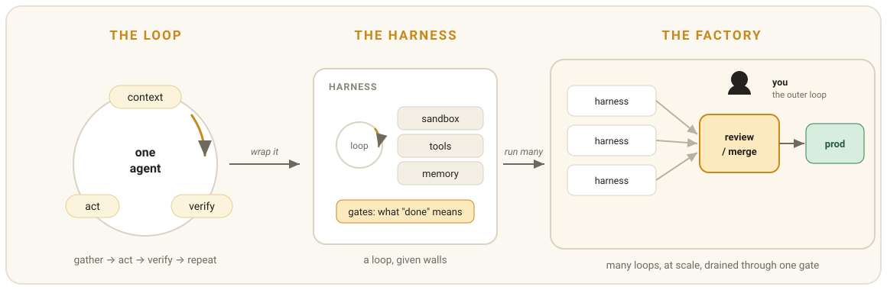
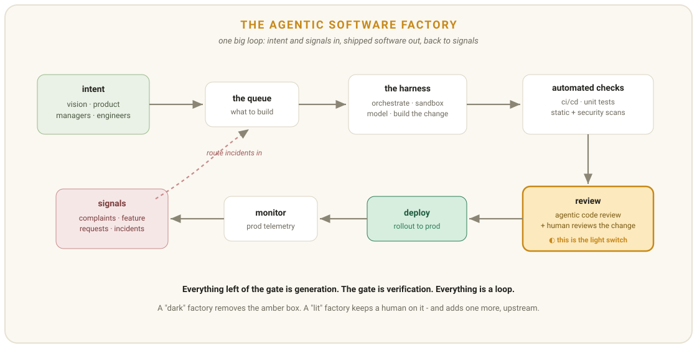
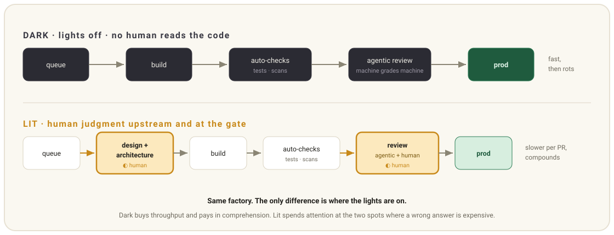
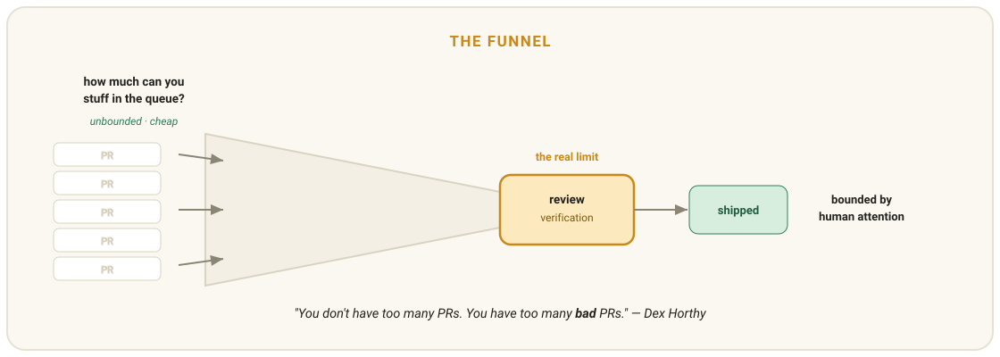

# 软件工厂：明与暗

> 原文：[Software Factories, Light and Dark](https://addyosmani.com/blog/software-factories/)
>
> 发布日期：2026-07-20

---

**软件工厂是在规模上驾驭循环。你可以让循环里有人（亮厂）：用判断力和专注换取速度和破碎。你也可以忽略人（暗厂），让那些智能体去划定范围、构建、交付代码，而没有谁真正读过细节。但如果人们不再阅读，他们就会不再理解你的软件。你现在最难的活，是搞清楚该建哪些检查，以及该委托多少自主性。**

---

软件工厂这个说法，可以追溯到 [Bob Bemer](https://en.wikipedia.org/wiki/R._W._Bemer) 1968 年的论文《程序生产的经济学》。半个世纪以来，很多人梦想过这样一个世界：软件是一个可重复、可度量的生产过程（类似于在工厂里冲压汽车零件），而不是个体的孤立手艺。从历史上看，这个梦想大体上（尽管并非普遍）落空了，部分原因在于"把想法冲压成型"实在太难。

但在过去两年里，情况变化得足够剧烈，现在重新审视这个旧梦想是有意义的。而且因为有些微妙之处很容易被含糊带过，所以值得稍微精确一点：到底什么是真正新且不同的，什么可能只是老陷阱打扮成了新机会。

HumanLayer 的联合创始人 Dex Horthy 最近在 AI Engineer World's Fair 上做了一场很棒的演讲，题为[**"Harness Engineering is not Enough: Why Software Factories Fail."**](https://youtu.be/htM02KMNZnk?t=27219)，就这个话题很值得一看。

## 循环是原子，工厂是规模化的循环

结构就是一切，而一切都从小单位开始。整个栈其实就是三个层层叠加的概念：循环、harness、工厂。

**循环是一个智能体重复做一件单一的事：收集上下文、执行动作、检查结果、再来一遍，直到某个条件满足。它是智能体化工作的最小单位，它之上的一切只是循环叠着循环。**

[循环工程](https://addyosmani.com/blog/loop-engineering/)的要点在于：你不再一轮一轮地提示智能体，而是去设计那个替你提示它的小系统。

**harness（承载框架）是循环四周的墙：它运行的沙盒、它能触达的工具、它能跨运行存活的记忆，以及决定什么算"完成"的那些闸门。循环是行为，harness 是行为运行其中的环境。**

把一个裸模型交出去、不给 harness，它会乐呵呵地永远转下去。harness 就是它周围所有让它跑起来有用又安全的东西。

**软件工厂是许多带着 harness 的循环同时运行，由一个工作队列喂入，再通过一道评审闸门排入生产，而人从上方拥有整个东西。它不是更大的智能体；它是一张用循环组成的组织架构图。**

最后的范式转变，是从写代码转向构建并运行那个写代码的[工厂](https://addyosmani.com/blog/factory-model/)。工作单位上移了一层，变成循环、harness 以及它们之间的流转，而不是单个代码 diff。

*循环 → harness → 工厂。工厂不是更聪明的智能体；它是许多带着 harness 的循环汇聚到一道评审闸门，由人拥有外层循环。*

## 把工厂画出来

Dex 花时间最多的那张核心幻灯片很精彩，因为它是一张理清思路的接线图，把本来显而易见的一个循环可视化了出来。这是我对它的解读：

*工厂是一个闭环：意图与生产信号汇入队列，harness 负责构建，自动化检查与评审把关，部署负责交付，监控把生产环境变回信号。*

意图从工程管理层的愿景、也直接从工程师那里流出，进入一个待办事项队列。由事故和用户请求驱动的信号也在推动同一个队列。harness 不过是从队列里取出一项、为它构建一个改动的东西。harness 之外，是我们为了让改动足够安全、可以进入生产所需要的全部自动化检查。这些自动化检查同时运行，毫不费力，工程师无需有意识地参与——靠的是 CI、测试、静态分析和各类扫描。这里唯一的决策点是评审闸门。批准之后，改动被部署并在生产中监控，监控数据又回流成最初让循环转起来的那些信号。

总的来说，这张图里每个方框的成本几乎为零：生成、测试、扫描。它们都能以可忽略的成本规模化运行。只有一个昂贵的方框顽固地抗拒规模化，那就是评审闸门。那个闪亮的琥珀色方框是"判断力"，也是"我们能否让开发更快、更频繁"这场争论的症结所在。

## 为什么叫它"暗厂"

**暗厂是在物理上关着灯运行的，因为车间里只有机器，而机器不需要光也能"看"。暗软件工厂是同一个动作：交付出去的代码没有任何人读过，只由其他机器验证。**

这个意象借自制造业。它的源头是物理的而非数字的，扎根于那些关掉灯、由机器人完成工作的厂房。[日本的 FANUC 从 2001 年起就在运行这类熄灯工厂](https://en.wikipedia.org/wiki/Lights_out_(manufacturing))；小米在 2024 年也开了一家高度自动化的自家暗厂。它们的共同点是：产品被组装、交付，而没有一个人读过它的任何部分。"暗"是在"阅读"这个动作被从流程中移除时出现的。

我借这个概念不是为了它的调性，也不是当作贬义。尽管它听起来够瘆人，"暗"在这里只是一个朴素的物理陈述：原来的车间，但没有灯。在软件里，车间就是 diff。写 diff 的人、评审 diff 的人、交付 diff 的人，这些人都消失了，剩下的只是一个只被构建它的机器验证过的 diff。

这件事出奇地容易做，至少一开始是这样。容易，是因为那个缺失的评审步骤会阻碍一切。它的缺席会让你对团队纵向吞吐量的感知突然、剧烈地变高。感觉像是你突破了音障。尽管看起来如此轻松，带着那些被埋起来的成本，要在这些暗色工作流里活下来，比看上去难得多。

## 光有 harness 工程还不够

随着模型与世界、与彼此交互，编排、沙盒原型、工具调用这套 harness 会越来越强大、越来越有效。然而，想要在长周期里、在持续叠加的改动中跟住代码库质量，模型内部存在一种固有的失效，我认为有充分理由相信，仅靠模型最终会在与[理解债](https://addyosmani.com/blog/comprehension-debt/)的这场仗里输掉。

**理解债是"存在的代码量"与"人类仍然理解的部分"之间不断扩大的落差。暗厂不会偿还它；暗厂以最快速度把它背在身上，而全程测试都是绿的。**

这是一个重要的区别，因为模型在某些任务上确实做得不错。但对任何不属于"对代码库一小块做即时改动"的事情，尤其是在复杂的棕地系统里，纯模型的自动化编码会面对一个无法逾越的障碍。周末玩具和副项目是相似的：几个月的开发周期通常就够把事情做到能跑，至少也差不多。但一个已经开发了十年以上的企业系统是另一头野兽；它必须在专业环境里、以专业节奏被维护。一个项目进行到三到六个月，你就已经淹没在没读过的代码里了。那种环境，尤其是生产代码强加的约束，会让即使很强大的智能体也表现糟糕——而这与做周末玩具的开发者享受的 vibe coding 形成鲜明对比。

Dex 根据经验报告说这是一次重大失败，严重到需要费尽力气手动调试才能定位。它来自把一座全自动代码工厂跑了大约四个月，期间没有任何人看过写出来的代码。这段经历的底层，是两个相互冲突的指标之间的取舍。一个是最大化 token 利用率，也就是我们目前当作"进展"的那个数字。另一个是任何人类参与者在任一时刻仍然理解的系统占比，而它正在悄悄最小化后者。

暗厂真正发光的地方，是它在测试始终保持绿色的同时烧穿一片片洁净代码的能力。最终的清算到来时，不会是一个戏剧性的"一切崩盘"时刻。它会是安静的、迟到的。

*暗厂和亮厂是同一条流水线，只是灯放在了不同位置。亮厂版本不只是把评审加回末端——它还把人的判断力上移到设计和架构阶段。*

## 瓶颈从来不在生成

软件工厂的根本约束不是我们能吐出多少代码，而是我们能多快验证它。

**背压是一条规则：你只能给一个循环你能廉价且可靠地验证的那么多自主性，一英寸都不能多。工厂真正的约束是验证，而不是生成。**

因为无界的生成能力与有限、无法规模化的人的注意力处于永恒的张力之中，核心问题就是廉价的生成与有边界的评审之间的落差。看看那个漏斗：只要代表验证的那个瓶颈不拓宽，它就会堵上。正如 Dex 指出的，问题不在量本身：我们真正受困于的，是坏 PR 的过剩。当你有高流量却没有可信的闸门时，制造出来的缺陷是不可避免的。这又回到了背压：自主性无法扩张到超出能被廉价且可靠验证的范围。

二阶问题解释了为什么改进模型不会自动弥合"它能生成什么"与"能被验证什么"之间的落差。在架构良好的系统上训练，可以说比通过简单测试更难：记住，衡量架构卓越度的代价函数不是以秒甚至分钟计，而是以月和年计。干净的梯度在功能上无法计算，所以一个期待对复杂设计决策做出干脆、即时评估的系统，是不可能靠好样本训练出来的。

*生成是宽大的漏斗口，验证是狭窄的瓶颈。让口子更快，只会让瓶颈处的堆积更深。*

## 把灯重新打开

**亮厂是同一条流水线，只是在判断力所在的地方留着灯。智能体仍然承担大部分构建工作，但在交付之前有人读过产出，并且在任何一次误判代价高昂的地方，灯都亮着。**

亮厂版本不是把评审钉在末端，而是把人的判断点向上游移动——在智能体开始一个循环之前，移到产品、设计和架构上。

前期那一小时的一个好处是，它能让实现阶段的小时数变少。它把一场漫长、令人沮丧的代码评审，变成快速读一份两百行的计划。你得以在决策被实现之前评审它，这样后面就不必在两千行生成代码里翻找"这个决策到底是什么"。有些决策足够昂贵、足够长寿，你会希望有人在早期就参与进来，趁成本还没复利。当然，即使你在前期花了时间，仍然会有需要看 diff 的时候。

你可能会觉得这一切听起来不怎么光鲜。你说得对。这张安全网由一些再普通不过的架构实践织成——这些实践我们一直知道，也基本一直忽略：好的类型和方法签名，让错误在编译器而不是生产环境里被抓住；测试接缝，让我们能钉住行为、让改动可观测；把代码排布好，让下一个读者——无论是人还是模型——知道去哪里找到他关心的东西；让调用栈短而易读；把组件边界定义清楚，让一个改动不至于有巨大的影响半径；以及依赖注入，让我们能把一块换成另一块。这些都不新。我们一直说我们在乎好的架构。但现在我们开始用自动化编码智能体了，这套架构终于开始干第二份工作：作为一张廉价且难以伪造的安全网，接住智能体会犯的错。

这张安全网必须活在模型之外，因为模型不会提供它。那些感觉最有能力的编码智能体——Claude Code 和 Codex 也在其中——是围绕自己的 harness 和工具做强化训练的：对行业里所有工具和惯用法都很流利，但对长期可维护性这类东西并不流利。我们一直挂在嘴边的"刻意设计的架构"，正是接住这笔债的工具，而我们对它的投入，就是在赎回我们自己的自主性。把它和安全的基础设施放在一起，就会有一些紧凑、低风险的循环可以无人值守地运行。Horthy 在最近一篇文章里描述过其中一个：一个每晚跑的 GitHub Actions cron，只修一个反模式——一个 lint 违规，或一个没必要做成可选的 prop——然后提交，开一个小 PR，全靠它自己完成，于是团队醒来时看到一个稍微好一点的代码库，和一个短到能读完的 diff。但对于赌注足够高的循环，你不会想冒着醒来发现认证系统、计费引擎或公开 API 契约已经坏掉的风险。那些地方把灯留着，相信一个有判断力、并且真正了解这个系统如何运作的人，会抓住那个错误。

## 什么样的循环配得上熄灯

无论你把它叫作背压、验证还是电灯开关，这条规则都适用。

只有当一个循环的检查足够廉价、能高频运行、并且依赖某种不容易被糊弄的东西时，它才配得上全自动的地位。红绿判定器、类型闸门、性质测试，以及一个配了真实评分准则的评审智能体，都算合格。你还需要这个判定器能立刻回答，并且不随时间漂移。当"完成"不只能由你证明、还能由机器证明时，你就抵达了自动化。

短循环比长循环更容易验证。[Dex 的经验法则](https://github.com/humanlayer/12-factor-agents/blob/main/content/factor-10-small-focused-agents.md)：一个智能体能撑住三到十步，超过二十步就开始丢线索。原因是上下文累积——智能体拖的东西越多，越容易走丢。循环短的时候，验证它很便宜。臃肿铺开的循环会把错误藏在角落里，这换个说法就是：它们从来就没配得上熄灯待遇。

留着灯是相反的情形。如果一个错误答案代价高昂、而且只有人才能抓住，那这个循环就需要被评审。测试抓不到的隐蔽生产 bug、巨大的影响半径、以及会塑造一年以上工作的决策，都符合条件。在这些情况下，[人的判断力并未离开软件](https://addyosmani.com/blog/human-judgment-doesnt-leave-the-software/)；你的注意力正是那个昂贵而关键的部分。

危险在于忘了逐个拨动开关，而是把它们全部设成同一种模式。全暗，你四个月后就得把一切拆掉重来。全亮，没人能按时完成评审，你卡在一个巨大的瓶颈里。真正困难、需要手艺的活，是决定每个开关放在哪里。

## 循环、图，还是状态机？

当你把一个任务交给智能体时，你很可能要在它周围搭一张图，不管你把这张图叫作有限状态机，还是一组按条件连接的服务调用。这是一种框定方式：软件不只是遵循某些抽象规则，而是一个结构化的工作流——每个节点是一个显式步骤，节点之间的每条边是一个显式条件。听起来结构很多，但其中大部分在任何软件里本来就存在，因为任何代码都可以表达成控制流图。所以唯一真正的新意在于：一个坚持自主的智能体，实际上只是在某张特定的图里四处游走，它的自由被约束在节点内部。而这里有个人们会忘掉的部分，[Dex 一年前写过](https://github.com/humanlayer/12-factor-agents)：软件本来就会长成那个结构。我们过去把程序画成流程图是有原因的。真正的新动作，是试图把那张图扔掉，改用一个循环来依赖模型逐个工具调用地择路，直到它宣布自己做完。那感觉像是解放，直到它撞上一个十年前的代码库；而大家现在重新发现的这门纪律——自己掌控控制流——其实只是把图沿着循环又走回来了。所以"我们是否该从循环回到图"这个问题，几乎就是在承认：我们一直都需要那张流程图。

实践里长这样。拿一个要修的 bug 来说。作为纯循环，你坐下来想：搞清楚哪里不对，改点代码，跑测试，看结果，如果这一轮没把这次运行搞死，就绕回去再来一遍。整段旅程是边走边决定的：追哪个问题、具体改哪行代码、跑哪些测试、以什么顺序跑、到底跑不跑测试、以及是重试还是宣布胜利。作为图，你第一件事是把"应该发生什么"画出来。复现 bug 或者去要更多信息，定位原因，尝试修复，跑测试，让失败的那次运行回到修复节点，而通过的那次进入评审，只有批准才到"完成"。智能体在每个方框里依然聪明；它只是不能走出你批准过的路径。Santi 用一张图把这个差别讲得很清楚。

当然，这张图真正的吸引力在于：它就是被画成图表的背压。你放弃智能体的一部分自由，换来强制检查和可读的失败点，于是一次运行死掉时，你能指出是哪个节点杀了它。这与 Dex 那句直白的话背后是同一种直觉：大多数所谓的智能体其实一点也不智能体化，"大部分是确定性代码，只在恰到好处的地方撒上几处 LLM 步骤"。而这也不只是人们当下碰巧这么构建的产物：你可以在 LangGraph 和 LlamaIndex Workflows 里看到这个模式，在 Jerry Liu 提出的"工作流图包在智能体之上"的混合方案里（外层循环在运行时长出图的部分），也在 David Khourshid 的提醒里——这其实就是状态机和 actor 模型换了身新衣服又出现了。

澄清一点，因为这个术语被严重重载了：我反复说"图"，指的不是知识图谱。我指的是一张预定义的、描述工作该如何流动的有向图，包含条件边等等，给循环一个你真正能信任的形状。

## 人到底去了哪里

注意，人从未离开工厂。他们只是挪了位置。

我认为工程师需要越来越多地拥有[外层循环](https://addyosmani.com/blog/own-the-outer-loop/)。智能体可以去调查一个 bug、写出诊断、实施修复、跑测试、写一份报告。这是内层循环的执行，它们能做得和任何人一样高效。但那从来就不是这份工作的全部。你拥有的部分是我想称之为外层循环的东西：判断这是不是解决问题的正确方式、验证诊断和实现是否站得住、批准改动，并承担判断错误的后果。两个循环之间的边界是证据——diff、测试、日志，以及一段把它们串起来的简短说明。类型、接缝和评分准则，让监督这一切成为可能，而不必为每个改动都花大力气。

我觉得这样讲有用：你不再蹲在产线上写改动；你站在产线末端，设计产线、守着闸门。你可以做很多事让模型更好、让 harness 更有能力，但我观察到，识别那些长期来看代价高昂的问题，通常不是能被自动化掉的事。仍然属于这份工作的核心，是比任何纸面流程和算力都更好地运用人的判断力。

机器人在黑暗里工作没问题，但人需要看见自己在做什么。如果工厂车间里一切都是暗的，你什么都看不见，甚至连电灯开关都找不到，危险就在这里。

**Pangram [判定](https://www.pangram.com/history/d151077c-b4ca-4277-a2fe-75e6cb282f06)这篇文章 100% 由人类撰写。**
